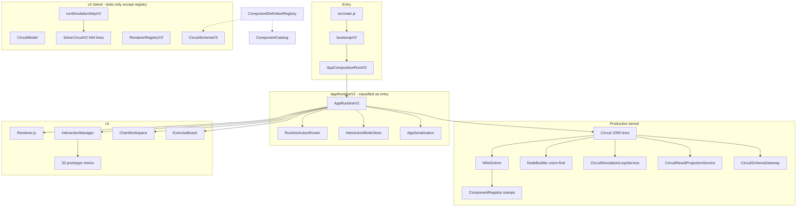

# Architecture Audit — 2026-10-10

- Date: 2026-10-10
- Scope: 当前运行时架构（入口、分层、SOT、求解/拓扑/序列化、交互、治理门禁）
- Method: 对照 `docs/plans/2026-03-03-v2-breaking-refactor-design.md` 的五层目标，核对 `src/main.js` → `AppRuntimeV2` 实装、import 图、CI 边界脚本
- Policy: 只记录、不修复
- Related: `docs/audits/project/2026-10-10-full-project-audit.md`（质量/数据完整性）；本文只谈结构

## 1. Executive verdict

**当前架构是“v2 入口包装的 v1 内核”，外加一套几乎不参与运行的 v2 仿真/渲染岛。**

2026-03-03 的 v2 破坏性重构报告把综合分打到 9.4，判定 `PASS (ready for v2 release candidate hardening)`。那份分数量的是 **`src/v2/**` 目录形态 + CI 字符串门禁**，不是课堂里真正跑的对象图。

今天的生产路径：

1. `src/main.js` 只允许 `bootstrapV2` + `AppRuntimeV2`（`check:v2:runtime-exclusive` 因此为绿）。
2. `AppRuntimeV2` 立刻 `new Circuit()` + `new Renderer()` + `new InteractionManager(this)`。
3. `Circuit.solver = new MNASolver()`；步进、拓扑、存档、`setInterval` 都在 `Circuit`。
4. `runSimulationStepV2` / `SolveCircuitV2` / `CircuitModel` / `RendererRegistryV2` / `CircuitDeserializerV3` **没有被 `src/app`、`src/ui`、`src/core` 引用**。

**Overall Assessment: Fail（相对已声明的五层目标）。** 可维护性治理把大文件拆薄了，没有把职责边界做实。

```
Intended (2026-03-03):  ui → app → domain/simulation → infra
Actual production:      AppRuntimeV2(entry) → Circuit(god) ↔ MNASolver
                                          ↘ Renderer / InteractionManager
Actual v2 island:       src/v2/*  (tests + ComponentDefinitionRegistry re-export)
```

## 2. Intended vs actual layers

| 设计层 | 设计职责 | 今天实际 | 判定 |
|---|---|---|---|
| `ui` | 纯渲染与事件采集 | `src/ui` 含交互、历史、属性对话框、习题板、图表；`Interaction.js` 是 29 行壳，方法由 33 处 `Object.assign(prototype)` 打上 | 未达标 |
| `app` | use-case 编排 | `AppRuntimeV2` 被 ESLint 标成 `entry` 以免受 app 层约束；真正编排在 `Circuit.startSimulation` / `RuntimeActionRouter` | 部分 |
| `domain` | 不可变电路模型 | 生产用可变 `Map` 元件对象；`CircuitModel` 是不可变快照，但拓扑协调器不用导线 | 双轨 |
| `simulation` | `solve(netlistDTO, state) → result`，禁止改元件、禁止带源对象 | `NetlistBuilder` 写入 `source: component`；`MNASolver.setCircuit` 解包回活对象；投影把 I/V/P 写回元件 | 未达标 |
| `infra` | 存储 / schema / AI | schema 有两份；AI 在 `src/ai`；存储散落 `AppSerialization` + `SafeStorage` | 双轨 |

ESLint `boundaries` 元素（`.eslintrc.cjs`）按 **目录** 切：`entry / ui / app / ai / embed / engine / core / components / v2 / utils`。这与设计文档的五层不是同一张图，且仍声明已删除的 `src/engine/**`。

`src/v2` 内部边界脚本（`scripts/ci/assert-v2-architecture-boundaries.mjs`）禁止 v2 引用 `src/core`。结果是：**生产求解器进不了 v2，v2 求解器进不了生产。** 两套核被 CI 锁死为永久分叉。

## 3. As-is runtime



`AppCompositionRootV2` 不是依赖注入容器。它只保证实例上有 `chartWorkspace` 和 `openAIPanel`，然后 `new AppClass()`。装配决策全部写在 `AppRuntimeV2` 构造函数里。

## 4. Dual-stack inventory

运行时真正用到的 v2 只有两处：

1. 入口：`bootstrapV2` / `createAppCompositionRootV2`
2. 元件目录：`src/components/ComponentDefinitionRegistry.js` re-export `src/v2/infra/components/ComponentDefinitionRegistry.js`

其余 v2 模块只出现在 `src/v2/**` 自身和对应测试里。

| 能力 | 生产路径 | 影子路径 | 漂移 |
|---|---|---|---|
| 电路聚合 | `Circuit` 可变 Map | `CircuitModel` 不可变 clone | v2 `removeComponent` 会删相关导线；生产 `Circuit.removeComponent` 不会 |
| 拓扑 | `NodeBuilder`：端子几何 + 导线并查集 | `TopologyCoordinatorV2`：只扫 `component.nodes`，**忽略 wires** | v2 不能替代课堂连线模型 |
| 网表 | `NetlistBuilder` v1，带 `source` 活引用 | `NetlistBuilderV2` 纯 DTO | 生产故意绕过纯度约束 |
| 求解 | `MNASolver` + `ComponentRegistry` + Shockley `JunctionModel` | `SolveCircuitV2` 巨型 switch，二极管 Ron/Roff | 电学模型不一致 |
| 结果 | `CircuitResultProjectionService` 写回 `comp.currentValue` 等 | `projectResultV2` 生成只读 view model | 设计要的是后者 |
| Schema | `CircuitSchemaGateway` 245 行 | `CircuitSchemaV3` 300 行 | 键集合几乎复制；校验文案中英不同 |
| 反序列化 | `CircuitDeserializer` + `createComponent` | `CircuitDeserializerV3` | 生产路径独有电容积分方法缺省改写 |
| 渲染 | `src/ui/Renderer.js` + `SVGRenderer` + `RendererRegistry` | `RendererRegistryV2` | v2 渲染器无运行时挂载 |
| 元件工厂 | `createComponent` | `createComponentV2` | 两套 ID 计数器 |

体积对照（本轮 `wc`）：

| 文件 | 行数 |
|---|---:|
| `src/core/runtime/Circuit.js` | 1059 |
| `src/components/Component.js` | 797 |
| `src/ui/Renderer.js` | 684 |
| `src/v2/simulation/SolveCircuitV2.js` | 664 |
| `src/core/simulation/ComponentRegistry.js` | 566 |
| `src/app/AppRuntimeV2.js` | 478 |

`src/` 合计 **254 文件 / 39086 行**。其中交互相关 97 文件 / 9927 行（`src/ui/interaction` 80 + `src/app/interaction` 17）。

## 5. Sources of truth

| 状态 | 声称的 SOT | 实际 | 风险 |
|---|---|---|---|
| 交互模式 | `interactionModeStore.context`（ADR 2026-03-03） | Store 是主路径；快照仍带 `legacyFlags`；`InteractionStateInitializer` 另有 `isDraggingWireEndpoint` / `isTerminalExtending` / `isRheostatDragging` 根字段 | 端点编辑双写（质量审计 M7） |
| 电路实体 | 设计：`CircuitModel` 不可变 | `Circuit.components/wires` 可变对象；几何、参数、显示值、动态历史混在同一对象 | 求解器与 UI 争同一引用 |
| 运行态 | 设计：`SimulationState` 唯一可变 | `SimulationState` 存在，但 `syncSimulationStateToComponents` 把 `backEmf/speed/prevVoltage/...` 同步回元件；`startSimulation` 直接改元件字段 | 双份动态状态 |
| 显示值 I/V/P | 设计：ViewModel | `CircuitResultProjectionService.updateComponentDisplayValues` 写 `comp.currentValue/voltageValue/powerValue/brightness` | UI 从实体读，不是从投影读 |
| 存档 | schema v3，无迁移器 | 应用存档把 `exerciseBoard/chartWorkspace` 塞进 `meta`；Gateway 拒绝未知键 | 见质量审计 C1 |
| 观测 | 图表工作区 | `ChartWorkspace*` 是活路径；`ObservationLayout/Interaction/Render/PlotCardController` 仅测试引用 | 半废弃 UI 栈 |

## 6. One simulation tick (production)

```
RuntimeActionRouter.startSimulation
  └─ 只认 type === 'PowerSource'          ← 教学策略写在 app，漏掉交流源
  └─ Circuit.startSimulation
        ├─ 按 type 重置电容/电感/电机/保险丝/二极管/继电器字段
        └─ setInterval(10ms) → Circuit.step     ← 仿真时钟在 domain 对象上
              ├─ CircuitSimulationLoopService.runStep
              │     ├─ ensureSolverPrepared
              │     │     NetlistBuilder.build({components: live objects})
              │     │     MNASolver.setCircuit(netlist) → unwrap entry.source
              │     ├─ solver.solve(dt, simTime)
              │     │     ComponentRegistry.stamp / JunctionModel
              │     ├─ solver.updateDynamicComponents
              │     └─ syncSimulationStateToComponents   ← 写回元件
              ├─ CircuitResultProjectionService.applyStepResults  ← 再写 I/V/P
              └─ app.onCircuitUpdate → Renderer / charts
```

设计要的 tick：

```
UI → runSimulationStepV2(circuitModel, simulationState)
      TopologyCoordinator.buildNetlist
      solveCircuitV2(dto, state) → { voltages, currents, nextState }
      projectResultV2 → 只读 ViewModel
      UI 渲染 ViewModel
```

`TopologyCoordinatorV2.buildNetlist` 从不读取 `circuitModel.wires`。即使将来把生产切到 v2 use-case，课堂导线拓扑也会丢失，除非另做一层 NodeBuilder。**v2 仿真栈现在不是可切换后端，是另一套玩具网表求解器。**

## 7. Extensibility: adding one component type

设计承诺：「新增器件只改 manifest/registry，不改核心 orchestrator。」

今天最少要动：

1. `src/v2/infra/components/ComponentDefinitionRegistry.js` — 默认参数
2. `src/core/simulation/ComponentRegistry.js` — stamp / current
3. `src/v2/simulation/SolveCircuitV2.js` — 影子 switch（否则 v2 coverage 脚本用假网表绿过）
4. `src/components/render/registry/*RendererMethods.js` + 实际绘制函数
5. `src/v2/ui/renderers/**` — 影子渲染
6. `src/ui/interaction/ComponentPropertySchema.js` — 目前只覆盖 6/21 类型
7. `CircuitResultProjectionService` / `CircuitFlowAnalysisService` / `SolverMatrixAssembler` / `DynamicIntegrator` / `Circuit.startSimulation` — 多处 `comp.type ===`
8. `index.html` 工具箱
9. 可能还要改 `NodeBuilder` / `ConnectivityCache`（三端、四端）

`core/` 内 `comp.type ===` 命中超过 70 处。type 分发没有收敛到 registry。

`StampDispatcher` 只映射 `Resistor/Bulb`，生产 stamp 先走 `ComponentRegistry`。它是为了拆文件留下的死路由。

## 8. Structural smells

### 8.1 Circuit 仍是聚合根 + 时钟 + IO + 诊断门面

`Circuit.js` 已降到 1059 行（hard 1400），服务类拆出去了，但 **对外 API 没变**：增删改、重建节点、启动/停止、`setInterval`、`toJSON/fromJSON`、短路诊断、自适应 dt、流分析全部挂在同一个实例上。拆分是委托，不是边界。

`fromJSON` 先 `clear()` 再校验（质量审计 C1/C2）是这个门面形状的直接后果：持久化不是纯函数，而是对活对象的破坏性加载。

### 8.2 InteractionManager 是原型混入巨物

`src/ui/Interaction.js` 29 行。`installInteractionCoreDelegates` + `installInteractionTailDelegates` 把 **33 个文件** 的方法 `Object.assign` 到 prototype。再叠加 `src/app/interaction/InteractionOrchestrator*.js` 14 个文件做指针状态机。

这满足了 `InteractionOrchestrator.js` 300 行预算（现 189），把复杂度变成「按手势阶段切文件」。新贡献者无法从模块名判断所有权；循环依赖风险靠约定而不是类型边界。

### 8.3 行数预算驱动的切片，而不是模块边界

热点预算监控 6 个文件。`ExerciseBoard` 964、`AIPanel` 751、`ChatController` 750、`SolveCircuitV2` 664 都不在表内。`check:core-size` 仍把不存在的 `src/v2/simulation/CircuitSolverV2.js` 标成 `optional skip`。治理在奖励「把大文件切碎」，不奖励「只留一个求解核」。

### 8.4 边界门禁是纸面约束

证据：

- `AppRuntimeV2` 单独标成 `entry`，允许 import `ui/ai/embed/engine/core/v2`。app 层规则对真正的组合根无效。
- `src/app/DeferredRuntimeControllersBundle.js` 从 `src/ui/charts` 等 re-export。按规则 `app → ui` 应失败。对本文件跑项目 ESLint：**0 error**。
- `src/components/ComponentDefinitionRegistry.js` re-export `src/v2/...`。按规则 `components → v2` 应失败。同样 0 error。
- `boundaries` 仍包含 `src/engine/**`；`ai` 被允许依赖 `engine`。

`check:v2:runtime-exclusive` 只读 `src/main.js` 的 import 字符串，不读 `AppRuntimeV2` 构造的对象图。

### 8.5 错误模型未接入主路径

`AppError` + `ErrorCodes` 定义了 `TOPO_* / SIM_* / IO_*`。`CircuitSchemaGateway` 抛的是中文 `Error` 字符串（`payload.meta 包含未知字段`）。UI 只能 `e.message`。设计第 6 节的结构化错误没有成为运行时合同。

### 8.6 观测 UI 半退役

图表工作区是活的观测面，并复用 `ObservationState` / `ObservationSources` / 模板服务。`ObservationLayoutController`、`ObservationInteractionController`、`ObservationRenderController`、`ObservationPlotCardController` 在 `src/` 内无运行时引用，只被测试抓住。12 个 observation 文件里有一部分是域模型，有一部分是死 UI。

## 9. What the architecture gets right

1. **元件定义已有唯一目录。** `ComponentCatalog` / 端子计数从 v2 registry 派生，schema 类型集合同源。这是少数真正落地的 v2 决策。
2. **求解内核内部已经服务化。** `NodeBuilder`、`WireCompactor`、`CircuitSimulationLoopService`、`CircuitResultProjectionService`、`JunctionModel`、LU cache key 是可测试的纯-ish 协作对象。问题是 `Circuit` 没有把它们藏到门面后面。
3. **交互模式 ADR 大体成立。** Store 存在，CI 有 mode contract 脚本，根字段回退在严格路径上被删过。
4. **延迟水合是真的组合。** 图表 / 习题 / 课堂 / 引导 / 嵌入桥不在首屏构造函数里一次性 new 完。这是 AppRuntimeV2 里最像 app 层的部分。
5. **无生产 npm 依赖。** 核心是原生 ESM + 自写 MNA，部署面干净。
6. **Schema v3 拒绝 legacy alias** 在生产 Gateway 上是真的。问题是应用层又把 UI 状态写进同一份 JSON。

## 10. Findings (architecture)

### Critical

#### A1. 声明的运行时与对象图不一致

- **Location**: `src/main.js:1-12`, `src/app/AppRuntimeV2.js:57-64`, `scripts/ci/assert-v2-runtime-exclusive.mjs`
- **Description**: exclusive 门禁保证入口文件长得像 v2。组合根构造的是 `Circuit` + `Renderer` + `InteractionManager`。
- **Impact**: 后续改动会被「已经在 v2」误导；v2 测试通过不等于课堂行为。二极管模型已经分叉。
- **Fix**: 二选一并改门禁。(1) 生产切到 `runSimulationStepV2` 且拓扑必须经 `NodeBuilder`；(2) 删除或测试隔离影子求解/渲染，把 exclusive 检查改成「AppRuntimeV2 不得 import SolveCircuitV2，且必须经 MNASolver」。推荐 (2) 作为先做的诚实化，再考虑 (1)。

### High

#### A2. 网表未切断活对象，投影写回实体

- **Location**: `src/core/simulation/NetlistBuilder.js:15-29`, `src/core/simulation/MNASolver.js:77-86`, `src/core/services/CircuitResultProjectionService.js:9-68`, `src/core/runtime/Circuit.js:761-783`
- **Description**: 设计禁止 netlist 带源引用、禁止求解器改元件、显示值归 ViewModel。三条均未落地。
- **Impact**: UI、历史快照、求解器共享可变对象。undo 缺 meta、电压表 `Infinity` 丢失，都是同一耦合的症状。
- **Fix**: netlist 只保留 `{id,type,nodes,params}`；`SimulationState` 为唯一运行可变；投影输出独立 view map，Renderer 读 view map。

#### A3. 影子求解器不能表达课堂拓扑

- **Location**: `src/v2/app/coordinators/TopologyCoordinatorV2.js:16-29`, `src/core/topology/NodeBuilder.js:4-80`
- **Description**: 生产节点来自端子世界坐标 + 导线并查集。v2 coordinator 假定 `component.nodes` 已填好，丢弃 wires。
- **Impact**: 把生产切到 v2 use-case 会得到错误电路。v2 测试用手工 nodes，覆盖不到连线语义。
- **Fix**: v2 TopologyCoordinator 改为调用（或包装）`NodeBuilder`；或明确标注 `SolveCircuitV2` 为非生产实验并移出 `check:v2:coverage` 的「全类型 stamp 成功」含义。

#### A4. type 分发泄漏

- **Location**: `Circuit.js:712-738`, `SolverMatrixAssembler.js`, `CircuitResultProjectionService.js`, `CircuitDeserializer.js`, `DynamicIntegrator.js` 等，core 内 70+ `comp.type ===`
- **Description**: `ComponentRegistry` 只覆盖 stamp/current。启动重置、矩阵准备、投影、反序列化各写一套类型表。
- **Impact**: 新元件必漏一处。Motor 并联印记（质量审计 H3）就是 registry 与积分器各写各的。
- **Fix**: 每类型一份 definition：`defaults + terminals + stamp + current + project + resetDynamic + serialize`。Assembler/Loop 只问 registry。

#### A5. 交互层用原型混入代替模块

- **Location**: `src/ui/Interaction.js:28-29`，33 个 `Object.assign(InteractionManagerClass.prototype, …)`
- **Description**: 预算达标的手段是把一个神类切成几十个同名委托文件。
- **Impact**: 所有权不清；测试倾向 mock `fromJSON`（质量审计 C2）。
- **Fix**: 按子系统拆实例（viewport / wiring / selection / history / properties），由 orchestrator 持有引用，停止向同一 prototype 堆方法。

#### A6. 架构 CI 不测量实际依赖

- **Location**: `.eslintrc.cjs:17-94`, `scripts/ci/assert-v2-runtime-exclusive.mjs`, `scripts/ci/assert-core-file-size-budget.mjs:16`
- **Evidence**: `DeferredRuntimeControllersBundle.js` app→ui 与 `ComponentDefinitionRegistry.js` components→v2 的 ESLint 均为 0 error；core-size 跳过不存在的 `CircuitSolverV2.js`。
- **Fix**: 给 boundaries 配可工作的 resolver 并加故意违规的回归测试；exclusive 检查 `AppRuntimeV2` 的 import；预算文件名改成 `SolveCircuitV2.js` 或删除该项。

### Medium

| ID | Title | Location |
|---|---|---|
| A7 | Composition root 不是装配，只是合同补丁 | `AppCompositionRootV2.js` |
| A8 | 仿真时钟在 `Circuit`（`setInterval` 10ms） | `Circuit.js:696-701` |
| A9 | 启动电源策略在 ActionRouter，与求解器的 AC 一等公民冲突 | `RuntimeActionRouter.js:23-33` |
| A10 | Schema/Deserializer 双份，键集合手工同步 | `CircuitSchemaGateway.js` vs `CircuitSchemaV3.js` |
| A11 | `AppError` 未用于 IO/拓扑主路径 | `src/core/errors/*` vs Gateway `throw new Error` |
| A12 | 观测控制器半废弃，图表才是活 UI | `src/ui/observation/*Controller.js` vs `src/ui/charts` |
| A13 | `legacyFlags` 仍从 mode store 投影 | `InteractionModeStore.js:38-54` |

### Low

| ID | Title |
|---|---|
| A14 | `StampDispatcher` 只服务 Resistor/Bulb，生产不走它 |
| A15 | ESLint 元素表保留 `engine` 层 |
| A16 | `Component.js` 仍是 SVGRenderer + 几何常量的门面，797 行靠近预算 |

## 11. Scorecard (this audit vs 2026-03-03 claim)

评分仍用当时的 10 分制，衡量 **正在运行的系统**。

| 维度 | 2026-03-03 宣称 | 2026-10-10 实装 | 说明 |
|---|---:|---:|---|
| 架构整洁度 | 9.5 | **5.5** | v2 目录整洁；运行图是 Circuit 神对象 |
| 健壮性 | 9.2 | **7.0** | 求解器本身认真；存档/撤销结构缺陷见质量审计 |
| 解耦程度 | 9.4 | **4.5** | 活对象贯穿 netlist/solver/UI |
| 可扩展性 | 9.6 | **5.0** | 有 registry，但 type 分发仍散落 |
| 可维护性 | 9.3 | **6.0** | 大文件下降；交互 97 文件混入 |
| 兼容性代价（越低越好） | 1.4 | **6.5** | schema 无迁移器，但双求解核就是兼容税 |
| 综合 | 9.4 | **5.6** | |

不建议再把 v2 目录存在当作架构完成的证据。

## 12. Recommended evolution (no rewrite)

不要并行维护第三套内核。按「诚实化 → 收口 → 再纯化」：

**P0 — 诚实化（1–3 天）**

1. 门禁改为描述真实图：`AppRuntimeV2` 使用 `Circuit`+`MNASolver`。
2. `SolveCircuitV2` / `RendererRegistryV2` 移入 `tests/fixtures` 或标 `@internal experimental`，coverage 脚本停止把「switch 默认成功」当全类型覆盖。
3. 修 boundaries resolver；删 `engine` 元素；core-size 对准真实文件名。

**P1 — 收口生产核（1–2 周）**

1. `Circuit` 变成门面：时钟上移到 app `SimulationDriver`；`fromJSON` 先校验再替换。
2. `removeComponent` 与 `CircuitModelCommands.removeComponent` 对齐（删悬空导线）。
3. Schema 只留一份（Gateway 调 V3 或反过来）。
4. 启动门把 `ACVoltageSource` 算作电源。

**P2 — 纯度（下个迭代）**

1. Netlist 去掉 `source`。
2. 投影不再写元件字段；Renderer 吃 view map。
3. 动态历史只留在 `SimulationState`。

**P3 — 扩展模型**

1. 每类型单一 definition 对象。
2. 交互按实例拆，不再 `Object.assign(prototype)`。
3. 若要真正切 v2 solver：必须先让 TopologyCoordinator 使用 NodeBuilder，并以 P0 电气回归做门禁。

## 13. Suggested new IDs (do not rewrite closed top30.md)

| id | area | title |
|---|---|---|
| PRJ-036 | Z0 | runtime-exclusive 只锁入口，不锁对象图 |
| PRJ-037 | Z0/Z2 | 生产 MNA 与 SolveCircuitV2 永久分叉 |
| PRJ-038 | Z1 | TopologyCoordinatorV2 忽略导线 |
| PRJ-039 | Z2 | netlist.source 把活元件送进求解器 |
| PRJ-040 | Z4 | InteractionManager 33 处 prototype mixin |
| PRJ-041 | Z0 | ESLint boundaries 不报告已知跨层 import |

## 14. What this audit did not do

- 未在浏览器里点选走查（架构结论不依赖像素）。
- 未跑 `check:full` / Playwright。分层与引用关系由源码和定向 ESLint 证实。
- 未修改生产代码。质量问题（存档、撤销、XSS、电机印记）见同日 `2026-10-10-full-project-audit.md`。
