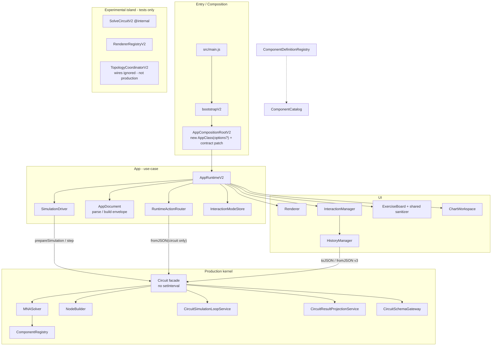
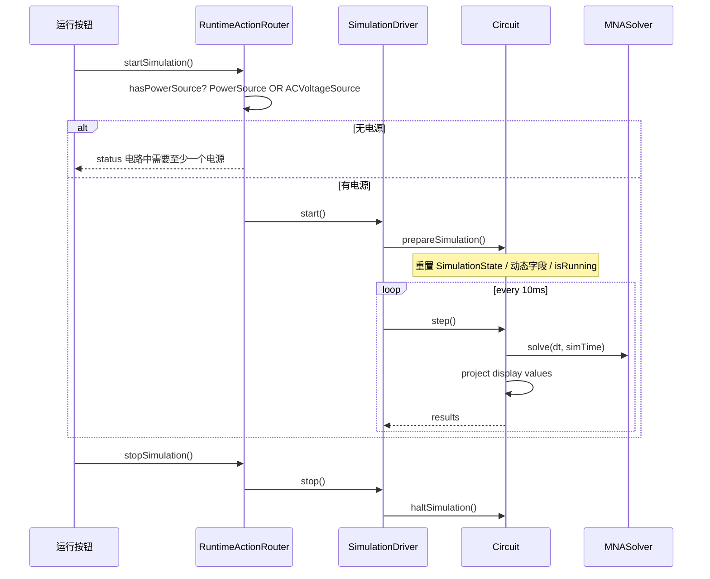
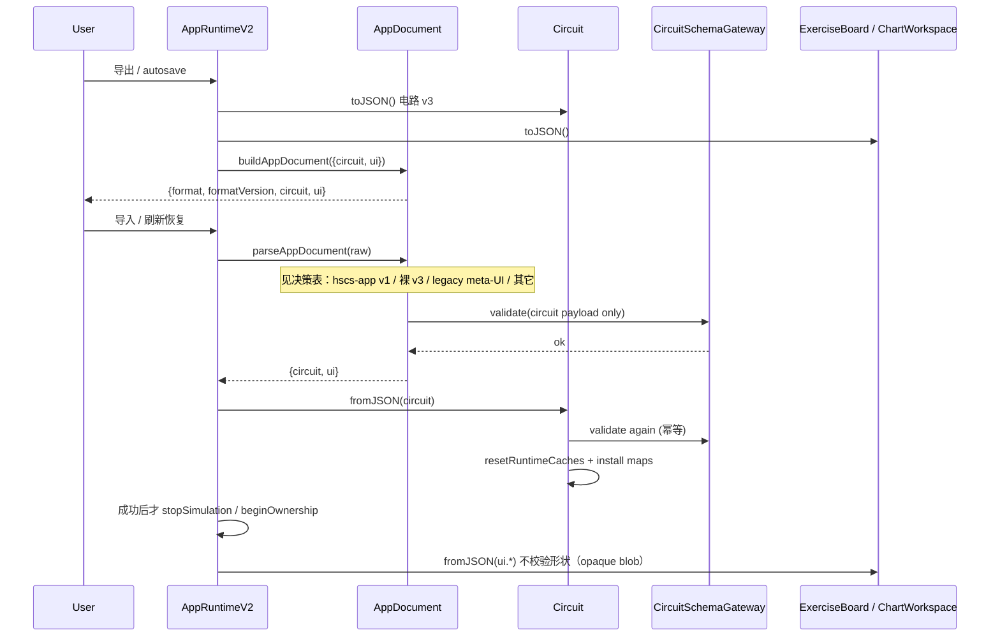
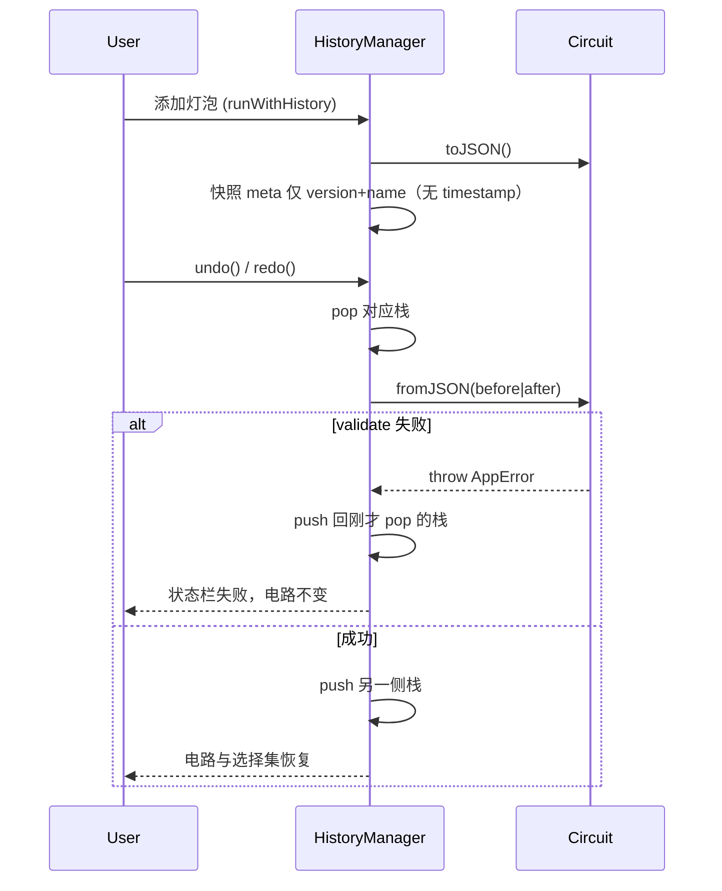

# 高中电路模拟器完整修复方案（质量审计 + 架构审计）

- **Author**: Circuit Simulator Maintainers
- **Date**: 2026-10-10
- **Status**: Draft
- **HEAD**: `b12aceb`
- **Product**: 高中实验台（Native JS ESM，无生产 npm 依赖）
- **Sources**:
  - `docs/audits/project/2026-10-10-full-project-audit.md`
  - `docs/audits/project/2026-10-10-architecture-audit.md`
  - `docs/plans/2026-03-03-v2-breaking-refactor-design.md`
  - `docs/process/maintainability-governance.md`
  - `docs/adr/2026-03-03-interaction-mode-sot.md`
- **Policy**: 本文是可实施设计，不改生产源码；不改写已闭环的 `docs/audits/project/top30.md` 状态列。实施工单可使用 PRJ-031–041。

---

## Overview

2026-10-10 两份审计的共同结论是：入口和目录已经“看起来像 v2”，课堂里真正跑的仍是 `AppRuntimeV2 → Circuit + MNASolver + Renderer + InteractionManager`。质量面上，应用存档把 UI 塞进电路 `meta`、`fromJSON` 先 `clear()` 再校验、撤销快照丢掉 `meta.version`，三者叠加会把画布清成空电路；习题板 Markdown 未消毒；电动机印记是并联反电动势；仅交流电源无法启动。架构面上，CI 只锁 `src/main.js` 的 import 字符串，`SolveCircuitV2` / `RendererRegistryV2` 是测试岛，ESLint `boundaries` 因缺少 resolver 放行已知跨层 re-export。

架构演化仍是 **诚实化 → 收口生产核 → 纯度 → 扩展模型**，但 **合入门闩以课堂可教性为准，不以 CI exclusive 脚本为准**。质量审计 Immediate 是 C1/C2/C3（存档/撤销/XSS）；这些 PR **不被** P0 CI 诚实化阻塞，可同周并行。不维护第三套求解核，不在前几轮 PR 重写 `InteractionManager`。应用存档改用 `{ format, formatVersion, circuit, ui }` 信封；电路 payload 保持 schema v3 无兼容迁移；`Circuit.fromJSON` 必须先校验再替换；电动机改为电枢串联 `Ra + E`；默认直流电源改为 6V。

---

## Background & Motivation

### 当前运行图（已用源码核对）

`src/main.js` 只调用 `bootstrapV2({ AppClass: AppRuntimeV2 })`，因此 `scripts/ci/assert-v2-runtime-exclusive.mjs` 为绿。`AppRuntimeV2` 构造函数立刻：

```js
this.circuit = new Circuit();           // Circuit.solver = new MNASolver()
this.renderer = new Renderer(this.svg, this.circuit);
this.interaction = new InteractionManager(this);
```

`runSimulationStepV2` / `SolveCircuitV2` / `CircuitModel` / `RendererRegistryV2` / `CircuitDeserializerV3` 不被 `src/app`、`src/ui`、`src/core` 引用。`src/v2` 内部边界脚本禁止 v2 引用 `src/core`，两套核被 CI 锁成永久分叉。

一次生产 tick：

```
RuntimeActionRouter.startSimulation
  └─ 只认 type === 'PowerSource'          ← H4
  └─ Circuit.startSimulation
        ├─ 按 type 重置动态字段
        └─ setInterval(10ms) → Circuit.step   ← A8
              NetlistBuilder.build({ source: component })  ← A2
              MNASolver.setCircuit → unwrap entry.source
              ComponentRegistry.stamp
              syncSimulationStateToComponents + 投影写回 I/V/P
```

### 质量痛点（Critical 已实机复现于审计）

| ID | 现场行为 |
|---|---|
| C1 | `buildAppSaveData` 把 `exerciseBoard`/`chartWorkspace` 写入 `meta`；Gateway `META_KEYS = {version,name,timestamp}`；`fromJSON` 先 `clear()` 再 `CircuitSchemaGateway.validate`。导入/autosave 失败会清空画布。 |
| C2 | `HistoryManager.captureState` 只留 `components/wires/probes`；`applyState` 调用 `fromJSON` 无 `meta.version`；抛错被 `safeInvoke` 吞掉，停在 `clear()` 之后。 |
| C3 | `ExerciseBoard.renderNow`：`marked.parse` → `innerHTML`。聊天路径已有 `AIPanel.sanitizeRenderedMarkdown`。 |

### 架构痛点

治理预算把 `Circuit.js` 收到 1059 行（hard 1400），但对外 API 未变：增删改、时钟、IO、诊断仍挂在同一实例。`fromJSON` 先清空是这个门面形状的直接后果。行数预算监控 6 个文件，漏掉 `ExerciseBoard` 964、`SolveCircuitV2` 664，且 `check:core-size` 把不存在的 `src/v2/simulation/CircuitSolverV2.js` 标成 `optional skip`。

### 约束（作为起点，下文 Key Decisions 论证）

- 不要并行维护第三套内核。
- 不要在第一批 PR 重写 `InteractionManager`（33 处 `Object.assign(prototype)`）。
- schema v3 对**电路 payload** 保持 no-compat。
- UI 状态不得塞进电路 `meta` 未知键。
- 课堂产品：默认电压必须明确（6V vs 12V）；电动机必须变成串联 `Ra + 反电动势`。

---

## Goals & Non-Goals

### Goals

1. **数据完整性**：导出 / autosave / 导入 / 撤销 / 删除元件后重载，全部能 round-trip 通过 schema v3，失败不得破坏当前电路。
2. **课堂 XSS 与嵌入边界**：习题板复用聊天消毒器；嵌入默认拒绝 origin，禁止 `*`，解冻需显式能力。
3. **教学物理**：电动机堵转电流 `V/Ra`；闭合开关电流走额外未知量；仅交流电源可点“运行”；工具箱 6V 与默认电动势一致。
4. **CI 诚实**：门禁描述真实对象图（生产 = `Circuit` + `MNASolver`）；quality job 不再在无浏览器的 runner 上跑 Playwright；coverage 不再把 v2 switch 默认成功当全类型覆盖。
5. **收口生产核**：`Circuit` 成为门面；仿真时钟上移到 app `SimulationDriver`；一份 schema；`removeComponent` 删除相关导线。

### Non-Goals（本轮明确不做）

1. 不把生产切到 `SolveCircuitV2`（其 `TopologyCoordinatorV2` 忽略 `wires`，二极管是 Ron/Roff，与生产 Shockley 分叉）。
2. 不在 P0/P1 重写 `InteractionManager` / 拆 33 个 prototype mixin。
3. 不引入电路 schema 迁移器（v2 及以下存档仍拒绝）。
4. 不改写 `docs/audits/project/top30.md` 的已闭环状态列。
5. 不做暗色主题、非线性灯泡、多 Ground 合并为同一参考点（见 Backlog）。
6. 不升级 ESLint 8 → 9（EOL 记入 backlog；P0 只删 `engine` 元素并修好 resolver）。
7. 不新增生产 npm 依赖（devDependency 仅允许 CI resolver / 测试）。

---

## Key Decisions

### D1. 应用信封 `{ format, formatVersion, circuit, ui }`，而不是放宽电路 `meta` 未知键

**选择**：autosave / 导出 / 嵌入 `exportCircuit` 使用应用文档信封。电路 payload 仍是严格 schema v3。`Circuit.fromJSON` **只接受电路 payload**，永远看不到 `exerciseBoard`。

**理由**：

- 审计要求“UI meta 不得塞进电路 meta 未知键”。放宽 `META_KEYS` 会把习题板泄漏进 domain 校验，历史快照也会拖上 UI。
- 当前损坏的应用存档（UI 在 `meta` 里）**从未成功加载过**（C1 实机 `THROW payload.meta 包含未知字段: exerciseBoard`）。因此不存在“已在用的合法应用存档”需要 schema 兼容。电路-only 的 v3 JSON（`Circuit.toJSON()`）仍然有效，必须继续能导入。
- 对磁盘上那些失败的 autosave，在 **app 层**做一次性剥离（`peelUiFromLegacyMeta`），这不是电路 schema 迁移器。

**反例（不采用）**：Gateway 忽略未知 meta 键。实现更快，但撤销、嵌入、场景包会继续把 UI 和电路绑死，schema 契约再次变模糊。

### D2. `fromJSON` 先校验再替换；失败保留旧图

`Circuit.fromJSON` 今日顺序（`Circuit.js:1041-1058`）：`this.clear()` → `CircuitDeserializer.deserialize`（内部 `Gateway.validate`）→ 填 Map。校验失败时画布已空。

**目标顺序**：`validate` → `deserialize` 到**局部**对象 → 成功后才调用从今日 `clear()` 抽出的 `resetRuntimeCaches()`（字段清单见 API §2）→ 安装 Map → `rebuildNodes()` → `markSolverCircuitDirty()`。失败路径不得碰活 Map。成功路径必须丢掉上一份电路的 `simulationState` / `netlist` / `solverPreparedTopologyVersion`，否则课堂常用 id（`V1`/`R1`）会把旧 `backEmf`/`prevVoltage` 带进新图。

### D3. 历史快照 = 可 `fromJSON` 的电路 v3，但 `meta` 只保留 `version` + `name`

`HistoryManager.captureState` 今日丢掉 `meta`。`applyState` 用 `safeInvoke(fromJSON)` 吞掉缺 version 的异常。

**目标**：快照必须能 round-trip `Circuit.fromJSON`，因此含 `meta.version = 3`。**不得**拷贝 `CircuitSerializer` 每次写入的 `timestamp: Date.now()`（`CircuitSerializer.js:26-30`）：`stateKey` 仍是 `JSON.stringify(state)`，带时间戳会使无改动的 `runWithHistory` 也推栈。

`applyState` 禁止 `safeInvoke` 包裹 `fromJSON`。`undo()` **与** `redo()` 都用 try/catch：失败则把刚 pop 的 entry 推回原栈，电路不变。

历史 **不含** `ui`。`tests/interaction.historyManager.spec.js` 今日要求 `toJSON`/`fromJSON` 非函数时不抛 —— **替换**这些用例，不是追加。

### D4. 生产求解核唯一：`MNASolver` + `ComponentRegistry`。v2 solver/renderer 降为 experimental

不把生产切到 `SolveCircuitV2`（A3：拓扑忽略导线）。不删文件以免一次 PR 过大，但：

- `assert-v2-coverage.mjs` 改测 **生产** registry/renderer。
- `assert-v2-runtime-exclusive.mjs` 断言 `AppRuntimeV2` **使用** `Circuit`，**禁止** import `SolveCircuitV2`。
- `SolveCircuitV2.js` / `RendererRegistryV2.js` 文件头标记 `@internal experimental`；core-size 用真实文件名或移出生产热点表。

### D5. 默认直流电源 6V（不是改标签为 12V）

产品是高中实验台。`index.html:66` 快捷标签已写 `6V`，`ComponentDefinitionRegistry` 默认 `voltage: 12`。学生按标签搭电路，数值全偏（H8）。

**决策**：`PowerSource.defaults.voltage = 6`。`ACVoltageSource.rmsVoltage` 保持 12（信号源/实验室交流，不是干电池）。内阻保持 `0.5Ω`。属性对话框 `defaultValue` 同步为 6。P0 电气基线大多显式写 `voltage: 12` 且 `internalResistance: 0`（`p0-electrical-regression.mjs`），不受默认 6V/0.5Ω 影响。

H3/H5 的欧姆定律门闩同样 **显式** `internalResistance: 0`。`r ≥ 1e-9` 时 Assembler 置 `_nortonModel`（`SolverMatrixAssembler.js:46-51`），`stampSourceViaMNA` 走 `Ieq = E/r`（`ComponentRegistry.js:417-421`）。默认 0.5Ω 会使堵转变成 `6/(5+0.5)≈1.0909`、开关回路变成 `6/(10+0.5)≈0.571`，对不上 `I=V/R`。课堂产品默认仍是 0.5Ω；只把教学电流测试钉成理想源，与 `tests/solver.powerSourceInternalResistance.spec.js` 的 `I=E/(R+r)` 分工。

### D6. 电动机：额外未知量实现串联 `V = E + I·Ra`，不是 Norton，也不是内部拓扑节点

今日（`ComponentRegistry.js:226-234`）：同一对端子既 `stampResistor(Ra)` 又 `stampVoltageSource(-E)` → **并联**。积分器却用 `I = (V-E)/R`（串联公式）。

**决策**：保留 `vsIndex`（Assembler 已为 Motor 分配），把支路方程改成：

```
V_n1 - V_n2 - I·Ra = E
I 为额外未知量（与理想电流表相同列）
```

不引入 Circuit 拓扑内部节点（避免 `NodeBuilder` / 导线几何介入）。不用 Norton（`Ra→0` 时病态；默认 5Ω 虽可用，但与“额外未知量”原建议一致，且电流直接来自解向量）。

积分器转矩改用求解器电流，不再用 `(V-E)/R` 重算，避免双公式再分叉。

### D7. 闭合开关 / SPDT 导通侧用串联 `Rε` 额外未知量取电流，不是理想 `V=0`

今日闭合：`stampResistor(1e-9)`，电流 `dV/1e-9`。LU 残差 `1e-6 V` → `1000 A`（H5）。

**不采用** 裸 `stampVoltageSource(0)`：`isIdealVoltageSource` 只认电源（`CircuitTopologyValidationService.js:10-14`），两只并联闭合开关会印两行相同 KVL，矩阵奇异。

**决策**：闭合支路调用与电机相同的 `stampSeriesVoltageSource(i1, i2, voltage=0, seriesR=1e-9, vsIndex)`，电流来自额外未知量（不再 `dV/1e-9`）。`1e-9` 与今日导通电阻同量级，两并联开关电流有限且之和为负载电流。断开：`1e12Ω`，电流 0，不占 `vsIndex`。

**SPDT**：只给**导通侧**分配 **一个** `vsIndex`（`position==='b'` → common–B，否则 common–A）。断开侧 `offR=1e12`。`prepareComponents` 必须给 Switch/SPDT 写 `vsIndex`（今日循环只有电源/电机/电流表，`SolverMatrixAssembler.js:55-90`）。改 `position` 已有路径须 `markSolverCircuitDirty()`。继电器触点保持有限 `contactOnResistance`。

### D8. 嵌入 fail-closed；宿主默认 `window.location.origin`；解冻是 capability

今日：`allowedParentOrigins` 为空则 `isOriginAllowed` 恒 true；`EmbedClient` `parentOrigin` 回退 `*` 且 `*` 时省略 query（`EmbedClient.js:80-83,99`）；桥 `targetOrigin || '*'`（`EmbedRuntimeBridge.js:40,163-165`）。

**决策**：

- 宿主 SDK 默认 `parentOrigin = window.location.origin`，**永不**默认 `*`。
- 解析结果含 `*` 或 allowlist 为空：`enabled` 的桥 **不** `addEventListener('message')`、**不** `postMessage`（不是“听了再拒”）。
- `capabilities: { unfreeze: boolean }`，query `?capabilities=unfreeze`。`setReadonly(false)` / `setOptions` 离开只读需要该能力。
- `READONLY_BLOCKED_METHODS` **保持** live 列表 `['run', 'clearCircuit', 'loadCircuit']`（`EmbedRuntimeRequestRouter.js:8`）。**不要**把 `setReadonly` / `setOptions` 加进去：`handleEmbedRuntimeRequest` 在 switch 之前调用 `assertMutableEmbedRequestAllowed`（`:56-57`），加进去会使只读宿主的解冻请求抛 `READONLY_MUTATION_BLOCKED`，永远走不到 `assertCapability`，`?capabilities=unfreeze` 失效。
- **课堂 embed（`mode=classroom`）不是只读。** `getRuntimeCapabilityFlags().allowsCircuitMutation` 保持 `!readOnly`。`addComponent` 只在 `allowsCircuitMutation === false` 时拦截。M8 修的是只读解冻洞，不是给课堂加第二道 mutation capability。

### D9. XSS：抽取共享消毒器；marked 关闭 raw HTML；不引入 DOMPurify

无生产 npm 依赖。`AIPanel.sanitizeRenderedMarkdown`（`AIPanel.js:244-306`）已是真 allowlist。抽到 `src/utils/markdown/sanitizeRenderedMarkdown.js`，习题板与聊天共用。`marked.parse` 增加 `html` renderer 返回空字符串，然后仍走消毒器（纵深防御）。MathJax 只 typeset 消毒后的预览节点。

### D10. C1/C2/C3 不被 CI 诚实化阻塞；P2 才切断 `netlist.source`

A2（活对象进求解器、投影写回 I/V/P）是解耦的根因，也是 C1/C2/H2 的**背景**，但切断 `source` 会碰到 Renderer 读 `comp.currentValue` 的整个 UI 面，不适合与存档修复绑在同一 PR。

**合入顺序（覆盖架构审计“P0 先诚实化”的字面顺序）**：

- 质量审计 §1 / §9：Immediate = C1 C2 C3 **今天**。PR-05（持久化）与 PR-02（XSS）**Deps: 无**，不关 PR-01。
- PR-01 CI 诚实化 **同周并行**，不是课堂修复的 merge gate。
- 课堂可教性以 C1/C2/C3 合入为准，不以 `assert-v2-runtime-exclusive` 为准。
- P2 纯度仍在 P1 内核之后。

### D13. MathJax / marked：提交进 `vendor/`，不用 git LFS，不进 bundle-size JS 列表

关闭“vendor vs CDN SRI”开放问题。仓库 **没有** git LFS。提交 `vendor/marked-12.0.0.min.js` 与 `vendor/mathjax-3.2.2/`（延迟 script，不进 esbuild main）。`scripts/e2e/*` 今日拦截 `cdn.jsdelivr.net/npm/marked@12.0.0` 与 `mathjax@3/es5/tex-chtml.js` —— PR-04 **必须**改这些 route（或保留为无害 leftover，且 **grep 排除 `scripts/e2e`**）。

### D14. 未知 `formatVersion` 拒绝；失败的 `loadCircuitData` 不停正在跑的模拟

- `format === 'hscs-app'` 且 `formatVersion !== 1` → `IO_ERR_INVALID_DOCUMENT`。不“忽略版本”。
- `parseAppDocument` / `fromJSON` 失败时 **不得** 调用 `stopSimulation` / `beginCircuitStorageOwnership`。今日 `RuntimeActionRouter.loadCircuitData` 在 `fromJSON` 之前就停模拟、抢 ownership（`RuntimeActionRouter.js:84-86`）——失败导入会把正在演示的电路停掉。成功替换之后再 stop + ownership + 渲染。

### D15. 组合根：`AppRuntimeV2` 接受可选 `options`，生产默认自建 Driver

今日 `createAppCompositionRootV2` 是 `new AppClass()` 无参（`AppCompositionRootV2.js:16-26`）。不存在“root 注入 driver 而构造函数不收 options”的路径。

**决策**：`constructor(options = {})`。缺省 `new Circuit()` + `new SimulationDriver({ circuit })`。root **可以**传 `{ circuit, simulationDriverFactory }`（测试 fake timers）。生产 `bootstrapV2` 不传，行为与今日一致。

双旗标：`circuit.isRunning` = 步进是否生效（`step()` 在 false 时 no-op，`Circuit.js:843`）；`driver.isRunning` = 定时器是否武装。`start()` 必须 `prepareSimulation()`（置 `circuit.isRunning`）**再**武装定时器；`stop()` 必须清定时器 **再** `haltSimulation()`。`HistoryManager` 继续读 `app.circuit.isRunning`。

### D11. Schema 以生产 Gateway 为 SoT；V3 文件在 P1 收口为薄封装或删除测试引用

两份 schema 键集合几乎复制，中英错误文案不同。v2 边界禁止 v2→core。P1：校验逻辑只留在 `CircuitSchemaGateway`（中文 `AppError`）。`tests/circuitSchema.v3.spec.js` 改测 Gateway；`allowLegacyMigration` 不进入生产。`CircuitSchemaV3.js` 若暂时保留，只允许作为 experimental re-export，且不得再复制键表。

### D12. 删除元件时删除相关导线（覆盖 ComponentActions 的 “Model C” 注释）

`ComponentActions.js:86` 写明 “Model C: wires are independent segments”。这与 schema“ref 必须指向仍存在的元件”冲突，H1 实机 `wire.bRef.componentId 不存在`。v2 `CircuitModelCommands.removeComponent` 已按 ref 删线。

**决策**：生产 `Circuit.removeComponent` 与 Commands 对齐：删除 `aRef`/`bRef.componentId` 匹配的导线（`removeWire` 已级联删探针）。无 ref、仅靠几何搭在端子上的导线保留（仍可加载）。Serializer 再丢弃悬空 ref 作为纵深防御。撤销靠完整快照恢复导线。

---

## Proposed Design

### 目标架构（P1 结束后的生产图）



P2 之后：`NetlistBuilder` 不再带 `source`；投影输出 `ViewMap`；Renderer 读 ViewMap。P1 **不要求**完成这一步。

### 仿真时钟与步进（P1）



`Circuit.startSimulation` 不再调用 `setInterval`。保留 `prepareSimulation()` + `step()` + `haltSimulation()`。现有直接 `circuit.step()` 的电气测试不改。少数调用 `circuit.startSimulation()` 的测试改为只断言状态重置，或注入 test clock。

### 保存 / 加载



**失败路径**：`parseAppDocument` / `fromJSON` 抛 `AppError` 时 `Circuit` 的 Map **未动**，模拟 **继续跑**。`loadCircuitFromStorage` catch 后 return false，用 `parsed.circuit.components.length` 生成 status（不得读顶层 `circuitJSON.components`）。导入失败走现有 `showImportError`。`Circuit.fromJSON(信封)` 必须 throw 且不清空。

### 撤销 / 重做



---

## API / Interface Changes

### 1. 应用文档信封

新模块：`src/app/AppDocument.js`（可从 `AppSerialization.js` 演进，避免再复制一份 `safeInvokeMethod`）。

```js
export const APP_DOCUMENT_FORMAT = 'hscs-app';
export const APP_DOCUMENT_VERSION = 1;

/**
 * @typedef {Object} CircuitPayloadV3
 * @property {{version: 3| '3' | '3.0', name?: string, timestamp?: number}} meta
 * @property {object[]} components
 * @property {object[]} wires
 * @property {object[]=} probes
 */

/**
 * @typedef {Object} AppUiState
 * @property {object=} exerciseBoard
 * @property {object=} chartWorkspace
 */

/**
 * @typedef {Object} AppDocumentV1
 * @property {'hscs-app'} format
 * @property {1} formatVersion
 * @property {CircuitPayloadV3} circuit
 * @property {AppUiState} ui
 */

export function buildAppDocument({ circuit, exerciseBoard, chartWorkspace }) {
    const circuitPayload = circuit.toJSON(); // 已含 meta.version=3
    const ui = {};
    const exercise = safeCall(exerciseBoard, 'toJSON');
    const charts = safeCall(chartWorkspace, 'toJSON');
    if (exercise !== undefined) ui.exerciseBoard = exercise;
    if (charts !== undefined) ui.chartWorkspace = charts;
    return {
        format: APP_DOCUMENT_FORMAT,
        formatVersion: APP_DOCUMENT_VERSION,
        circuit: circuitPayload,
        ui
    };
}

export function restoreAppUi({ exerciseBoard, chartWorkspace, ui }) {
    // ui 是 opaque blob：原样交给各子系统 fromJSON，不在 app 层校验字段。
    safeCall(exerciseBoard, 'fromJSON', ui?.exerciseBoard);
    safeCall(chartWorkspace, 'fromJSON', ui?.chartWorkspace);
}

function isPlainObject(value) {
    return !!value && typeof value === 'object' && !Array.isArray(value);
}

function assertCircuitPayloadShape(circuit) {
    if (!isPlainObject(circuit) || !Array.isArray(circuit.components) || !Array.isArray(circuit.wires)) {
        throw new AppError(ErrorCodes.IO_ERR_INVALID_DOCUMENT, '无效的电路 JSON：缺少 components/wires');
    }
}

/**
 * 决策表（每一行都有 fixture；见 Data Model）：
 * | 输入 | 结果 |
 * | hscs-app 且 formatVersion === 1 | unwrap circuit；ui 原样；若 circuit 自身也是 hscs-app，再 unwrap **一次** |
 * | hscs-app 且 formatVersion !== 1 | throw IO_ERR_INVALID_DOCUMENT |
 * | 根对象带未知 format | throw（不得落入裸 v3 分支） |
 * | 裸 {meta,components,wires} 且 meta 无 UI 键 | 当电路 payload |
 * | 裸电路且 meta.exerciseBoard / meta.chartWorkspace | peel 这两键到 ui，其余未知 meta 键留在 meta 让 Gateway 拒绝 |
 * | 数组 / null / 缺 components|wires / 嵌套信封超过一层 | throw IO_ERR_INVALID_DOCUMENT |
 *
 * `loadCircuitData` / `importCircuit` / `loadCircuitFromStorage` / embed `loadCircuit`
 * **全部**走本函数。`Circuit.fromJSON` **只**接受电路 payload；传入整份信封必须 throw，且 **不得** clear。
 */
export function parseAppDocument(raw) {
    if (raw == null || typeof raw !== 'object' || Array.isArray(raw)) {
        throw new AppError(ErrorCodes.IO_ERR_INVALID_DOCUMENT, '无效的电路文档：根必须是对象');
    }

    if (raw.format === APP_DOCUMENT_FORMAT) {
        if (raw.formatVersion !== APP_DOCUMENT_VERSION) {
            throw new AppError(
                ErrorCodes.IO_ERR_INVALID_DOCUMENT,
                `不支持的应用文档版本: ${raw.formatVersion}`
            );
        }
        let circuit = raw.circuit;
        let ui = isPlainObject(raw.ui) ? { ...raw.ui } : {};
        if (isPlainObject(circuit) && circuit.format === APP_DOCUMENT_FORMAT) {
            if (circuit.formatVersion !== APP_DOCUMENT_VERSION) {
                throw new AppError(
                    ErrorCodes.IO_ERR_INVALID_DOCUMENT,
                    `不支持的嵌套应用文档版本: ${circuit.formatVersion}`
                );
            }
            if (isPlainObject(circuit.ui)) {
                ui = { ...circuit.ui, ...ui };
            }
            circuit = circuit.circuit;
        }
        if (isPlainObject(circuit) && circuit.format === APP_DOCUMENT_FORMAT) {
            throw new AppError(ErrorCodes.IO_ERR_INVALID_DOCUMENT, '嵌套信封超过一层');
        }
        assertCircuitPayloadShape(circuit);
        return { circuit, ui, recoveredLegacyUi: false };
    }

    if (Object.prototype.hasOwnProperty.call(raw, 'format') && raw.format != null) {
        throw new AppError(ErrorCodes.IO_ERR_INVALID_DOCUMENT, `未知文档格式: ${raw.format}`);
    }

    assertCircuitPayloadShape(raw);

    const meta = isPlainObject(raw.meta) ? { ...raw.meta } : {};
    const ui = {};
    let recoveredLegacyUi = false;
    if (Object.prototype.hasOwnProperty.call(meta, 'exerciseBoard')) {
        ui.exerciseBoard = meta.exerciseBoard;
        delete meta.exerciseBoard;
        recoveredLegacyUi = true;
    }
    if (Object.prototype.hasOwnProperty.call(meta, 'chartWorkspace')) {
        ui.chartWorkspace = meta.chartWorkspace;
        delete meta.chartWorkspace;
        recoveredLegacyUi = true;
    }
    return { circuit: { ...raw, meta }, ui, recoveredLegacyUi };
}
```

只剥离 `exerciseBoard` 与 `chartWorkspace`。其它未知 `meta` 键（例如 `foo`）留在电路 payload 上，由 `CircuitSchemaGateway` 拒绝。这不是电路 schema 迁移器。

**`ui` 是 opaque blob。** 不要按下面的示意字段做 schema。round-trip 必须走真实 `ExerciseBoard.toJSON()`（含 `markdown/visible/mode/typography/layout`，`ExerciseBoard.js:646-662`）与真实 `serializeChartWorkspaceState()`（含 `schemaVersion/sampleIntervalMs/selection/charts`，`ChartWorkspaceState.js:403-412`）。示意 JSON 只展示信封骨架。

**精确 JSON 形状（信封骨架；`ui.*` 以 live `toJSON()` 为准）**：

```json
{
  "format": "hscs-app",
  "formatVersion": 1,
  "circuit": {
    "meta": { "version": 3, "name": "电路设计", "timestamp": 1760000000000 },
    "components": [
      {
        "id": "V1",
        "type": "PowerSource",
        "label": null,
        "x": 100,
        "y": 100,
        "rotation": 0,
        "properties": { "voltage": 6, "internalResistance": 0.5 },
        "display": null,
        "terminalExtensions": null
      }
    ],
    "wires": [],
    "probes": []
  },
  "ui": {
    "exerciseBoard": {
      "markdown": "...",
      "visible": true,
      "mode": "preview",
      "typography": { "fontSizePx": 16, "lineHeight": 1.5, "editorFont": "prose", "proseWidth": true },
      "layout": { "left": 0, "top": 0, "width": 420, "height": 360 }
    },
    "chartWorkspace": {
      "schemaVersion": 2,
      "sampleIntervalMs": 50,
      "selection": { "activeChartId": null, "activeSeriesId": null },
      "charts": []
    }
  }
}
```

`Circuit.toJSON()` / 场景包 / 历史快照 **不含** `format` 字段，仍是裸 v3。H2 断言写在 `Circuit.toJSON().components[i].properties.resistance`，**不要**写 `toJSON().circuit`。

`tests/app.serialization.spec.js` 今日锁定 bug：`expect(result.meta?.exerciseBoard).toEqual({ mode: 'quiz' })`。PR-05 **必须反转**这些断言：`buildAppSaveData`/`buildAppDocument` 的结果是信封，`exerciseBoard` 在 `ui` 不在 `meta`；`result.circuit.meta.exerciseBoard` 为 `undefined`。

### 2. `Circuit.fromJSON` / `replaceLoadedCircuit`

仓库里 **没有** `resetTopologyCaches()`。今日 `fromJSON` 先 `this.clear()`（`Circuit.js:1041-1058`）。`clear()`（`:975-1005`）必须被拆成「halt + 字段重置」；成功路径跑完整清单，失败路径一次都不跑。

```js
// src/core/runtime/Circuit.js
fromJSON(json) {
    const loaded = CircuitDeserializer.deserialize(json, {
        normalizeObservationProbe: (probe) => this.normalizeObservationProbe(probe)
    });
    this.replaceLoadedCircuit(loaded);
}

/**
 * 从今日 clear() 抽出的字段重置。不含 Map 填充。
 * PR-05：引入 haltSimulation 作为今日 stopSimulation 的本体（isRunning=false + clearInterval）。
 * PR-10：haltSimulation 改为只清 circuit.isRunning；interval 改由 SimulationDriver.stop 清除。
 */
haltSimulation() {
    this.isRunning = false;
    if (this.simulationInterval) {
        clearInterval(this.simulationInterval);
        this.simulationInterval = null;
    }
}

resetRuntimeCaches() {
    this.haltSimulation();
    this.nodes = [];
    this.netlist = null;
    this.lastResults = null;
    this.simTime = 0;
    this.currentDt = this.dt;
    this._adaptiveEaseStreak = 0;
    this.terminalConnectionMap = new Map();
    this._wireFlowCache = { version: null, map: new Map() };
    this.shortedPowerNodes = new Set();
    this.shortedSourceIds = new Set();
    this.shortedWireIds = new Set();
    this.shortCircuitCacheVersion = null;
    this.topologyBatchDepth = 0;
    this.topologyRebuildPending = false;
    this.topologyVersion = 0;
    this.topologyReplacementByRemovedId = {};
    this.simulationStepId = 0;
    this.solverPreparedTopologyVersion = -1;
    this.solverCircuitDirty = true;
    this.componentTerminalTopologyKeys = new Map();
    this.terminalWorldPosCache = new Map();
    this.simulationState = new SimulationState();
    if (typeof this.solver.setSimulationState === 'function') {
        this.solver.setSimulationState(this.simulationState);
    }
}

replaceLoadedCircuit(loaded) {
    this.resetRuntimeCaches();
    this.components = new Map();
    this.wires = new Map();
    this.observationProbes = new Map();
    for (const comp of loaded.components) this.components.set(comp.id, comp);
    for (const wire of loaded.wires) this.wires.set(wire.id, wire);
    for (const probe of loaded.probes) {
        const probeId = this.ensureUniqueObservationProbeId(probe.id);
        this.observationProbes.set(probeId, { ...probe, id: probeId });
    }
    this.rebuildNodes();
    this.markSolverCircuitDirty(); // Circuit.js:128-130：solverCircuitDirty=true; solverPreparedTopologyVersion=-1
}

clear() {
    this.resetRuntimeCaches();
    this.components = new Map();
    this.wires = new Map();
    this.observationProbes = new Map();
}
```

`ensureSolverPrepared()`（`Circuit.js:184-206`）在 `solverCircuitDirty === false` 且 `solverPreparedTopologyVersion === topologyVersion` 时跳过重建。成功加载必须 `markSolverCircuitDirty()`，否则会复用上一张图的 netlist。

`CircuitDeserializer.deserialize` 保持：第一句 `CircuitSchemaGateway.validate(json)`。禁止在 validate 之前改传入对象或活 Map。信封对象（含 `format`）走 Gateway 会因未知顶层键失败——这是 `Circuit.fromJSON(envelope)` 的合同：throw 且不清空。

`clear()` 仍供“清空电路”按钮使用，**不得**被失败的 `fromJSON` 调用。PR-10 之后 `Circuit.clear` / `resetRuntimeCaches` 只 `haltSimulation()`；`RuntimeActionRouter.clearCircuit` 已先 `stopSimulationImpl()`（即 `driver.stop()`），两旗标成对清掉。

### 3. `RuntimeActionRouter.loadCircuitData`

今日实现（`RuntimeActionRouter.js:80-86`）要求顶层 `data.components`/`data.wires` 为数组，然后 **先** `beginCircuitStorageOwnership`、**先** `stopSimulationImpl`，再 `fromJSON(data)`。信封 `{format,formatVersion,circuit,ui}` 会在数组守卫处抛错；即便过了守卫，失败导入也会停掉正在演示的电路。

**删除**顶层数组守卫。计数与 id 列表一律来自 `parsed.circuit`。`stopSimulation` / `beginCircuitStorageOwnership` **只在** `fromJSON` 成功之后。

```js
loadCircuitData(data, options = {}) {
    const {
        statusText = '',
        silent = false
    } = options;
    const parsed = parseAppDocument(data); // throw → 调用方 catch；不停模拟、不抢 ownership
    this.app.circuit.fromJSON(parsed.circuit); // 再 validate；失败则旧图仍在、模拟仍在跑
    this.stopSimulationImpl();
    this.app?.beginCircuitStorageOwnership?.(options.storageSource || 'runtime-load');
    restoreAppUi({
        exerciseBoard: this.app.exerciseBoard,
        chartWorkspace: this.app.chartWorkspace,
        ui: parsed.ui
    });
    const components = parsed.circuit.components;
    const wires = parsed.circuit.wires;
    const allIds = [
        ...components.map((component) => component.id),
        ...wires.map((wire) => wire.id)
    ];
    this.updateIdCounterFromExistingImpl(allIds);
    this.app?.renderer?.render?.();
    this.app?.interaction?.clearSelection?.();
    this.app?.chartWorkspace?.refreshComponentOptions?.();
    this.app?.chartWorkspace?.refreshDialGauges?.();
    const resolvedStatus = statusText || `已导入电路: ${parsed.circuit.meta?.name || '未命名'}`;
    this.uiBridge?.showCircuitLoaded?.({ data: parsed.circuit, statusText: resolvedStatus, silent });
    return {
        componentCount: components.length,
        wireCount: wires.length
    };
}
```

`AppRuntimeV2.loadCircuitFromStorage`（今日 `:389-392` 读 `circuitJSON.components.length`）必须先 `parseAppDocument`，用 `parsed.circuit.components.length` 拼 status。禁止在信封上读顶层 `.components`（会 `Cannot read properties of undefined`，看起来像恢复失败）。parse/fromJSON 失败走现有 catch、`return false`，**不** stop。

`importCircuit` 同样把 name 从 `parsed.circuit.meta.name` 取（不要 `data.meta.name` 当信封根）。

今日测试 `tests/runtimeActionRouter.spec.js` 断言 `fromJSON` 被传入带 `meta.exerciseBoard` 的整包——**必须改测试**，断言传入的是剥离后的 `circuit`。

### 4. `HistoryManager`

`CircuitSerializer.serialize` 每次写 `timestamp: Date.now()`（`CircuitSerializer.js:26-30`）。`stateKey` 仍是 `JSON.stringify(state)`（`HistoryManager.js:33-35`）。快照 **禁止**拷贝 timestamp，否则无改动的 `runWithHistory` 也会入栈。

```js
captureState() {
    const toJSON = this.interaction?.circuit?.toJSON;
    if (typeof toJSON !== 'function') {
        throw new TypeError('circuit.toJSON is required');
    }
    const json = toJSON.call(this.interaction.circuit);
    const components = [...(json.components || [])].sort(byId);
    const wires = [...(json.wires || [])].sort(byId);
    const probes = [...(json.probes || [])].sort(byId);
    return {
        meta: {
            version: 3,
            name: json.meta?.name
            // 故意不写 timestamp
        },
        components,
        wires,
        probes
    };
}

applyState(state, selection) {
    if (!state) return;
    const payload = {
        meta: { version: 3, name: state.meta?.name },
        components: state.components || [],
        wires: state.wires || [],
        probes: state.probes || []
    };
    this.interaction.circuit.fromJSON(payload); // 抛错向上；成功路径已 halt + 换图
    const app = this.interaction?.app;
    // 成功之后才停 UI/Driver 时钟。禁止在 fromJSON 之前 stopSimulation。
    if (typeof app?.stopSimulation === 'function') {
        app.stopSimulation();
    }
    const allIds = [
        ...(state.components || []).map((component) => component.id),
        ...(state.wires || []).map((wire) => wire.id)
    ].map(normalizeIdentifier).filter((id) => typeof id === 'string');
    updateEntityIdCounterFromExisting(allIds);
    this.interaction?.renderer?.render?.();
    app?.chartWorkspace?.refreshComponentOptions?.();
    app?.chartWorkspace?.refreshDialGauges?.();
    this.restoreSelectionSnapshot(selection);
}

undo() {
    const entry = this.undoStack.pop();
    if (!entry) return;
    this.isRestoring = true;
    try {
        this.applyState(entry.before, entry.selectionBefore);
        this.redoStack.push(entry);
        this.interaction.updateStatus(entry.label ? `撤销：${entry.label}` : '已撤销');
    } catch (error) {
        this.undoStack.push(entry);
        this.interaction.updateStatus(`撤销失败：${error.message}`);
        this.interaction.logger?.error?.('undo failed', error);
    } finally {
        this.isRestoring = false;
    }
}

redo() {
    const entry = this.redoStack.pop();
    if (!entry) return;
    this.isRestoring = true;
    try {
        this.applyState(entry.after, entry.selectionAfter);
        this.undoStack.push(entry);
        this.interaction.updateStatus(entry.label ? `重做：${entry.label}` : '已重做');
    } catch (error) {
        this.redoStack.push(entry);
        this.interaction.updateStatus(`重做失败：${error.message}`);
        this.interaction.logger?.error?.('redo failed', error);
    } finally {
        this.isRestoring = false;
    }
}
```

`tests/interaction.historyManager.spec.js` 今日要求 `toJSON`/`fromJSON` 非函数时不抛（`:5`、`:20`）——**替换**这些用例，不是追加：

- `captureState` 在 `toJSON` 非函数时 throw。
- `applyState` 在 `fromJSON` 非函数时 throw。
- 真实 `Circuit` 集成：2 元件 → 再加灯泡 → undo 后 count=2，且快照 `meta.version===3`、无 `timestamp`。
- `runWithHistory` 空操作（action 不改电路）不增长 `undoStack`。
- undo 后 redo 回到 3 元件；`fromJSON` 被 stub 抛错时 redo entry 回到 `redoStack`，电路不变。

### 5. `removeComponent`

```js
removeComponent(id) {
    if (!isPresentId(id)) return;
    const normalizedId = String(id);
    this.components.delete(normalizedId);
    this.invalidateComponentTerminalCache(normalizedId);
    const dangling = [];
    for (const [wireId, wire] of this.wires) {
        if (wireReferencesComponent(wire, normalizedId)) dangling.push(wireId);
    }
    for (const wireId of dangling) this.removeWire(wireId); // 已级联探针
    this.requestTopologyRebuild();
}

function wireReferencesComponent(wire, componentId) {
    const target = String(componentId);
    return String(wire?.aRef?.componentId) === target
        || String(wire?.bRef?.componentId) === target;
}
```

删除 `ComponentActions.js` 的 Model C 注释，改为“删除元件时删除绑定到该元件的导线；无 ref 的独立线段保留”。`renderer.removeComponent` 之后继续 `renderWires()`。

`CircuitSerializer.serialize` 纵深防御：若 `aRef.componentId` 不在当前 components 中，省略该 ref（不写进 JSON）。

### 6. 电压表 `Infinity` 哨兵

`JSON.stringify(Infinity) === 'null'`。schema 今日不对 Voltmeter.resistance 做 `ensureFinite`，加载后 `resistance === null`。

**序列化必须写在 `getCircuitComponentProperties` 的 Voltmeter 分支**（`CircuitComponentProperties.js:116-121` 今日 Ammeter/Voltmeter 共用且原样写出 `Infinity` → `JSON.stringify` 变 `null`）。拆 case：

```js
function dumpVoltmeterResistance(value) {
    if (value === Infinity || value === 'Infinity') return 'Infinity';
    if (value === null || value === undefined) return 'Infinity';
    return value;
}

// getCircuitComponentProperties:
case 'Ammeter':
    return {
        resistance: Number.isFinite(comp.resistance) ? comp.resistance : 0,
        range: comp.range,
        selfReading: !!comp.selfReading
    };
case 'Voltmeter':
    return {
        resistance: dumpVoltmeterResistance(comp.resistance),
        range: comp.range,
        selfReading: !!comp.selfReading
    };
```

**schema**（仅 `type === 'Voltmeter'`）：

- 允许：有限数 `>= 0`、字符串 `"Infinity"`、`null`（读入时视为 Infinity，兼容已写出的坏文件）。
- 拒绝：`"nan"`、负数、对象。

**反序列化**：

```js
if (comp.type === 'Voltmeter') {
    const raw = properties.resistance;
    if (raw === null || raw === undefined || raw === 'Infinity' || raw === Infinity) {
        comp.resistance = Infinity;
    } else {
        const n = Number(raw);
        if (!Number.isFinite(n) || n < 0) throw AppError(...);
        comp.resistance = n === 0 ? Infinity : n; // 与属性对话框“0 = 理想”一致
    }
}
```

理想电压表 JSON 片段：

```json
{ "id": "VM1", "type": "Voltmeter", "x": 0, "y": 0, "properties": { "resistance": "Infinity", "range": 15 } }
```

### 7. 电动机串联印记

生产 `MNASolver.stampComponent`（`MNASolver.js:346-363`）注入的 context **只有** `stampResistor` / `stampCurrentSource` / `stampVoltageSource`。Registry 调用 `context.stampSeriesVoltageSource` 之前必须先把该函数挂上 context，否则 Motor stamp 静默 no-op。

现有 `stampVoltageSource` 对额外行使用 **赋值 `=`**（`SolverMatrixAssembler.js:212-216`），不是 `+=`。新原语必须同样用 `=`，禁止混用。

```js
// SolverMatrixAssembler — 与 stampVoltageSource 同形：守卫 + 赋值 =
stampSeriesVoltageSource(A, z, i1, i2, voltage, seriesR, vsIndex, nodeCount, logger = this.logger) {
    if (!Number.isInteger(vsIndex) || vsIndex < 0) {
        logger?.warn?.('Skip series voltage source stamp due to invalid vsIndex');
        return;
    }
    const equationRow = nodeCount - 1 + vsIndex;
    if (equationRow < 0 || equationRow >= A.length || !A[equationRow]) {
        logger?.warn?.('Skip series voltage source stamp due to out-of-range equation row');
        return;
    }
    const r = Math.max(Number(seriesR) || 0, 1e-12);
    if (i1 >= 0) A[equationRow][i1] = 1;
    if (i2 >= 0) A[equationRow][i2] = -1;
    A[equationRow][equationRow] = -r;          // (V1 - V2) - I·R = voltage
    if (i1 >= 0) A[i1][equationRow] = 1;        // I 离开 n1
    if (i2 >= 0) A[i2][equationRow] = -1;
    z[equationRow] = voltage;
}

// MNASolver
stampSeriesVoltageSource(A, z, i1, i2, voltage, seriesR, vsIndex, nodeCount) {
    return this.matrixAssembler.stampSeriesVoltageSource(
        A, z, i1, i2, voltage, seriesR, vsIndex, nodeCount, this.logger
    );
}

// MNASolver.stampComponent 注入的 context 增加：
handler.stamp(comp, {
    stampResistor: (rI1, rI2, rValue) => this.stampResistor(A, rI1, rI2, rValue),
    stampCurrentSource: (cFrom, cTo, current) => this.stampCurrentSource(z, cFrom, cTo, current),
    stampVoltageSource: (vI1, vI2, voltage, vsIndex, totalNodeCount) =>
        this.stampVoltageSource(A, z, vI1, vI2, voltage, vsIndex, totalNodeCount),
    stampSeriesVoltageSource: (vI1, vI2, voltage, seriesR, vsIndex, totalNodeCount) =>
        this.stampSeriesVoltageSource(A, z, vI1, vI2, voltage, seriesR, vsIndex, totalNodeCount),
    getSourceInstantVoltage: (targetComp) => this.getSourceInstantVoltage(targetComp),
    dt: this.dt,
    resolveDynamicIntegrationMethod: (targetComp) => this.resolveDynamicIntegrationMethod(targetComp),
    state: this.simulationState
}, { n1, n2, i1, i2, nodeCount, isValidNode });
```

`ComponentRegistry` Motor：

```js
stamp: (comp, context, nodes) => {
    const backEmf = Number.isFinite(comp.backEmf) ? comp.backEmf : 0;
    const ra = Number.isFinite(comp.resistance) && comp.resistance > 0 ? comp.resistance : 5;
    context.stampSeriesVoltageSource(nodes.i1, nodes.i2, backEmf, ra, comp.vsIndex, nodes.nodeCount);
},
current: (comp, context, nodes) => {
    const vector = Array.isArray(context.solveVector) ? context.solveVector : [];
    const nodeCount = Number.isFinite(context.nodeCount)
        ? context.nodeCount
        : (Number.isFinite(nodes.nodeCount) ? nodes.nodeCount : 0);
    if (!Number.isInteger(comp.vsIndex)) return 0;
    const I = vector[nodeCount - 1 + comp.vsIndex] || 0;
    return I; // 额外未知量 = 离开 n1 的教学电流。禁止照抄今日 `-(vector)`（那是并联 -E 印记的符号补偿）
}
```

**极性合同（测试锁死，不是注释）**：`n1` 正端，`V1-V2 = E + I·Ra`，`E = kω ≥ 0`。堵转夹具：

```js
const v1 = addComponent(circuit, 'PowerSource', 'V1', { voltage: 6, internalResistance: 0 });
const motor = addComponent(circuit, 'Motor', 'M1', { resistance: 5 });
// 接线后：
circuit.isRunning = true; // Circuit.step() 在 false 时直接 return（Circuit.js:843）
circuit.step();
expect(circuit.lastResults.currents.get('M1')).toBeCloseTo(1.2, 6);
expect(motor.currentValue).toBeCloseTo(1.2, 6);
```

`internalResistance: 0` 与 `p0-electrical-regression.mjs` 的欧姆定律夹具相同。默认 0.5Ω 不得出现在此门闩。`tests/helpers/circuitTestUtils.js` 的 `solveCircuit()` 只调 `solver.solve`，**不**走投影，写不出 `currentValue`——H3 不得用它。PR-07 早于 PR-10，没有 `prepareSimulation()`；prelude 是 `circuit.isRunning = true`（与 `tests/solver.rcRlTransient.spec.js` 相同）。

若 stamp 与 `current()` 的符号组合得到负数，改 `current()` 或 `z` 的符号直到该测试绿——不要只测 unit stamp。

`DynamicIntegrator` Motor 分支 **生产路径禁止** `(V-E)/R`：

```js
const measured = currents?.get?.(comp.id);
if (!Number.isFinite(measured)) {
    this.logger?.warn?.(`Motor ${comp.id} missing solver current; torque skipped`);
    continue;
}
const current = measured;
```

积分器单测必须传入 `currents` Map。另测：`currents.get(id) = 0` 而 `(V-E)/R = 1.2` 时，`speed`/`backEmf` 按 0 电流积分，证明没有走公式回退。

LU cache：`SolverMatrixCacheKeyBuilder` Motor 键仍只含 `R`（`:76-77`）。串联 `E` 在 `z` 不在 `A`，复用分解合法。**不要**把 `E`/`backEmf` 加进 A-key。

`detectConflictingIdealSources` 继续 **不把 Motor 当理想电压源**。不必改 `isIdealVoltageSource`。

### 8. 开关 / SPDT 电流

**禁止**闭合开关走裸 `stampVoltageSource(0)`：`isIdealVoltageSource` 只认 `PowerSource`/`ACVoltageSource`（`CircuitTopologyValidationService.js:10-14`），两只并联闭合开关会印两行相同 KVL，矩阵奇异。今日 `1e-9Ω` 导通电阻是良态的；新模型用与电机相同的串联原语保留该阻尼。

`prepareComponents` 今日 **从不**给 Switch/SPDT 写 `vsIndex`（`SolverMatrixAssembler.js:55-90`）。必须加循环。`_isShorted` 时跳过 vsIndex（与 Ammeter 相同），否则 `voltageSourceCount` 与分解缓存会对不上。

```js
// SolverMatrixAssembler.prepareComponents 在 Ammeter 分支之后：
} else if (comp.type === 'Switch') {
    if (comp.closed && !comp._isShorted) {
        const n1 = comp.nodes?.[0];
        const n2 = comp.nodes?.[1];
        if (isValidNode(n1) && isValidNode(n2)) {
            comp.vsIndex = voltageSourceCount++;
        }
    } else {
        comp.vsIndex = undefined;
    }
} else if (comp.type === 'SPDTSwitch') {
    if (!comp._isShorted) {
        const nCommon = comp.nodes?.[0];
        const nA = comp.nodes?.[1];
        const nB = comp.nodes?.[2];
        const routeToB = comp.position === 'b';
        const nOn = routeToB ? nB : nA;
        if (isValidNode(nCommon) && isValidNode(nOn)) {
            comp.vsIndex = voltageSourceCount++; // 只分配一个，导通侧
        }
    } else {
        comp.vsIndex = undefined;
    }
}
```

Registry Switch（`Rε = 1e-9`，与今日导通电阻同量级）：

```js
stamp: (comp, context, nodes) => {
    if (comp.closed) {
        context.stampSeriesVoltageSource(nodes.i1, nodes.i2, 0, 1e-9, comp.vsIndex, nodes.nodeCount);
        return;
    }
    context.stampResistor(nodes.i1, nodes.i2, 1e12);
},
current: (comp, context, nodes) => {
    if (!comp.closed || !Number.isInteger(comp.vsIndex)) return 0;
    const vector = context.solveVector || [];
    const nodeCount = Number.isFinite(context.nodeCount) ? context.nodeCount : nodes.nodeCount;
    return vector[nodeCount - 1 + comp.vsIndex] || 0; // 与电机相同：额外未知量即教学电流
}
```

SPDT stamp：导通侧 `stampSeriesVoltageSource(iCommon, iOn, 0, onR || 1e-9, vsIndex, nodeCount)`；断开侧 `stampResistor(iCommon, iOff, offR || 1e12)`。**一个** `vsIndex`。改 `position` 的现有路径必须 `markSolverCircuitDirty()`。

继电器触点保持有限 `contactOnResistance`，不占 vsIndex。

`SolverMatrixCacheKeyBuilder` 已含 `closed` / `position`。闭合开关现在改变 `voltageSourceCount`，key 仍因 `closed` 变化而失效——不要在 `_isShorted` 时仍分配 vsIndex。测试夹具与 H3 相同：`PowerSource { voltage: 6, internalResistance: 0 }`，`circuit.isRunning = true` 再 `step()`，不走 `solveCircuit()`。6V + 10Ω + 闭合开关 → 开关电流 ∈ (0.59, 0.61)。**两只闭合开关并联**在同一回路仍可解，各电流有限且之和 ≈ 0.6A。默认内阻 0.5Ω 会使回路变成 `6/10.5≈0.571`，不得用于此门闩。

### 9. 启动门：交流是电源

```js
// src/core/simulation/SourceTypes.js  (新，避免再复制 type 字符串)
export const ACTIVE_SOURCE_TYPES = Object.freeze(['PowerSource', 'ACVoltageSource']);
export function isActiveSourceType(type) {
    return ACTIVE_SOURCE_TYPES.includes(type);
}
```

`RuntimeActionRouter.startSimulation` 用 `isActiveSourceType`。`NodeBuilder` 参考地回退（今日只看 `PowerSource` 负极，`NodeBuilder.js:126-136`）同样把 `ACVoltageSource` 负极当作候选，避免“仅交流且无 Ground”时参考点挑选与直流不一致。

### 10. `SimulationDriver`

新文件 `src/app/SimulationDriver.js`：

```js
export class SimulationDriver {
    constructor({
        circuit,
        intervalMs = 10,
        setIntervalFn = globalThis.setInterval.bind(globalThis),
        clearIntervalFn = globalThis.clearInterval.bind(globalThis)
    }) {
        this.circuit = circuit;
        this.intervalMs = intervalMs;
        this._setInterval = setIntervalFn;
        this._clearInterval = clearIntervalFn;
        this._timer = null;
    }

    get isRunning() { return this._timer != null; }

    start() {
        if (this._timer != null) return;
        this.circuit.prepareSimulation();
        try {
            this._timer = this._setInterval(() => {
                this.circuit.step();
            }, this.intervalMs);
        } catch (error) {
            this._timer = null;
            this.circuit.haltSimulation();
            throw error;
        }
    }

    stop() {
        if (this._timer != null) this._clearInterval(this._timer);
        this._timer = null;
        this.circuit.haltSimulation();
    }
}
```

`Circuit.prepareSimulation` = 今日 `startSimulation` 去掉 `setInterval` 的部分（置 `isRunning=true`、重置动态字段、`ensureSolverPrepared`）。`haltSimulation` = 今日 `stopSimulation` 去掉 `clearInterval`（只 `isRunning=false`）。可暂时保留 `startSimulation()` 作为 `prepareSimulation` 的别名并 **dev logger.warn 一次**，但不得再开定时器。电气测试继续直接 `circuit.step()`，须先 `prepareSimulation()` 或手动 `isRunning=true`。

**组合根（D15）**：今日 `createAppCompositionRootV2` 是 `new AppClass()` 无参（`AppCompositionRootV2.js:16-26`），`AppRuntimeV2` 构造函数无 options（`AppRuntimeV2.js:40-64`）。不存在“root 注入 factory 而构造函数不收参”的路径。

```js
// AppRuntimeV2
constructor(options = {}) {
    // ... runtimeOptions / svg / logger 与今日相同 ...
    this.circuit = options.circuit || new Circuit();
    this.simulationDriver = typeof options.simulationDriverFactory === 'function'
        ? options.simulationDriverFactory({ circuit: this.circuit })
        : new SimulationDriver({ circuit: this.circuit });
    this.renderer = new Renderer(this.svg, this.circuit);
    this.interaction = new InteractionManager(this);
    // ...
}

// AppCompositionRootV2
export function createAppCompositionRootV2({ AppClass, appOptions } = {}) {
    return {
        createApp() {
            const instance = new AppClass(appOptions || {});
            return ensureRuntimeContract(instance);
        }
    };
}
```

生产 `bootstrapV2({ AppClass: AppRuntimeV2 })` **不传** `appOptions`，行为与今日一致。测试可传 `simulationDriverFactory` + fake timers。

双旗标必须成对：

| 操作 | circuit.isRunning | driver.isRunning (`_timer != null`) |
|---|---|---|
| `driver.start()` | `prepareSimulation()` 先置 true，再武装定时器 | true |
| `driver.stop()` | 先清定时器，再 `haltSimulation()` | false |
| `start()` 中途武装失败 | halt，timer 保持 null | false |
| `Circuit.step()` | false 时 no-op（`Circuit.js:843`） | 与 timer 无关 |

`HistoryManager` 继续读 `app.circuit.isRunning`。fake-timer 测试必须同时断言两个旗标：start 后两者 true；stop 后两者 false；只 `prepareSimulation` 不 `driver.start` 则 `step()` 可手动调用但 `driver.isRunning === false`。

Router（PR-10，不是 PR-06）：`startSimulation` 改调 `this.app.simulationDriver.start()`；`stopSimulation` 改调 `driver.stop()`。PR-06 仍调 `circuit.startSimulation()`。

M10（100 Hz UI）本轮 **不改 10ms**，只搬家。rAF 合并列为 P2 backlog。

### 11. Markdown 消毒

新文件 `src/utils/markdown/sanitizeRenderedMarkdown.js`：

```js
export function isSafeLinkHref(href) { /* 从 AIPanel 原样搬迁 */ }

export const MARKDOWN_ALLOWED_TAGS = Object.freeze([
    'p', 'br', 'strong', 'em', 'code', 'pre', 'blockquote', 'a',
    'ul', 'ol', 'li', 'hr', 'h1', 'h2', 'h3', 'h4', 'h5', 'h6',
    'table', 'thead', 'tbody', 'tr', 'th', 'td', 'del', 'sup', 'sub'
]);

export function sanitizeRenderedMarkdown(html, { documentRef } = {}) { /* 现 AIPanel 实现 */ }

export function parseMarkdownSafe(text, { marked, documentRef }) {
    if (typeof marked?.parse !== 'function') {
        return escapeHtml(String(text || '')).replace(/\n/g, '<br>');
    }
    // marked@12 要 Renderer 实例；普通 `{ html() {} }` 可能被忽略。消毒器仍是真实控制面。
    const renderer = typeof marked.Renderer === 'function' ? new marked.Renderer() : null;
    if (renderer) renderer.html = () => '';
    const parsed = marked.parse(String(text || ''), {
        breaks: true,
        gfm: true,
        ...(renderer ? { renderer } : {})
    });
    if (typeof parsed !== 'string') {
        return escapeHtml(String(text || '')).replace(/\n/g, '<br>');
    }
    return sanitizeRenderedMarkdown(parsed, { documentRef });
}
```

`ExerciseBoard.renderNow` 今日把 HTML 写到 `previewInner`（若存在）却 typeset `this.preview`（`ExerciseBoard.js:614-625`）。改后 **同一节点**既收消毒 HTML 也交给 MathJax：

```js
const html = parseMarkdownSafe(text, { marked: window.marked, documentRef: document });
const target = this.previewInner || this.preview;
target.innerHTML = html;
mathJax.typesetPromise([target]);
```

`AIPanel.sanitizeRenderedMarkdown` 改为调用共享函数（保持方法，避免大面积改聊天测试）。

`tests/exerciseBoard.spec.js:174` 今日断言未消毒 `'<p>ok</p>'` 透传——保留合法 `<p>`，并 **新增**（不要只写在 Quality 段落）：

- `it('strips script tags from exercise preview')`
- `it('strips img onerror from exercise preview')`
- `it('neutralizes javascript: links in exercise preview')`

共享单测 `tests/markdown.sanitize.spec.js` 覆盖同一组向量，防止 AIPanel 包装漂移。`tests/safeDOM.spec.js` 可以留在门禁里，但消毒器测试的家是 `markdown.sanitize.spec.js`，不是 SafeDOM。

### 12. 嵌入协议增量（`docs/embed-protocol.md` 同步）

今日宿主 SDK 仍默认 `*`：`buildEmbedSrc` `parentOrigin = options.parentOrigin || options.targetOrigin || '*'`，且 `*` 时省略 query（`EmbedClient.js:80-83`）；`HSCSApplet` 回退 `window.location.origin || '*'`（`:99`）；桥 `this.targetOrigin = options.targetOrigin || '*'`（`EmbedRuntimeBridge.js:40`），`postEnvelope(..., targetOrigin || '*')`（`:163-165`）；`parseEmbedRuntimeOptionsFromSearch` `targetOrigin` 缺省 `'*'`（`EmbedRuntimeOptions.js:119`）。只改 viewer `isOriginAllowed` 而不改这些回退，宿主会生成空 allowlist，viewer 拒绝刚创建它的父页。

```js
export function isOriginAllowed(origin, allowedParentOrigins) {
    if (!origin || origin === 'null') return false;
    if (!Array.isArray(allowedParentOrigins) || allowedParentOrigins.length === 0) return false;
    if (allowedParentOrigins.includes('*')) return false;
    return allowedParentOrigins.includes(origin);
}

function originsAreUsable(targetOrigin, allowedParentOrigins) {
    const list = Array.isArray(allowedParentOrigins) ? allowedParentOrigins : [];
    if (targetOrigin === '*' || list.includes('*') || list.length === 0) return false;
    return true;
}

export function parseEmbedRuntimeOptionsFromSearch(search = '') {
    // 贴合 live EmbedRuntimeOptions.js:99-101：参数名 search，局部 query。
    const query = typeof search === 'string' ? search : '';
    const params = new URLSearchParams(query.startsWith('?') ? query.slice(1) : query);
    const hasEmbedFlag = parseBooleanFlag(params.get('embed'), false);
    const hasModeFlag = params.has('mode');
    const embedRequested = hasEmbedFlag || hasModeFlag;
    const mode = normalizeMode(params.get('mode'));

    const rawFeatureFlags = {};
    [
        ['toolbox', 'toolbox'],
        ['sidePanel', 'sidePanel'],
        ['ai', 'ai'],
        ['exerciseBoard', 'exerciseBoard'],
        ['statusBar', 'statusBar']
    ].forEach(([queryKey, featureKey]) => {
        if (!params.has(queryKey)) return;
        rawFeatureFlags[featureKey] = parseBooleanFlag(params.get(queryKey), undefined);
    });

    const targetOrigin = params.get('targetOrigin') || ''; // 不再默认 '*'
    const allowedParentOrigins = (params.get('allowedOrigins') || '')
        .split(',').map((item) => item.trim()).filter(Boolean);
    if (allowedParentOrigins.length === 0 && targetOrigin && targetOrigin !== '*') {
        allowedParentOrigins.push(targetOrigin);
    }
    const capabilitiesRaw = (params.get('capabilities') || '')
        .split(',').map((item) => item.trim()).filter(Boolean);
    const capabilities = { unfreeze: capabilitiesRaw.includes('unfreeze') };
    const usable = originsAreUsable(targetOrigin, allowedParentOrigins);
    return {
        enabled: embedRequested && usable, // 无合法 origin → enabled=false
        mode,
        readOnly: mode === EMBED_MODE_READONLY || parseBooleanFlag(params.get('readonly'), false),
        classroomLevel: normalizeClassroomLevel(params.get('classroomLevel'), mode),
        targetOrigin: usable ? targetOrigin : '',
        allowedParentOrigins: usable ? allowedParentOrigins : [],
        capabilities,
        autoSave: embedRequested ? parseBooleanFlag(params.get('autosave'), false) : true,
        restoreFromStorage: embedRequested ? parseBooleanFlag(params.get('restore'), false) : true,
        features: normalizeFeatureFlags(mode, rawFeatureFlags)
    };
}

// EmbedClient.buildEmbedSrc / HSCSApplet
const parentOrigin = options.parentOrigin
    || options.targetOrigin
    || (typeof window !== 'undefined' ? window.location.origin : '');
// 永不默认 '*'。parentOrigin 为空或 '*' → 不写 targetOrigin query，调用方应视为配置错误。
if (parentOrigin && parentOrigin !== '*') {
    url.searchParams.set('targetOrigin', parentOrigin);
}
if (options.capabilities?.unfreeze) {
    url.searchParams.set('capabilities', 'unfreeze');
}

// EmbedRuntimeBridge constructor
this.capabilities = { unfreeze: !!options.capabilities?.unfreeze };
this.targetOrigin = options.targetOrigin && options.targetOrigin !== '*' ? options.targetOrigin : '';
this.allowedParentOrigins = Array.isArray(options.allowedParentOrigins) ? options.allowedParentOrigins : [];
this.enabled = !!options.enabled && originsAreUsable(this.targetOrigin, this.allowedParentOrigins);
if (this.enabled) this.initialize(); // initialize 才 addEventListener('message')

postEnvelope(envelope, targetOrigin) {
    const dest = targetOrigin || this.parentOrigin || this.targetOrigin;
    if (!dest || dest === '*') return; // 不发送
    this.parentWindow.postMessage(envelope, dest);
}
```

`READONLY_BLOCKED_METHODS` **保持** live 值，不要扩：

```js
const READONLY_BLOCKED_METHODS = Object.freeze(['run', 'clearCircuit', 'loadCircuit']);
```

`assertCapability` 放在 `handleEmbedRuntimeRequest` 里、**mutation guard 之后**、switch 之前。这样 `setReadonly(false)` 在只读模式下走到 capability 检查，而不是被 `READONLY_MUTATION_BLOCKED` 短路。

```js
export function handleEmbedRuntimeRequest(bridge, method, payload = {}) {
    assertMutableEmbedRequestAllowed(bridge, method); // 只拦 run/clearCircuit/loadCircuit
    assertCapability(bridge, method, payload);        // 只拦无 unfreeze 的解冻
    switch (method) {
        case 'setReadonly':
            bridge.readOnly = !!payload?.readOnly;
            bridge.applyMode(bridge.mode);
            return bridge.getStateSnapshot();
        case 'setOptions':
            return handleEmbedSetOptions(bridge, payload);
        // ping / getState / run / … 与今日相同
    }
}

function assertCapability(bridge, method, payload) {
    if (method === 'setReadonly' && payload?.readOnly === false && !bridge.capabilities.unfreeze) {
        throw createBridgeError('CAPABILITY_DENIED', 'unfreeze capability is required');
    }
    if (method === 'setOptions' && payload?.readOnly === false && !bridge.capabilities.unfreeze) {
        throw createBridgeError('CAPABILITY_DENIED', 'unfreeze capability is required');
    }
    if (method === 'setOptions' && payload?.mode && payload.mode !== EMBED_MODE_READONLY
        && bridge.isReadOnlyActive() && !bridge.capabilities.unfreeze) {
        throw createBridgeError('CAPABILITY_DENIED', 'unfreeze capability is required to leave readonly');
    }
}
```

拒绝信封示例（写入 `docs/embed-protocol.md`）：

```json
{
  "channel": "HSCS_EMBED_V1",
  "apiVersion": 1,
  "type": "error",
  "id": "req-1",
  "error": {
    "code": "CAPABILITY_DENIED",
    "message": "unfreeze capability is required"
  }
}
```

**课堂 embed（`mode=classroom`）不是只读。** `getRuntimeCapabilityFlags().allowsCircuitMutation` 保持 `!readOnly`（`AppRuntimeV2.js:181`）。`addComponent` 只在 `allowsCircuitMutation === false` 时拦截。M8 修的是只读解冻洞，不是给课堂加第二道 mutation capability。

`ComponentActions.addComponent` 开头：

```js
if (this.app?.getRuntimeCapabilityFlags?.().allowsCircuitMutation === false) {
    return createFailureResult(..., ErrorCodes.APP_ERR_ACTION_FAILED, '当前模式不允许修改电路');
}
```

### 13. CI 门禁（P0）

`scripts/ci/assert-v2-runtime-exclusive.mjs` 增加对 `AppRuntimeV2.js` 的断言。引号风格必须两边都认（HEAD 是单引号，双引号同样合法）：

```js
const runtimeSource = readFileSync(runtimePath, 'utf8');
if (!/from\s+['"]\.\.\/core\/runtime\/Circuit\.js['"]/.test(runtimeSource)) {
    fail('AppRuntimeV2 must import production Circuit');
}
if (/SolveCircuitV2|runSimulationStepV2|RendererRegistryV2/.test(runtimeSource)) {
    fail('AppRuntimeV2 must not import experimental v2 solver/renderer');
}
if (!/new Circuit\s*\(/.test(runtimeSource)) {
    fail('AppRuntimeV2 must instantiate Circuit');
}
```

`assert-core-file-size-budget.mjs`：删除不存在的 `CircuitSolverV2.js`；若仍监控 v2 solver，改为 `src/v2/simulation/SolveCircuitV2.js` 且标 `track: 'experimental v2'`。生产热点表加入（**target 警告，非 hard**）：

| File | Hard | Target |
|---|---:|---:|
| `src/ui/ExerciseBoard.js` | 1100 | 800 |
| `src/ui/AIPanel.js` | 900 | 700 |
| `src/ui/ai/ChatController.js` | 900 | 700 |

同步 `docs/process/maintainability-governance.md`（治理合同要求改预算必须改文档+脚本+测试）。

`assert-v2-coverage.mjs` 改为对生产 `DefaultComponentRegistry` + `RendererRegistry` 跑所有 `listComponentDefinitionTypes()`。**不要**调用 `solveCircuitV2`。不要把“没有 `unsupported component type` 警告”当成功（这是 v2 default 分支假绿的根因）。

录音 mock（吞掉一切调用会再造假绿，必须记录调用；Ground/BlackBox stamp no-op 合法，但 `get(type)` 必须存在且含 `stamp`+`current`，调用 `stamp` 不得 throw）：

```js
function createRecordingStampContext() {
    const calls = [];
    const record = (name) => (...args) => { calls.push({ name, args }); };
    return {
        calls,
        stampResistor: record('stampResistor'),
        stampCurrentSource: record('stampCurrentSource'),
        stampVoltageSource: record('stampVoltageSource'),
        stampSeriesVoltageSource: record('stampSeriesVoltageSource'),
        getSourceInstantVoltage: () => 0,
        dt: 0.01,
        resolveDynamicIntegrationMethod: () => 'auto',
        state: { get() { return {}; } }
    };
}
function nodesFor(type) {
    const isValidNode = (n) => Number.isInteger(n) && n >= 0;
    if (type === 'SPDTSwitch' || type === 'Rheostat') {
        return { n1: 1, n2: 2, i1: 0, i2: 1, nodeCount: 4, isValidNode };
    }
    if (type === 'Relay') {
        return { n1: 1, n2: 2, i1: 0, i2: 1, nodeCount: 5, isValidNode };
    }
    return { n1: 1, n2: 2, i1: 0, i2: 1, nodeCount: 3, isValidNode };
}
function stubComponent(type) {
    const nodes = type === 'SPDTSwitch' ? [1, 2, 3]
        : type === 'Relay' ? [1, 2, 3, 4]
        : type === 'Rheostat' ? [1, 2, 3]
        : [1, 2];
    return { id: `${type}1`, type, nodes, vsIndex: 0, closed: true, position: 'a', resistance: 5 };
}
```

对每个 type：`DefaultComponentRegistry.get(type)` 缺失 → fail；`stamp` throw → fail。不要求 Ground 真的调用 `stampResistor`。`tests/ci.v2Coverage.spec.js` 若脚本文件名不变，保留日志前缀 `[v2-coverage] ok`。experimental v2 测试继续在 vitest 下跑，不当作生产覆盖信号。

脚本可改名为 `assert-production-component-coverage.mjs`，`package.json` 的 `check:v2:coverage` 指向新脚本以免打散现有 `check` 字符串；或保留命令名、换实现。

quality job：

```yaml
- name: Run quality checks and regressions
  run: npm run check && npm run baseline:p0 && npm run baseline:circuitjs && npm run baseline:ai
```

**不要** `check:full`（其 `check:e2e` 需要 Chromium）。更新 `assert-ci-workflow-coverage.mjs` 与 `tests/ci.workflow.spec.js`。新增 `ai-mobile-e2e` job：`npx playwright install --with-deps chromium` + `npm run test:e2e:ai-mobile`。`mode-conflict-matrix-e2e` 若脚本使用 Playwright，同样补 install（当前 job 未装浏览器）。

ESLint boundaries：

- 增加 **直接** devDependency `eslint-import-resolver-node`（非生产依赖；`eslint-plugin-boundaries@5.4.0` 已传递依赖它，但要钉在 package.json 里避免幽灵依赖）。
- **不要**预先添加 `eslint-plugin-import`。`package.json` 今日没有它。实施 PR-01 **之前**先在 throwaway 工作树上只加 resolver 跑 `./node_modules/.bin/eslint`；仅当该运行证明 boundaries 需要 `eslint-plugin-import` 才加入。
- `settings['import/resolver'] = { node: { extensions: ['.js'] } }`。
- 删除 `engine` 元素；`ai` 不再 allow `engine`。
- **不要事先点名** `DeferredRuntimeFeatures.js` 为 entry。今日 entry 已有 `src/main.js` 与 `src/app/AppRuntimeV2.js`（`.eslintrc.cjs:18-19`）。throwaway eslint 的报错列表写入 PR-01 描述，作为允许例外表（候选很可能含 `DeferredRuntimeControllersBundle.js` 的 app→ui re-export、`ComponentDefinitionRegistry.js` 的 components→v2）。只把 throwaway 里真正报错、且属于组合根/已知目录事实的文件标 `entry` 或单文件 override。
- `src/components/ComponentDefinitionRegistry.js` override：允许 `components → v2`（若 throwaway 确认这是唯一生产 v2 引用）。
- 回归 fixture：**必须**放在 `tests/helpers/eslint-boundary-violation.js`（`src/` 之外）。`tests/lint.boundaries.spec.js` 对该文件跑 eslint，期望 `core → ui` error。不要把 fixture 放进 `src/` 被 `boundaries/include` 误伤生产。

### 14. `AppError` 接入 IO

```js
// ErrorCodes.js 新增
IO_ERR_SCHEMA_REJECTED: 'IO_ERR_SCHEMA_REJECTED',
IO_ERR_INVALID_DOCUMENT: 'IO_ERR_INVALID_DOCUMENT',

// AppError 扩展可选字段（保持旧构造兼容）
this.severity = options.severity || 'error';
this.hints = Array.isArray(options.hints) ? options.hints : [];
this.context = options.context || null;
```

Gateway：

```js
throw new AppError(ErrorCodes.IO_ERR_SCHEMA_REJECTED, `${label} 包含未知字段: ${key}`, {
    severity: 'error',
    hints: ['电路 meta 仅允许 version / name / timestamp', '应用存档请使用 hscs-app 信封'],
    context: { path: label, key }
});
```

UI 仍展示 `e.message`；日志打 `e.code`。不在本轮强迫所有 TOPO/SIM 改 AppError（A11 范围限 IO 主路径）。

---

## Data Model Changes

### 电路 payload（不变的 v3 合同，除 Voltmeter 哨兵）

顶层键仍是 `{ meta, components, wires, probes }`。`meta` 仍只允许 `version|name|timestamp`。`version` 必须是 `3` / `'3'` / `'3.0'`。无迁移器。

Voltmeter `properties.resistance` 从“任意 JSON 值”收紧为 `number >= 0 | "Infinity" | null`。

### 应用文档（新）

见 D1。localStorage key **不改**（`RuntimeStorageEntries.circuitAutosave`）。新写入一律信封。读取：`parseAppDocument` 兼容裸 v3 + 损坏的 meta-UI 混装。

### `parseAppDocument` 决策表与 fixture

| # | 输入 | 输出 |
|---|---|---|
| 1 | `hscs-app` + `formatVersion: 1` + `circuit` 为裸 v3 | `{ circuit, ui, recoveredLegacyUi: false }` |
| 2 | `hscs-app` + `formatVersion: 2` | throw `IO_ERR_INVALID_DOCUMENT` |
| 3 | `{ "format": "nope", "components": [], "wires": [] }` | throw（不得当裸 v3） |
| 4 | 信封的 `circuit` 自身又是 `hscs-app` v1 | unwrap **一次**；`ui` 外层覆盖内层 |
| 5 | 三层嵌套信封 | throw `嵌套信封超过一层` |
| 6 | 裸 v3 | `{ circuit: raw, ui: {}, recoveredLegacyUi: false }` |
| 7 | 损坏 autosave（UI 在 meta） | peel 后 `recoveredLegacyUi: true` |
| 8 | 裸 v3 但 `meta.foo` 未知 | peel 不碰 `foo`；随后 Gateway 拒绝 |
| 9 | 顶层数组 / `null` | throw |
| 10 | 缺 `components` 或 `wires` | throw |

Fixture 1 — 合法信封（`ui` 形状以 live toJSON 为准，测试用真实 `ExerciseBoard.toJSON()` 更好）：

```json
{
  "format": "hscs-app",
  "formatVersion": 1,
  "circuit": { "meta": { "version": 3, "name": "电路设计" }, "components": [], "wires": [] },
  "ui": { "exerciseBoard": { "markdown": "x", "visible": false, "mode": "edit" } }
}
```

Fixture 2 — 未知版本：

```json
{ "format": "hscs-app", "formatVersion": 2, "circuit": { "meta": { "version": 3 }, "components": [], "wires": [] }, "ui": {} }
```

Fixture 3 — 未知 format（mermaid「else 裸电路 v3」不得命中）：

```json
{ "format": "nope", "meta": { "version": 3 }, "components": [], "wires": [] }
```

Fixture 4 — 嵌套信封一层（embed `loadCircuit` 误传入 `exportCircuit` 的整包）：

```json
{
  "format": "hscs-app",
  "formatVersion": 1,
  "circuit": {
    "format": "hscs-app",
    "formatVersion": 1,
    "circuit": { "meta": { "version": 3 }, "components": [], "wires": [] },
    "ui": { "exerciseBoard": { "markdown": "inner" } }
  },
  "ui": { "exerciseBoard": { "markdown": "outer" } }
}
```

期望 `circuit.meta.version === 3` 且 `ui.exerciseBoard.markdown === "outer"`。

Fixture 7 — 损坏 autosave（审计实机形态）：

```json
{
  "meta": { "version": 3, "exerciseBoard": { "markdown": "x" }, "name": "电路设计" },
  "components": [],
  "wires": []
}
```

期望 `recoveredLegacyUi === true`，`circuit.meta` 仅剩 `version`/`name`，`ui.exerciseBoard.markdown === "x"`。

### 迁移策略

| 现存对象 | 策略 |
|---|---|
| 裸 v3 电路 JSON（场景包、学生分享、`Circuit.toJSON`） | 继续合法。`parseAppDocument` 识别 `components`+`wires` 且无 `format`。 |
| 损坏的 autosave（UI 在 meta） | app 层剥离后校验电路；`recoveredLegacyUi=true` 可打日志。再次保存写成信封。 |
| v2 及以下电路 | 仍拒绝。 |
| 历史内存快照 | 进程内；发布后用户刷新即新代码。无需迁移 undo 栈。 |

### `fromJSON` 顺序（强制测试锁定）

1. `Gateway.validate(json)`（信封对象在此失败，Map 未动）
2. 创建元件/导线/探针 **局部数组**
3. `resetRuntimeCaches()`（halt + 今日 `clear()` 的全部字段，见 API §2 清单）
4. 安装 Map → `rebuildNodes()` → `markSolverCircuitDirty()`
5. 任何一步在第 3 步之前 throw → 调用前的 `this.components` 仍在

测试：

- 先加载 2 个元件，再 `fromJSON({ meta: { version: 2 }, ... })`，size 仍为 2。
- `fromJSON(hscs-app 信封)` throw 且 size 不变。
- 跑一个含 Motor+Capacitor 的电路（`V1` 有 `backEmf`/`prevVoltage`），再 `fromJSON` 另一张也用 id `V1` 的图；断言新 `V1` 的动态字段是默认值，不是上一张的 leftover。

---

## Quality issue remediation

凡 Critical / High 均有 PR 归属，见文末 Mapping。此处给出实施要点与 Medium/Low 的 **include / defer**。

### Critical

**C1** — 信封 + validate-then-replace。测试：`tests/app.storage.spec.js` 用真实 `Circuit` + mock exerciseBoard 走 `buildAppDocument` → `parseAppDocument` → `fromJSON`；`tests/circuit.io.spec.js` 断言带 `exerciseBoard` 的**旧混装**经 `parseAppDocument` 可恢复，且直接 `Circuit.fromJSON(混装)` 仍拒绝且不清空。`tests/app.serialization.spec.js` **反转** `meta.exerciseBoard` 断言：新写入在 `ui.exerciseBoard`，`circuit.meta` 无 UI 键。Data Model 十行 fixture 各一条 `it(...)`。

**C2** — 完整 `toJSON` 快照（`meta.version=3` + `name`，无 timestamp）；`applyState` 不 `safeInvoke` `fromJSON`；`undo` **与** `redo` 失败回栈。禁止只测 mock。替换 `tests/interaction.historyManager.spec.js` 里“非函数 toJSON/fromJSON 不抛”的用例。补：空操作不入栈；H1 的 undo 恢复导线写在同一份真实 Circuit 集成测试里。

**C3** — 共享消毒器。`parseMarkdownSafe` 使用 `new marked.Renderer()`（或 `marked.use`）。测试向量（`tests/exerciseBoard.spec.js` 具名 `it` + `tests/markdown.sanitize.spec.js`）：`<script>alert(1)</script>`、``、`<a href="javascript:alert(1)">`、合法 `<p>`/`<code class="language-js">`。MathJax `typesetPromise` 的节点必须等于写入 `innerHTML` 的节点（`previewInner || preview`）。

### High

**H1** — `removeComponent` 删 ref 导线。测试：接好 R1 后删除 R1，`toJSON` 通过 validate；undo 恢复导线。

**H2** — `"Infinity"` 哨兵。`dumpVoltmeterResistance` 只在 `getCircuitComponentProperties` 的 Voltmeter case。测试拆开：`Circuit.toJSON().components[i].properties.resistance === "Infinity"`；`JSON.parse(JSON.stringify(thatPayload))` 该字段仍是字符串 `"Infinity"`（不是 `null`）。信封测试用 `doc.circuit.components[...]`。

**H3** — 串联印记。新 `tests/solver.motor.spec.js`：  
- 堵转夹具：`PowerSource { voltage: 6, internalResistance: 0 }` + `Motor { resistance: 5 }`，`ω=0`。`circuit.isRunning = true` 后 `circuit.step()`（`Circuit.js:843`；与 `tests/solver.rcRlTransient.spec.js` 相同 prelude）。然后 `lastResults.currents.get(motorId) ≈ 1.2` **且** `motor.currentValue ≈ 1.2`（正号，容差 1e-6）。不得用 `solveCircuit()`（无投影，没有 `currentValue`）。不得依赖默认内阻 0.5Ω。  
- 并联对照：若误用旧印记，电流不是 `V/Ra`；断言与纯电阻 `Ra` 支路电流一致。  
- 转动：同一 `internalResistance: 0` 夹具，给定 `ω` 使 `E=3`，`I ≈ 0.6A`。  
- `tests/simulation.dynamicIntegrator.spec.js`：传入 `currents` Map；`currents=0` 而 `(V-E)/R=1.2` 时不得按 1.2 积分。  
`tests/solver*.js` 今日零 Motor 命中，本测试为门禁。

**H4** — `isActiveSourceType`。测试放在新文件 `tests/runtimeActionRouter.acStart.spec.js`（避免与 PR-05 抢 `runtimeActionRouter.spec.js`）：仅 `ACVoltageSource` 的 Map，`RuntimeActionRouter.startSimulation` 返回 true 且调用 **`circuit.startSimulation()`**（今日缝，`RuntimeActionRouter.js:50`）。**不要**断言 `prepareSimulation` / `driver.start`——那是 PR-10 的 API。`isActiveSourceType` 与 `NodeBuilder` 共用。

**H5** — 开关串联 `Rε` 额外未知量。夹具：`PowerSource { voltage: 6, internalResistance: 0 }` + 10Ω + 闭合开关；`circuit.isRunning = true` 再 `step()`。开关电流 ∈ (0.59, 0.61)，**不是** `~1000`。SPDT 导通侧同样。再测：两只闭合开关并联在同一回路仍可解，各电流有限，之和 ≈ 0.6A。默认 0.5Ω 内阻不得用于此门闩。

**H6** — fail-closed。测试：空 allowlist 的 `onWindowMessage` 不 handleRequest；只读模式下 `setReadonly(false)` 无 `unfreeze` 抛 **`CAPABILITY_DENIED`**（代码不是 `READONLY_MUTATION_BLOCKED`）；带 `?capabilities=unfreeze` 时同一请求成功。`READONLY_BLOCKED_METHODS` 仍是 `run` / `clearCircuit` / `loadCircuit`。`*` 配置下 `enabled` 桥不 `postMessage`。

**H7** — 钉版本 + 同域 vendor。`build:frontend` 把 `vendor/marked-12.0.0.min.js` 与 `vendor/mathjax-3.2.2/tex-chtml.js` 拷进 `dist/`（文件提交进仓库，避免 CI 拉 CDN）。`index.html` 用相对路径。MathJax 改为习题板/AI 首次打开时插入 script（`ExerciseBoard`/`AIPanel` 已有 load listener）。SRI：同域可选；若保留 CDN 备份则必须 integrity。CSP 仍只有 `frame-ancestors *` —— 本轮不扩 CSP（避免误伤 MathJax 字体），记入 backlog。

**H8** — 默认 6V。改 `ComponentDefinitionRegistry` + `ComponentPropertySchema` defaultValue。测试：`createComponent('PowerSource')` 的 `voltage === 6`。场景包里显式 12V 的条目保持 12（那是特定实验，不是默认）。

**H9** — `.tool-item` 改为 `<button type="button">`，保留 `draggable="true"`。原生 Enter/Space 触发现有 click → `setPendingToolType`。补 `aria-pressed` 当 pending。`tests/interaction.toolboxBindingsController.spec.js` + 合同测试 `tests/workbench.componentTrayContract.spec.js` 断言 tagName=BUTTON。

**H10** — `README.md:79` 改为 `src/core/scenarios/ClassroomScenarioPack.js`；删除“旧观察存档自动归一化”与 no-compat 的自相矛盾句，改为“电路 schema v3 无迁移器；应用信封 v1 可剥离历史上误写入 meta 的 UI”。`AGENTS.md`：`Solver.js`/`stampComponent` → `src/core/simulation/ComponentRegistry.js` + `DefaultComponentRegistry.register`；删除不存在的 `test_simple_circuit.json`，改为 `tests/circuit.io.spec.js` 中 3V/8Ω 案例。`docs/releases/v0.9-rc1-release-notes.md` 路径同步。`tests/agents.doc.spec.js` 一并更新。

**H11** — quality 与 e2e 拆分，见 §13。

**H12** — 降级 experimental，见 D4。不在本轮删除 664 行，以免测试大面积红。P3 若要切 v2 solver：必须先让 TopologyCoordinator 使用 `NodeBuilder` **且** P0 电气基线保持绿——当前不满足，禁止切。

### Medium / Low backlog（显式决定）

| ID | 决定 | 说明 |
|---|---|---|
| M1 两接地不合并 | **defer** | 现有测试刻意断言孤立 Ground 不是 node 0。改语义是教学策略，需单独产品决策。 |
| M2 缺 `integrationMethod` 被写成 BE | **include**（PR-05） | `CircuitDeserializer.js:109-112` 删除缺字段改写。`createComponent` 默认 `integrationMethod: "auto"`。测试名：`it('omitted integrationMethod stays auto')`（省略字段 → 仍 `auto`，不是 `backward-euler`）；`it('explicit backward-euler is preserved')`（payload 已写 `"backward-euler"` → 保持 BE）。 |
| M3 保险丝 I²t 用 outer dt | **include**（与 H5 同一电气 PR 或紧随） | `updateFuseState` 改为每个 AC 子步累加 `substepDt`。`CircuitSimulationLoopService` 已按子步 `solve`；把 `elapsedStepDt` 换成子步长度传入投影，或在子步循环内更新熔断。 |
| M4 求解成功跳过浮空警告 | **defer** | 改诊断策略，易吵。P2 与 AppError 诊断一起做。 |
| M5 灯泡线性电阻 | **defer** | AGENTS.md 已声明；非线性灯丝是新物理，超出本轮。 |
| M6 属性对话框 6/21 | **include 部分** | H3 PR 给 Motor 补惯量/反电势常数/转矩常数。其余类型 defer。 |
| M7 端点编辑双状态 | **defer** | P3 + ADR 收口；不在前几轮动 InteractionManager。 |
| M8 `setOptions` 解冻 / `addComponent` 不看 capability | **include** | 并入 H6。 |
| M9 习题板 320px 与 max-width 冲突 | **include** | 并入 H9/CSS：`min-width: min(320px, 100%)`。 |
| M10 10ms interval | **defer 改频率** | P1 只搬家。P2 再考虑 rAF/显示 20Hz、仿真 dt 不变。 |
| M11 无暗色 / reduced-motion | **defer** | polish。 |
| M12 热点漏 UI 大文件 | **include** | P0 加入 target 警告，见 §13。 |
| L1 StampDispatcher 死路由 | **include** | 电气 PR 中：生产 stamp 已 registry-first；删除 dispatcher 成功路径或让它不再短路 registry。今日 registry 命中后 return，dispatcher 对 Resistor 实际不跑。保持 registry-first，把 dispatcher 标 deprecated 或从 `stampComponent` 移除。 |
| L2 `legacyFlags` 投影 | **defer** | P3 / ADR。 |
| L3 三套吸附阈值 | **defer** | polish。 |
| L4 ESLint 8 EOL + `engine` 层 | **include 删 engine**；升级 ESLint **defer** | P0。 |
| L5 `debtDashboard.spec.js` 依赖 dist | **include** | P0：断言改为 `mainKiB === null \|\| number` 已部分存在；对 markdown `target` 大小写或无 dist 时 skip bundle 段落。生成器在无 dist 时写 `bundle.status=warn` 且 markdown 仍含 `target`。 |

### Architecture findings

| ID | 决定 | 落点 |
|---|---|---|
| A1 exclusive 只锁入口 | P0 | D4 / §13 |
| A2 netlist.source + 投影写回 | P2 | 见下文纯度 |
| A3 TopologyCoordinator 忽略 wires | P0 降级；禁止当生产后端 | D4 |
| A4 type 分发 70+ | P3 | 每类型一份 definition；本轮 Motor/Switch 仍改 registry（正确位置） |
| A5 33 mixin | P3 | 明确不在前几轮 |
| A6 CI 纸老虎 | P0 | resolver + 真实文件名 + exclusive 读 AppRuntimeV2 |
| A7 Composition root 合同补丁 | P1 | `AppRuntimeV2.constructor(options={})` 可收 `{ circuit, simulationDriverFactory }`；root 可传 `appOptions`；生产 bootstrap 不传 |
| A8 时钟在 Circuit | P1 | `SimulationDriver` |
| A9 启动电源策略 | P1 | 与 H4 同一 PR |
| A10 Schema 双份 | P1 | Gateway SoT |
| A11 AppError 未用于 IO | P1 | 与 C1 同一 PR |
| A12 观测控制器半废弃 | **defer 删除** | P0 在债务看板标注 live=`src/ui/charts`，dead=`Observation*Controller` 仅测试。删除另开 PR，避免误伤 ChartWorkspace 复用的 `ObservationState`。 |
| A13 legacyFlags | defer P3 | |
| A14 StampDispatcher | include，见 L1 | |
| A15 engine 元素 | P0 | |
| A16 Component.js 797 行 | defer P3 | |

### P2 纯度（下一迭代，不进第一批 PR）

目标接口：

```js
// Netlist DTO — 无 source
{
  meta: { version: 1 },
  nodes: [{ index: number, id: string }],
  components: [{ id, type, nodes: number[], params: Record<string, unknown> }]
}

// Solve
solve(netlistDto, simulationState, { dt, simTime }) → {
  voltages: number[],
  currents: Map<string, number>,
  nextState: SimulationState,
  valid: boolean,
  meta: object
}

// View map — 禁止写 comp.currentValue
Map<id, { currentValue, voltageValue, powerValue, brightness, conducting, energized, speed, backEmf }>
```

`MNASolver.setCircuit` 删除 `entry.source` unwrap，改为从 `params` 读电阻等。过渡期可 `params` 与活对象双写，但 stamp 只读 params/state。Renderer 增加 `setViewMap(map)`；缺 map 时旧字段回退，回退打 debug 计数指标。

`SimulationState` 成为唯一运行可变；`syncSimulationStateToComponents` 删除。

### P3 扩展模型（再下一轮）

每类型一份 definition 对象：

```js
{
  type, displayName, terminalCount, defaults,
  stamp(comp, ctx, nodes),
  current(comp, ctx, nodes),
  resetDynamic(entry, comp),
  project(comp, results, viewEntry),
  serialize(comp),
  applyProperties(comp, properties)
}
```

`Circuit.startSimulation` / `SolverMatrixAssembler` / `CircuitResultProjectionService` / Deserializer 不再出现 `comp.type ===`，只问 registry。

InteractionManager：按实例拆 viewport / wiring / selection / history / properties，orchestrator 持有引用。**单独里程碑，不与存档修复耦合。**

v2 solver 转正条件（全部满足才允许）：

1. `TopologyCoordinatorV2.buildNetlist` 调用生产 `NodeBuilder`（端子世界坐标 + 导线并查集）。
2. 二极管模型与生产 Shockley 线性化一致（或生产改用同一模型并过基线）。
3. `npm run baseline:p0` 与 `baseline:circuitjs` 在切后端后全绿。

否则 `SolveCircuitV2` 保持 experimental。

---

## Alternatives Considered

### Alt-A. 放宽 Gateway `META_KEYS`，忽略未知 meta

- 优点：C1 一行修复；autosave 立刻能加载。
- 缺点：UI 继续污染电路契约；历史快照会开始携带习题板；未知键忽略后无法发现真正的坏字段。
- **弃用**，见 D1。

### Alt-B. 生产切换到 `runSimulationStepV2`

- 优点：表面上完成 2026-03-03 五层设计。
- 缺点：`TopologyCoordinatorV2` 丢弃 wires（A3）；二极管 Ron/Roff vs Shockley；课堂连线会解错。审计明确“不是可切换后端”。
- **弃用**。P3 有硬条件。

### Alt-C. 电动机 Norton：`Ra ∥ Ieq=E/Ra`

- 优点：不需要 `vsIndex`，改动面小于额外未知量。
- 缺点：`Ra→0` 病态；与“串联电枢”教学语言不一致；仍要改 current()。
- **弃用**，见 D6。内部拓扑节点同样弃用（会污染 NodeBuilder）。

### Alt-D. 撤销不走 `fromJSON`，改为差分补丁

- 优点：避开 schema。
- 缺点：两套恢复语义；schema 收紧后补丁仍可能非法；实现成本高于“快照带 version”。
- **弃用**。

### Alt-E. 引入 DOMPurify / npm 生产依赖做 XSS

- 违反“无生产 npm 依赖”。现有 allowlist 已在聊天路径验证。
- **弃用**。

---

## Security & Privacy Considerations

| 威胁 | 严重度 | 缓解 |
|---|---|---|
| 习题板 / 导入 JSON Markdown XSS，读 `sessionStorage ai_session_key`，`postMessage` 父页 | Critical | C3 共享消毒器 + marked 关闭 raw HTML；MathJax 只排版消毒节点 |
| 嵌入 `postMessage` 任意 origin 加载恶意电路 / 解冻只读 | High | H6 fail-closed、禁 `*`、unfreeze capability |
| CDN 投毒 MathJax/marked | High | H7 vendor 进仓库/dist，去掉运行时浮动 `@3` |
| `setOptions` 绕过只读后 `loadCircuit` | High | M8 与 H6 同 PR |
| 消毒器 bypass（`javascript:`、svg、mathml） | Medium | allowlist 无 svg/mathml；链接协议白名单与 AIPanel 相同；单测锁向量 |
| 能力标志写在 URL 上可被宿主滥用 | Low | `unfreeze` 仅嵌入宿主显式开启；默认只读课堂页不带该参数 |

隐私：API 密钥保持 sessionStorage，本轮不改。应用信封可能含习题文本，仍只存在用户本机 localStorage / 导出文件。

---

## Observability

- **日志**：`fromJSON` 失败打 `AppError.code` + `context.path`，level error；成功加载损坏混装打 warn `recoveredLegacyUi`。undo 失败 error。嵌入 `FORBIDDEN` / `CAPABILITY_DENIED` warn。
- **指标（内存计数即可，无后端）**：`window.debugCircuit()` 增加 `lastIoErrorCode`、`simulationDriverRunning`、`experimentalV2Imported: false`。
- **CI 信号**：quality 不再因缺浏览器红；e2e 失败看独立 job artifact。`check:core-size` 对 UI 大文件 warn 不 fail（hard 仍保护 Circuit/MNASolver）。
- **电气回归**：H3/H5 新测试进入 `npm run test:reliability` 文件列表（该脚本是显式文件清单）。
- **告警**：无生产 APM。课堂场景以状态栏文案为准：导入失败、撤销失败、无电源、origin 拒绝。

---

## Rollout Plan

无 feature flag 基础设施。用 **PR 切片 + CI 门禁** 代替旗标。PR 按 **DAG** 合入（不是“每个 PR 可独立 merge”）：无 Deps 的节点可并行；有 Deps 的必须等上游。失败则单独 revert。

**课堂可教性以 C1/C2/C3 合入为准，不以 `assert-v2-runtime-exclusive` 为准。** 质量审计 Immediate = C1 C2 C3 **今天**。PR-02 与 PR-05 **Deps: 无**，不被 PR-01 阻塞。

1. **同周并行**：PR-01 CI 诚实化 **以及** PR-02 XSS、PR-03 嵌入、PR-04 vendor、**PR-05 持久化内核**。PR-01 不是课堂修复的 merge gate。resolver 风险仍在 PR-01 内消化（throwaway 报错表 → entry/override）。
2. **P1c 教学物理**（建议晚于 PR-05，避免电气测试还建立在会清图的 `fromJSON` 上；非硬依赖）：H3/H4/H5/H8 + M3/M6-Motor。跑 `baseline:p0` + `baseline:circuitjs`。M2 已在 PR-05。
3. **P1d 门面**：SimulationDriver（PR-10，Deps 建议 PR-06）、schema 双份收口（PR-11，Deps PR-05）、H9/H10。
4. **P2**：netlist 无 source、ViewMap。单独迭代。
5. **P3**：definition 对象、Interaction 拆实例。

**回滚**：git revert 单 PR。存档信封向前兼容读取裸 v3；若需回滚信封写入，旧代码仍无法读信封 —— 因此 **信封写入必须与读取器同一 PR 落地**，禁止“先改写入、后改读取”。回滚 P1b 会再次暴露 C1/C2，只在严重回归时做。

**发布说明**（实施时写，不在本设计改 release notes 除 H10 路径）：应用导出格式变为 `hscs-app`；旧的纯电路 JSON 仍可导入；电路 v3 仍无迁移器；默认电池 6V。

---

## Risk Register

| 风险 | 严重度 | 可能 | 缓解 |
|---|---|---|---|
| 修好 ESLint resolver 后大量历史跨层报错，P0 无法落地 | High | Medium | 同一 PR 明确 entry 集合与 **一条** `components→v2` 例外；加故意违规回归，而不是关掉 rule |
| `fromJSON` 顺序修复后，依赖“先 clear”的测试/调用方失败 | Medium | High | 全仓搜 `fromJSON`；失败保留旧图的测试锁定新语义 |
| 电动机印记改正后，若有隐藏测试/截图依赖错误电流 | Medium | Low | 当前零 Motor 电路测试；补正向测试；跑 p0/circuitjs（不含电机，防回归其它） |
| 闭合开关改串联 Rε 额外未知量后 vsIndex 与 LU cache 不同步 | High | Medium | cache key 已含 `closed`/`position`；`_isShorted` 不分配 vsIndex；并联双开关可解测试 |
| 信封与裸 v3 双格式使嵌入 `loadCircuit` 调用方搞混 | Medium | Medium | `parseAppDocument` 两者都收；协议文档写明 payload.circuit 可以是裸 v3 或整份 app document（若误传整信封，parse 仍成功） |
| vendor MathJax 体积冲击 bundle budget（main 320 / hard 400，total 582 / hard 620） | Medium | High | MathJax **不要打进 main**；延迟加载独立 script，不进 esbuild main。`check:bundle-size` 只量 JS bundle，不量 vendor 字体。若 total 超 620，把 MathJax 完全排除出 budget 脚本的 JS 列表 |
| `removeComponent` 删线与用户“导线是独立线段”心智冲突 | Medium | Medium | 无 ref 的线保留；有绑定的线删除；undo 恢复；状态栏可提示“已删除 N 条连线” |
| quality 去掉 `check:full` 后 e2e 漏跑 | High | Low | 独立 job 已跑 wire/responsive/observation；补 ai-mobile；`assert-ci-workflow-coverage` 改断言 quality 命令为 `check`+baselines 且 e2e jobs 仍在 |
| 默认 6V 改变未显式设电压的课堂演示 | Low | Medium | 发布说明 + 快捷标签本来就是 6V；场景包显式 12 保持 |
| `safeInvoke` 仍在 capture 之外吞 IO 错误 | Medium | Medium | 本轮禁止 fromJSON 走 safeInvoke；后续治理可把 IO 列入 lint 限制 |

---

## Mapping table：审计 ID → PR

| 审计 ID | PRJ | PR | 阶段 |
|---|---|---|---|
| A1, A6, A15, H11, H12, M12, L4(engine), L5 | PRJ-036, PRJ-037, PRJ-041 | PR-01 CI honesty | P0 |
| A3（降级，不修拓扑） | PRJ-038 | PR-01 | P0 |
| C3 | PRJ-033 | PR-02 XSS sanitizer | P1a |
| H6, M8 | — | PR-03 Embed fail-closed | P1a |
| H7 | — | PR-04 Vendor CDN | P1a |
| C1, C2, H1, H2, A11, M2 | PRJ-031, PRJ-032 | PR-05 Persistence kernel | P1b |
| H4, A9 | PRJ-035 | PR-06 AC start gate | P1c |
| H3, M6(Motor 字段) | PRJ-034 | PR-07 Motor series stamp | P1c |
| H5, M3, L1/A14 | — | PR-08 Switch/SPDT current | P1c |
| H8 | — | PR-09 Default 6V | P1c |
| A8, A7, M10(只搬家) | — | PR-10 SimulationDriver | P1d |
| A10 | — | PR-11 One schema | P1d |
| H9, M9 | — | PR-12 Toolbox a11y | P1d |
| H10 | — | PR-13 Docs paths | P1d |
| A2, A4(启动) | PRJ-039 | PR-14 Netlist purity + view map | P2 |
| A5, A13, M7 | PRJ-040 | 以后：Interaction 实例拆分 | P3 |
| A4 收完、A12 删除死 UI、M1/M4/M5/M11、L2/L3、ESLint 9 | — | backlog | 以后 |

**DAG（覆盖“彼此独立 merge”的口号）**：

- 无上游：PR-01、PR-02、PR-03、PR-04、PR-05、PR-07、PR-09、PR-12、PR-13。
- PR-05 与 PR-06 都改 `RuntimeActionRouter.js`（不同方法）；可并行但需 rebase。PR-06 的 AC 测试放新文件，避免与 PR-05 抢 `runtimeActionRouter.spec.js`。
- PR-08 与 PR-07 都改 `SolverMatrixAssembler.js` / `MNASolver` context；**建议 PR-07 之后**。
- PR-06 建议晚于 PR-05（电气测试建立在不会清图的 `fromJSON` 上），非硬依赖。
- PR-10 建议晚于 PR-06（Router 已认 AC）；`driver.start` 断言只写在 PR-10。
- PR-11 Deps: PR-05。
- PR-14 Deps: PR-01–13。

PR-02/03/04/05 与 PR-01 **同周并行**；C1/C2/C3 不以 exclusive 脚本为 gate。

---

## Open Questions

无。MathJax vendor（无 LFS、延迟 script、grep 排除 `scripts/e2e`）见 D13。SPDT 只分配一个 `vsIndex` 见 D7。未知 `formatVersion` 拒绝、失败加载不停模拟见 D14。课堂 embed 保持 `allowsCircuitMutation: !readOnly` 见 D8。默认电压、信封 vs 放宽 meta、不切 v2 solver、不重写 InteractionManager 均已定。

---

## References

- `docs/audits/project/2026-10-10-full-project-audit.md`
- `docs/audits/project/2026-10-10-architecture-audit.md`
- `docs/plans/2026-03-03-v2-breaking-refactor-design.md`
- `docs/process/maintainability-governance.md`
- `docs/adr/2026-03-03-interaction-mode-sot.md`
- `docs/embed-protocol.md`
- 生产核对：`src/main.js`、`src/app/AppRuntimeV2.js`、`src/core/runtime/Circuit.js`（1059）、`src/core/io/CircuitSchemaGateway.js`、`src/app/AppSerialization.js`、`src/ui/interaction/HistoryManager.js`、`src/ui/ExerciseBoard.js:598-618`、`src/core/simulation/{MNASolver,NetlistBuilder,ComponentRegistry}.js`、`src/v2/**`、`.eslintrc.cjs`、`scripts/ci/assert-v2-runtime-exclusive.mjs`、`scripts/ci/assert-core-file-size-budget.mjs`
- 建议工单 ID（不要改 top30 状态列）：PRJ-031–041，见两份审计第 9/13 节

---

## PR Plan

原则：按上文 Mapping 的 **DAG** 合入，不是“每个 PR 可独立 merge”。无 Deps 的节点可并行；有 Deps 的等上游。失败则单独 revert。禁止“先写信封不读信封”。测试命令写的是该 PR 的**最低门禁**；涉及求解器时追加 baselines。

### PR-01 — CI 诚实化：真实对象图、真实文件名、quality 与 e2e 分离

- **Files**: `scripts/ci/assert-v2-runtime-exclusive.mjs`, `scripts/ci/assert-core-file-size-budget.mjs`, `scripts/ci/assert-v2-coverage.mjs`, `scripts/ci/assert-ci-workflow-coverage.mjs`, `.eslintrc.cjs`, `.github/workflows/ci.yml`, `package.json`, `docs/process/maintainability-governance.md`, `tests/ci.v2RuntimeExclusive.spec.js`, `tests/ci.v2CoreSizeBudget.spec.js`, `tests/ci.v2Coverage.spec.js`, `tests/ci.workflow.spec.js`, `tests/debtDashboard.spec.js`, `tests/lint.boundaries.spec.js`（新）, `tests/helpers/eslint-boundary-violation.js`（新，`src/` 外）, `src/v2/simulation/SolveCircuitV2.js`（文件头 experimental）, `src/v2/ui/renderers/RendererRegistryV2.js`（头注释）
- **Deps**: 无（**不**阻塞 PR-02/PR-05）
- **Description**: exclusive 检查 `AppRuntimeV2` 必须用 `Circuit`（引号风格 `/from\s+['"]...['"]/`）、禁止 experimental solver。coverage 改为生产 registry + 录音 mock（缺 type/throw 即 fail；不调用 `solveCircuitV2`；Ground no-op 合法）。core-size 删除 `CircuitSolverV2.js` skip。quality 跑 `check`+baselines，不跑 Playwright。新增 ai-mobile e2e job（`--with-deps`）。ESLint：先 throwaway 跑 resolver，把报错列表写进本 PR 描述作为例外表；直接 devDep `eslint-import-resolver-node`；**仅当 throwaway 证明需要**才加 `eslint-plugin-import`；删 `engine`；fixture 在 `tests/helpers/`。UI 大文件进入 target 警告。
- **Tests/gates**: `npm run check:v2:runtime-exclusive && npm run check:v2:coverage && npm run check:core-size && npm run check:ci-workflow && npm run lint && npm test -- tests/ci.v2RuntimeExclusive.spec.js tests/ci.workflow.spec.js tests/debtDashboard.spec.js tests/lint.boundaries.spec.js`
- **Rollback**: revert。若 resolver 让无关文件变红，应在本 PR 修分类而不是回滚后继续纸门禁。

### PR-02 — 习题板 XSS：共享 Markdown 消毒器

- **Files**: `src/utils/markdown/sanitizeRenderedMarkdown.js`（新）, `src/ui/AIPanel.js`, `src/ui/ExerciseBoard.js`, `tests/exerciseBoard.spec.js`, `tests/markdown.sanitize.spec.js`（新）, `tests/aiPanel.chat.spec.js`（若消毒路径有断言）
- **Deps**: 无（可与 PR-01 并行；不被 CI 诚实化阻塞）
- **Description**: 抽取 `sanitizeRenderedMarkdown`；`parseMarkdownSafe` 使用 `new marked.Renderer()`（或 `marked.use`）把 `html()` 置空，然后仍走消毒器。`innerHTML` 与 `MathJax.typesetPromise` 指向同一节点（`previewInner || preview`）。
- **Tests/gates**: `npx vitest run tests/exerciseBoard.spec.js tests/markdown.sanitize.spec.js tests/aiPanel.chat.spec.js`；具体 `it` 名见 API §11。`tests/safeDOM.spec.js` 可选，不是消毒器的家。
- **Rollback**: revert。聊天与习题板同时回退到 PR 前函数。

### PR-03 — 嵌入 fail-closed 与 unfreeze capability

- **Files**: `src/embed/EmbedRuntimeOptions.js`, `src/embed/EmbedRuntimeBridge.js`, `src/embed/EmbedRuntimeRequestRouter.js`, `src/embed/EmbedClient.js`, `src/ui/interaction/ComponentActions.js`, `docs/embed-protocol.md`, `tests/embedRuntimeBridge.spec.js`, `tests/embedRuntimeBridge.readonlyMutations.spec.js`, `tests/embedRuntimeRequestRouter.spec.js`, `tests/embedClient.spec.js`
- **Deps**: 无
- **Description**: `EmbedClient`/`buildEmbedSrc` 默认 `parentOrigin = window.location.origin`，永不 `*`。解析结果含 `*` 或 allowlist 空 → `enabled=false`，不 `addEventListener('message')`、不 `postMessage`。`parseEmbedRuntimeOptionsFromSearch` 保持 live 的 `search` → `query` 绑定。`capabilities: { unfreeze }`，query `?capabilities=unfreeze`。`READONLY_BLOCKED_METHODS` 保持 `['run','clearCircuit','loadCircuit']`；`assertCapability` 在 mutation guard **之后**。课堂 embed 保持 `allowsCircuitMutation: !readOnly`。协议文档补 `CAPABILITY_DENIED` JSON 示例。
- **Tests/gates**: `npx vitest run tests/embedRuntimeBridge.spec.js tests/embedRuntimeBridge.readonlyMutations.spec.js tests/embedRuntimeRequestRouter.spec.js tests/embedClient.spec.js tests/app.runtimeCapabilities.spec.js`。断言默认 src 含当前 origin、不含 `*`；空/`*` allowlist 的桥不 listen；只读 `setReadonly(false)` 无 capability → `CAPABILITY_DENIED`（不是 `READONLY_MUTATION_BLOCKED`）。
- **Rollback**: revert。已部署的宽松嵌入宿主必须补 `targetOrigin`/`allowedOrigins` 才能在新版本工作——这是故意 breaking，写入 embed-protocol。

### PR-04 — 钉住 marked/MathJax 并 vendor

- **Files**: `index.html`, `vendor/`（新，普通 git blob，**不用 LFS**）, `scripts/build-frontend.mjs`, `embed.html`/`viewer.html` 若同样拉 CDN, `scripts/e2e/*.mjs`（更新 marked/mathjax route 到 vendor 路径，或保留为无害 leftover）
- **Deps**: 无
- **Description**: 提交 `vendor/marked-12.0.0.min.js` 与 `vendor/mathjax-3.2.2/`（延迟 script，不进 esbuild main）。仓库没有 git LFS，不要引入。HTML 改相对路径。
- **Tests/gates**: `npm run build:frontend && npm run check:bundle-size`；`rg cdn.jsdelivr --glob '!scripts/e2e/**' --glob '!docs/**' --glob '!dist/**'` 应为 0。e2e 六份脚本今日拦截 `cdn.jsdelivr.net/npm/marked@12.0.0` 与 `mathjax@3/es5/tex-chtml.js`——必须改 route 或明确保留并排除 grep。
- **Rollback**: revert HTML + vendor。离线课堂会回到 CDN。

### PR-05 — 持久化内核：信封、validate-then-replace、undo、删线、电压表哨兵

- **Files**: `src/app/AppDocument.js`（新或从 AppSerialization 重构）, `src/app/AppSerialization.js`, `src/app/AppRuntimeV2.js`, `src/app/RuntimeActionRouter.js`, `src/core/runtime/Circuit.js`, `src/core/io/CircuitDeserializer.js`, `src/core/io/CircuitSerializer.js`, `src/core/io/CircuitSchemaGateway.js`, `src/core/runtime/CircuitComponentProperties.js`, `src/core/errors/AppError.js`, `src/core/errors/ErrorCodes.js`, `src/ui/interaction/HistoryManager.js`, `src/ui/interaction/ComponentActions.js`, `tests/app.serialization.spec.js`, `tests/app.storage.spec.js`, `tests/circuit.io.spec.js`, `tests/circuitSchema.spec.js`, `tests/interaction.historyManager.spec.js`, `tests/runtimeActionRouter.spec.js`, `tests/interaction.componentActions.spec.js`
- **Deps**: 无（不被 PR-01 阻塞）
- **Description**: 实现 D1–D3、D12、D14、H2、A11、M2。`parseAppDocument` 按决策表实现（含嵌套信封一次 unwrap）。`loadCircuitData` 删除顶层数组守卫，**成功后**才 stop/ownership。`fromJSON` 走 `resetRuntimeCaches` 全字段清单（禁止调用不存在的 `resetTopologyCaches`）。历史 `meta` 仅 version+name；undo **与** redo try/catch。`dumpVoltmeterResistance` 写在 `getCircuitComponentProperties`。**同一 PR 完成读与写。** 反转 `tests/app.serialization.spec.js`。替换 history 非函数不抛用例。
- **Tests/gates**: `npx vitest run tests/circuit.io.spec.js tests/circuitSchema.spec.js tests/app.serialization.spec.js tests/app.storage.spec.js tests/interaction.historyManager.spec.js tests/runtimeActionRouter.spec.js tests/interaction.componentActions.spec.js`。必须包含：id 重用动态字段清零；失败导入不停模拟；`omitted integrationMethod stays auto` / `explicit backward-euler is preserved`；undo 恢复导线；`Circuit.toJSON()` 电压表 `"Infinity"` stringify 仍是字符串。
- **Rollback**: revert 整 PR。不要只回写入。

### PR-06 — 交流电源可启动模拟

- **Files**: `src/core/simulation/SourceTypes.js`（新）, `src/app/RuntimeActionRouter.js`, `src/core/topology/NodeBuilder.js`, `tests/runtimeActionRouter.acStart.spec.js`（新）, `tests/topology.nodeBuilder.spec.js`
- **Deps**: 无硬依赖；建议晚于 PR-05。与 PR-05 同改 `RuntimeActionRouter.js` 时 rebase。
- **Description**: `PowerSource` 与 `ACVoltageSource` 同为有源器件。NodeBuilder 参考地回退包含交流负极。本 PR **不**引入 `SimulationDriver`。
- **Tests/gates**: `npx vitest run tests/runtimeActionRouter.acStart.spec.js tests/topology.nodeBuilder.spec.js tests/circuit.acSubstep.spec.js`；断言 `circuit.startSimulation()` 在仅 AC 电路上被调用。**禁止**断言 `prepareSimulation`/`driver.start`。`npm run baseline:p0`
- **Rollback**: revert。

### PR-07 — 电动机串联电枢

- **Files**: `src/core/simulation/SolverMatrixAssembler.js`, `src/core/simulation/MNASolver.js`, `src/core/simulation/ComponentRegistry.js`, `src/core/simulation/DynamicIntegrator.js`, `src/ui/interaction/ComponentPropertySchema.js`, `tests/solver.motor.spec.js`（新）, `tests/solverMatrixAssembler.spec.js`, `tests/simulation.dynamicIntegrator.spec.js`
- **Deps**: 无
- **Description**: Assembler 新增 `stampSeriesVoltageSource`（赋值 `=`，与 `stampVoltageSource` 同形）。`MNASolver.stampComponent` context **必须**注入该函数。Motor stamp/current 走额外未知量；积分器只读 `currents` Map，无 `(V-E)/R` 生产回退。LU Motor key 仍只含 `R`。属性对话框补 `torqueConstant`/`emfConstant`/`inertia`。
- **Tests/gates**: `npx vitest run tests/solver.motor.spec.js tests/solverMatrixAssembler.spec.js tests/simulation.dynamicIntegrator.spec.js tests/simulation.componentRegistry.spec.js`。堵转夹具：`internalResistance: 0`，`circuit.isRunning = true` 再 `step()`；`currents.get(id)` 与 `currentValue` 均为 **+1.2**。禁止 `solveCircuit()`。积分器：传入 Map，sentinel 电流 ≠ `(V-E)/R`。`npm run baseline:p0 && npm run baseline:circuitjs`；加入 `test:reliability` 列表
- **Rollback**: revert。课堂电机实验回到错误并联模型。

### PR-08 — 闭合开关 / SPDT 串联 Rε 电流未知量

- **Files**: `src/core/simulation/SolverMatrixAssembler.js`, `src/core/simulation/ComponentRegistry.js`, `src/core/simulation/MNASolver.js`（context 已在 PR-07 注入则只复用）, `src/core/simulation/SolverMatrixCacheKeyBuilder.js`（确认 key）, `src/core/services/CircuitResultProjectionService.js`（M3 子步 dt）, `src/core/services/CircuitSimulationLoopService.js`, `src/core/simulation/StampDispatcher.js` 或 `MNASolver.stampComponent`, `tests/solver.newComponents.spec.js`, 新 `tests/solver.switchCurrent.spec.js`
- **Deps**: 建议 PR-07 之后（共享 `stampSeriesVoltageSource` 与 Assembler vsIndex 循环）。
- **Description**: 闭合 Switch/SPDT 导通侧 `stampSeriesVoltageSource(0, Rε=1e-9)` + **一个** vsIndex（`prepareComponents` 必须分配）。**不是**理想 `V=0`。断开侧 `1e12Ω`。保险丝 I²t 按子步累加；去掉 dispatcher 对生产 stamp 的死路由。
- **Tests/gates**: `npx vitest run tests/solver.switchCurrent.spec.js tests/solver.newComponents.spec.js tests/solver.luCache.spec.js tests/circuit.resultProjectionService.spec.js`。夹具 `internalResistance: 0` + `isRunning = true` 再 `step()`。含并联双开关可解测试。`npm run baseline:p0`
- **Rollback**: revert。

### PR-09 — 默认直流电源 6V

- **Files**: `src/v2/infra/components/ComponentDefinitionRegistry.js`, `src/ui/interaction/ComponentPropertySchema.js`, 任何断言默认 12 的测试（`grep createComponent('PowerSource')`）, `AGENTS.md` PowerSource 默认值, `tests/component.factory.spec.js` / `tests/componentDefinitionRegistry.spec.js`
- **Deps**: 无
- **Description**: 默认 `voltage: 6`；对话框 defaultValue 6；快捷标签保持 6V。AC 仍 12 Vrms。场景包显式 12 不改。
- **Tests/gates**: `npx vitest run tests/componentDefinitionRegistry.spec.js tests/component.factory.spec.js tests/interaction.propertyDialogController.spec.js`；`npm run baseline:p0`（确认无隐式默认）
- **Rollback**: revert。工具箱会再次 6V 标签对 12V 默认。

### PR-10 — Circuit 门面：SimulationDriver + 组合根注入

- **Files**: `src/app/SimulationDriver.js`（新）, `src/core/runtime/Circuit.js`, `src/app/AppRuntimeV2.js`, `src/app/RuntimeActionRouter.js`, `src/v2/main/AppCompositionRootV2.js`, `tests/runtimeActionRouter.spec.js`, `tests/circuit.adaptiveTimestep.spec.js`, `tests/solver.newComponents.spec.js`（`startSimulation` 用法）, `tests/app.bootstrapV2.spec.js`
- **Deps**: 建议 PR-06 之后（Router 已认 AC）；不强制。本 PR 才把 Router 从 `circuit.startSimulation()` 改到 `driver.start()`。
- **Description**: 时钟离开 Circuit。`AppRuntimeV2.constructor(options={})` 缺省自建 `SimulationDriver`；root 可传 `appOptions.simulationDriverFactory`。生产 bootstrap 不传。`start()` 先 `prepareSimulation` 再武装定时器；`stop()` 先清定时器再 `haltSimulation`。`startSimulation` 不再 `setInterval`。
- **Tests/gates**: `npx vitest run tests/runtimeActionRouter.spec.js tests/app.bootstrapV2.spec.js tests/circuit.adaptiveTimestep.spec.js`。fake timers：start 后 `circuit.isRunning` 与 `driver.isRunning` 均为 true；stop 后均为 false。此处才断言 `driver.start`。
- **Rollback**: revert。

### PR-11 — 一份 schema：Gateway 为 SoT

- **Files**: `src/core/io/CircuitSchemaGateway.js`, `src/v2/infra/io/CircuitSchemaV3.js`, `src/v2/infra/io/CircuitDeserializerV3.js`, `tests/circuitSchema.v3.spec.js`, `tests/circuitSchema.spec.js`
- **Deps**: PR-05（校验已抛 AppError、Voltmeter 哨兵已定）
- **Description**: 删除重复键表。v3 测试改测 Gateway；legacy migration 测试改为断言**拒绝**。若 v2 文件保留，必须 re-export 而非复制。
- **Tests/gates**: `npx vitest run tests/circuitSchema.spec.js tests/circuitSchema.v3.spec.js tests/circuit.io.spec.js`
- **Rollback**: revert。

### PR-12 — 元件库键盘可达 + 习题板窄屏 min-width

- **Files**: `index.html`, `css/style.css`, `src/ui/interaction/ToolboxBindingsController.js`, `tests/interaction.toolboxBindingsController.spec.js`, `tests/workbench.componentTrayContract.spec.js`
- **Deps**: 无
- **Description**: `.tool-item` → `<button type="button">`；pending 时 `aria-pressed`；习题板 `min-width: min(320px, 100%)`。
- **Tests/gates**: 上述 vitest；`npm run test:e2e:responsive`（需浏览器，在 e2e job 跑）
- **Rollback**: revert。

### PR-13 — 文档路径与 AGENTS 更新

- **Files**: `README.md`, `AGENTS.md`, `docs/releases/v0.9-rc1-release-notes.md`, `tests/agents.doc.spec.js`, `tests/release.docsIntegrity.spec.js`（若有路径断言）
- **Deps**: 无。若 PR-09 已改默认 6V，AGENTS PowerSource 默认写成 6V，避免来回改。
- **Description**: 去掉 `src/engine`、`Solver.js`/`stampComponent`、`test_simple_circuit.json`。澄清电路 no-compat vs 应用信封。
- **Tests/gates**: `npx vitest run tests/agents.doc.spec.js tests/release.docsIntegrity.spec.js`
- **Rollback**: revert。

### PR-14 — P2 纯度：netlist 无 source、投影 ViewMap（下一迭代，不与上面抢合）

- **Files**: `src/core/simulation/NetlistBuilder.js`, `src/core/simulation/MNASolver.js`, `src/core/services/CircuitResultProjectionService.js`, `src/core/runtime/Circuit.js`, `src/ui/Renderer.js`, `src/core/simulation/SimulationState.js`, 大量读 `comp.currentValue` 的 UI
- **Deps**: PR-01–13 全合；电气基线绿
- **Description**: DTO 无活引用；Renderer 读 ViewMap；删除 `syncSimulationStateToComponents`。
- **Tests/gates**: `npm run check && npm run baseline:p0 && npm run baseline:circuitjs`；`tests/solver.netlistPath.spec.js` 扩展断言无 `source` 键
- **Rollback**: revert。这是高风险解耦，必须单独 PR。

### 明确不做的 PR（本设计周期）

- 重写 InteractionManager / 去掉 33 mixin（PRJ-040，P3）。
- 将生产切换到 SolveCircuitV2。
- 改 `top30.md` 状态列。
- 非线性灯泡、多 Ground 合并、暗色主题、ESLint 9。
