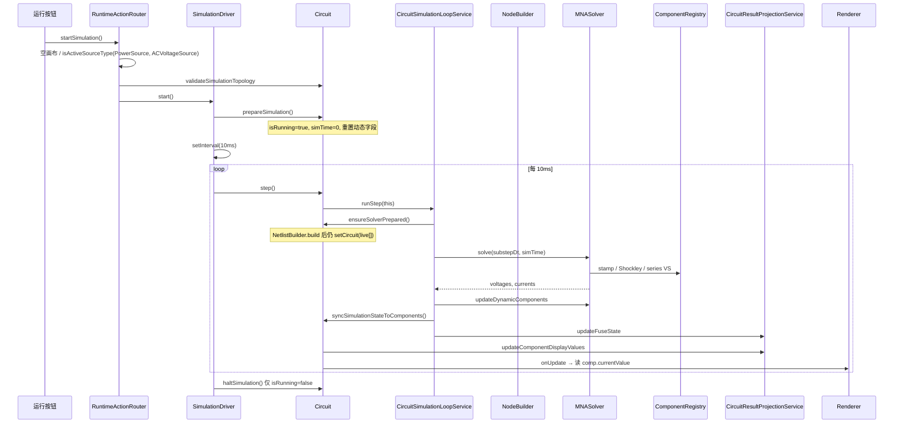
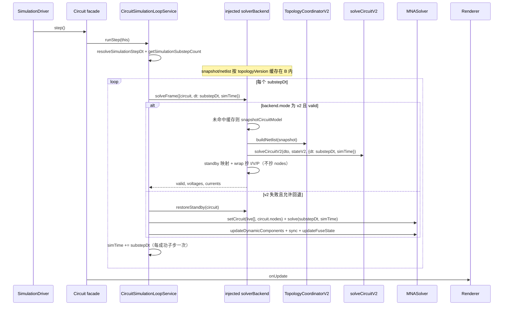

# 完成 V2 拓扑 / 求解核 / 投影并切生产（V1 回退 + 浸泡后删除）

- **Author**: Circuit Simulator Maintainers
- **Date**: 2026-10-12
- **Status**: Approved（Grok reviewer + Codex，2026-10-12）
- **HEAD**: `ee00f88`（`ee00f88416afe64d139938891bf2c18c1b116e90`，课堂 P0+P1 freeze）
- **Product**: 高中实验台（Native JS ESM，无生产 npm 依赖）
- **Supersedes**: `docs/plans/2026-10-10-full-remediation-design.md` 的 Non-Goal「不把生产切到 SolveCircuitV2」与 D4「v2 solver 保持 experimental」。该 Non-Goal 在拓扑丢导线、二极管分叉、P0 无电机/交流/半导体时成立。本设计关闭这些缺口后切流，而不是在缺口仍在时改 CI 绿条。
- **Does not rewrite**: `docs/audits/project/top30.md` 状态列。
- **Does not regress**: C1–C3 / H1–H11（存档信封、fromJSON 先校验再替换、Markdown 消毒、电机串联 Ra+E、交流可启动、闭合开关额外未知量、Ground 并到 node 0、嵌入 fail-closed）。
- **Sources (live)**:
  - `src/v2/app/coordinators/TopologyCoordinatorV2.js`
  - `src/v2/simulation/{NetlistBuilderV2,SolveCircuitV2,ResultPostprocessorV2,SimulationStateV2}.js`
  - `src/v2/app/{usecases/RunSimulationStepV2,ResultProjector,coordinators/SimulationCoordinatorV2}.js`
  - `src/v2/domain/CircuitModel.js`
  - `src/core/topology/NodeBuilder.js`
  - `src/core/simulation/{NetlistBuilder,ComponentRegistry,MNASolver,SolverMatrixAssembler,JunctionModel,DynamicIntegrator}.js`
  - `src/core/runtime/Circuit.js`
  - `src/core/services/{CircuitSimulationLoopService,CircuitTopologyService,CircuitResultProjectionService}.js`
  - `src/app/{AppRuntimeV2,AppRuntimeV2Delegates,RuntimeActionRouter,SimulationDriver,AppDocument}.js`
  - `src/v2/main/{bootstrapV2,AppCompositionRootV2}.js`
  - `src/ai/skills/SimulationRefreshSkill.js`
  - `scripts/ci/{assert-v2-runtime-exclusive,assert-v2-architecture-boundaries,assert-v2-coverage,assert-ci-workflow-coverage}.mjs`
  - `docs/plans/2026-03-03-v2-breaking-refactor-design.md`
  - `docs/audits/project/{2026-10-10-architecture-audit,2026-10-12-next-issues}.md`

---

## Overview

课堂运行时今天是「v2 入口包装的 v1 内核」：`src/main.js` → `bootstrapV2` → `AppRuntimeV2` → `Circuit` + `MNASolver` + `Renderer` + `InteractionManager`。时钟在 `src/app/SimulationDriver.js`（10ms）；`Circuit.haltSimulation` 只置 `isRunning=false`。`src/v2` 的不可变 `CircuitModel`、纯 netlist DTO、`ResultProjector`、分离的 coordinator 是架构上要保留的形状，但 **当前 `TopologyCoordinatorV2.buildNetlist` 从不读取 `circuitModel.wires`**，只扫元件上预先写好的 `component.nodes`。生产 `NodeBuilder` 则对端子世界坐标 + 导线端点做并查集，并把所有 `Ground` 并到地球（node 0）。今天若把 tick 切到 V2，画布上的导线会被当成不存在。

本设计给出一条可独立合入的顺序：先在 **现行 V1** 上扩电气基线网（电机堵转 / 交流 RMS / 二极管 / 开关），再把 NodeBuilder 语义 port 进 V2 拓扑，再把 `SolveCircuitV2` 的物理印记对齐 `ComponentRegistry`（含 Shockley 与 `stampSeriesVoltageSource`），再加 ViewMap 适配器与 shadow 双跑，再以 `ui.solverBackend` 旗标切默认 V2（V1 同帧回退），浸泡达标后删除 V1 求解核。第一刀切核时 **Renderer / InteractionManager 仍读活元件字段**；**活对象上的 `comp.nodes` / `circuit.nodes` / `wire.nodeIndex` 仍由生产 `NodeBuilder` 写入，直到 R2**；`CircuitModel` 成为含 UI 的唯一 SOT 不在本列车。

---

## Background & Motivation

### 课堂已冻、架构债未关

`docs/audits/project/2026-10-12-next-issues.md` 记录：课堂 Critical/High 可教性已关；剩下 H12/R1（双核岛）与 R2/A5（Circuit 神对象 + 33 mixin）。A3「TopologyCoordinatorV2 丢导线」被标 Defer 且禁止切生产。用户现已决定：**V2 拓扑/核/投影完成后切生产**，V1 作 fallback，浸泡后删除 V1 核。这取代 2026-10-10 设计 D4 / Alt-B / Non-Goal 1，但不推翻当时的事实判断——那些缺口今天仍在活源里。

### 当前对象图（活源核对）

| 声称 | 实际（HEAD `ee00f88`） |
|---|---|
| v2 runtime | `AppRuntimeV2` 立刻 `new Circuit()` / `new Renderer` / `new InteractionManager`（`AppRuntimeV2.js:58-68`） |
| 拓扑 | `CircuitTopologyService.rebuild` → `NodeBuilder.build({components, wires, getTerminalWorldPosition})` |
| 网表 | `NetlistBuilder.build` **已无** `source` 键；但 `Circuit.ensureSolverPrepared` 仍把 **live 数组** 传给 `MNASolver.setCircuit(components, this.nodes)`（`Circuit.js:187-196`），DTO 被存起来却不求解 |
| 求解 | `MNASolver` + `DefaultComponentRegistry` + `JunctionModel` Shockley + `stampSeriesVoltageSource` |
| 投影 | `Circuit.syncSimulationStateToComponents` + `CircuitResultProjectionService.updateComponentDisplayValues` 写 `comp.currentValue` |
| UI | `Renderer.buildValueDisplaySnapshot` 读 `comp.currentValue/voltageValue/powerValue`；`MeasurementReadoutController` / `PropertyPanelController` / `ObservationSources` 同 |
| V2 岛 | `runSimulationStepV2` 只被测试引用。CI `assert-v2-runtime-exclusive.mjs` 禁止 `src/app|ui|core|embed` 出现 `SolveCircuitV2` / `runSimulationStepV2` |
| 分层门 | `assert-v2-architecture-boundaries.mjs` 禁止 `src/v2` import `src/core`（唯一例外：`CircuitSchemaV3.js` → `CircuitSchemaGateway.js`）。ESLint `boundaries` 则允许 `v2 → utils` |

`tests/solver.parity.spec.js` **不能**当作「V2 已可切课堂」的证据：`buildV2Dto` 用命名端子预先填 `nodes`，完全绕过 `TopologyCoordinatorV2` 与导线；`buildRuntimeCircuit` 才真正 `connectWire`。现有四条 canonical 案例（`series-source-resistor` 等）是预分配节点的玩具网表，不是画布连线。

### 痛点（切流前必须关）

1. **导线不可见**：`TopologyCoordinatorV2.js:21-28` 只 `circuitModel.components`，`collectNodeList` 取 `component.nodes` 最大下标。两个电阻若只靠 `Wire` 相连、JSON 不持久化 `nodes`（`CircuitSerializer` 确实不写 `nodes`），V2 会把它们当成孤岛。
2. **电机仍是并联反电动势**：`SolveCircuitV2.js:455-460` 对同一对端子既 `stampResistor(Ra)` 又 `stampIdealVoltageSource(-backEmf)`。生产已是 `stampSeriesVoltageSource(..., backEmf, ra, vsIndex)`（`ComponentRegistry.js:238-245`）。切过去会把堵转电流从 `V/Ra` 打回开路/并联错解（回归 H3）。
3. **闭合开关走 `dV/1e-9`**：V2 `stampResistor(1e-9)` + `ResultPostprocessorV2` `deltaV/1e-9`。生产闭合开关占 `vsIndex` 并用 `stampSeriesVoltageSource(0, 1e-9)`。切过去会回归 H5。
4. **二极管模型分叉**：生产 `stampJunctionViaLinearization`（Shockley）；V2 `resolveDiodeResistance` Ron/Roff。`tests/solver.junctionNonlinear.spec.js` 要求膝点连续、反向泄漏 `< 1e-9`。Ron/Roff 过不了。
5. **动态积分与交流子步**：生产有梯形/后向欧拉自动切换、开关时强制 BE、按交流频率子步进。V2 每步一次 BE，默认 `dt=0.001` 且无子步。`Circuit.dt` 是 `0.01`。
6. **投影写回**：V2 `projectResultV2` 已产出只读数组，但课堂 Renderer 不读它。没有适配器就切核，仪表全是 0。

---

## Goals & Non-Goals

### Goals

1. V2 拓扑与生产 `NodeBuilder` 同语义：端子几何并查集、量化坐标合一、导线理想导体、全部 Ground 共用 node 0、未连接端子保持 `-1`。
2. V2 求解与生产 `ComponentRegistry` + `MNASolver` 在 parity 矩阵上数值对齐（容差见各行），再允许 default-on。
3. 求解路径以 ViewMap 为 **I/V/P 与动态显示** 的 SOT；V2 路径停止调用 `syncSimulationStateToComponents`。过渡期适配器只抄显示字段（电流、电压、功率、亮度、conducting/speed/backEmf/blown/i2tAccum），**不抄 `nodes` / `wire.nodeIndex`**。
4. 切流可逆：`solverBackend = 'v1' | 'v2' | 'shadow'`，默认 `'v1'` 直到浸泡；失败在 **同一子步** 回退 V1（先恢复 standby 快照再解该 `substepDt`）；每个成功子步 `simTime += substepDt`；不双积分 fuse/motor。
5. CI 门禁按 PR 阶段演进，而不是一次拆掉 exclusive 脚本。
6. 课堂空画布、无电源、仅交流、电机开路、嵌入只读、Markdown/MathJax、存档信封行为不回退。

### Non-Goals

1. **不**在本列车重写 `InteractionManager` 的 33 处 `Object.assign(prototype)`（`src/ui/interaction/Interaction*Delegates.js`）。切核不依赖拆 mixin。
2. **不**做非线性灯泡。生产 `DefaultComponentRegistry.register('Bulb', Resistor)` 仍是线性电阻；parity 对齐线性即可。
3. **不**手改 `vendor/mathjax-3.2.2` minified blob。`index.html` 已 `packages: { '[-]': ['require', 'autoload', 'html', 'href'] }`，习题板先 `sanitizeRenderedMarkdown` 再 MathJax。
4. **不**改写 `docs/audits/project/top30.md` 状态列。
5. **不**把 `CircuitModel` 变成含 UI 几何交互的唯一 SOT。第一刀：求解后端换 V2，画布实体仍是 `Circuit.components/wires`。
6. **不**新增生产 npm 依赖。devDependency 仅测试/CI。
7. **不**引入电路 schema 迁移器。payload 仍是 schema v3 no-compat。旗标放在应用信封 `ui`，不放 `circuit.meta`。
8. **不**在切核 PR 里改 `SimulationDriver` 的 10ms 墙钟或把绘制改成 rAF（M10 另票）。

---

## Proposed Design

### 1. Honest as-is vs to-be runtime

#### 1.1 生产 tick（今天，必须保持可教）



#### 1.2 V2 tick（今天，测试岛）

```mermaid
sequenceDiagram
    participant T as tests/app.runSimulationStepV2.spec.js
    participant U as runSimulationStepV2
    participant Topo as TopologyCoordinatorV2
    participant NL as NetlistBuilderV2
    participant Sim as SimulationCoordinatorV2
    participant K as solveCircuitV2
    participant Pr as projectResultV2

    T->>U: circuitModel 预写 nodes, 无 wires
    U->>Topo: buildNetlist(circuitModel)
    Note over Topo: 忽略 circuitModel.wires
    Topo->>NL: build({components, nodes: 0..maxIndex})
    U->>Sim: solveStep({netlist, state, options})
    Sim->>K: solveCircuitV2
    Note over K: Motor 并联 E; Switch dV/1e-9; 二极管 Ron/Roff
    U->>Pr: projectResultV2 → 只读数组
    Note over U: 生产 tick 从不走到这里
```

#### 1.3 目标 tick（default-on 之后，V1 仍可回退）

`solveFrame` 的粒度是 **交流子步**，不是整段 10ms 墙钟。`CircuitSimulationLoopService` 仍拥有 `resolveSimulationStepDt` / `getSimulationSubstepCount`；核每次只看见一个 `substepDt`。编号算法见 §5.0。**注入的 backend `B` 拥有 snapshot/netlist 缓存**；`L` 只调用 `solveFrame({circuit, dt: substepDt, simTime})`，不出现 `snapshotCircuitModel`。



**第一刀切核原则**：`SimulationDriver`、`RuntimeActionRouter` 启动门、`Circuit` 可变 Map、Renderer、33 mixin **不动**。活节点编号仍由生产 `NodeBuilder` 在 `requestTopologyRebuild` 时写入。V2 只把几何快照编进 DTO 求解；`NodeBuilderV2` 必须与生产赋号顺序一致，使 DTO 端子下标 **逐槽等于** live `comp.nodes`（不允许「整体重编号」混用 `lastResults.voltages` 与 live 下标）。

### 2. V2 topology completion spec

#### 2.1 必须 port 的生产行为（对照 `NodeBuilder.js:4-218`）

| 规则 | 生产实现 | V2 目标 |
|---|---|---|
| 并查集对象 | postId `T:{id}:{ti}` 与 `W:{wireId}:a/b` | 同构；算法放在 `src/v2/simulation/NodeBuilderV2.js` |
| 坐标桶 | `pointKey(pos)` **拒绝非整数**（`CanvasCoords.js:50-57`）。生产 `NodeBuilder.build` **并不** normalize：它把 `wire.a`/`wire.b` 直接交给 `pointKey`（`NodeBuilder.js:74-80`）。整数来自 `Circuit.addWire` 已调用的 `normalizeCanvasPoint`（`Circuit.js:268-273`） | **`NodeBuilderV2` 必须在 `pointKey` 之前**对导线端点 **和** 端子世界坐标调用 `normalizeCanvasPoint`（或等价取整）。CircuitModel 快照可能没走过 `addWire`；未取整的点 `pointKey` → `null` → 静默不 union |
| 端子位置 | `getTerminalWorldPosition` + `Circuit.getTerminalWorldPositionCached` | coordinator 注入同一函数；V2 从 `src/utils/TerminalGeometry.js` 引用（KD2，相对路径见 §2.3） |
| 导线 | 注册两端点后 `union(aId, bId)`，理想导体 | 同；缺 `a`/`b` 的导线跳过 |
| 连接度 | `degree = wireCount + otherTerminalCount`；`degree==0` 视为未连接 | 同 |
| Ground | 所有 `type==='Ground'` 的端子 0 先 union 到同一根；优先已连接 Ground 为 node 0；否则电源负极；否则任一已连接端子；孤立 Ground 仍作参考 | 逐条复制赋号 **顺序**，禁止「简化成只认第一个 Ground」，禁止整体重编号 |
| 未连接端子 | `comp.nodes[ti] = -1`（`NodeBuilder.js:186-199`） | DTO **与** `SolveCircuitV2.normalizeComponent` 都必须保留槽位 `-1`。活源塌缩点是求解器不是 DTO：`normalizeNodeIndex` 对 `parsed < 0` 返回 `null`，随后 `filter` 把 `[3,-1]` 变成 `[3]`，`stampResistor` 把单端打到地（`SolveCircuitV2.js:49-65`） |
| 导线节点 | `wire.nodeIndex` 供短路动画 | 仅写入 **live** 对象，由生产 `NodeBuilder` 在 rebuild 时赋值。V2 DTO 可带 `wires[].nodeIndex` 供求解诊断，**适配器不得抄回 live** |

`CircuitSerializer` **不持久化** `nodes`。课堂图的逻辑节点永远是派生量。`TopologyCoordinatorV2` 若继续读 `component.nodes`，导入的存档会全是未定义节点。

#### 2.2 CircuitModel：几何 vs 逻辑节点（活节点 SOT = 生产 NodeBuilder）

`CircuitModel`（`src/v2/domain/CircuitModel.js`）已经是不可变克隆：`components` / `wires` / `version`。本列车 **Key Decision：直到 R2，live 对象上的节点编号唯一 SOT 仍是生产 `NodeBuilder`**（`CircuitTopologyService.rebuild` → `comp.nodes` / `circuit.nodes` / `wire.nodeIndex`）。

- **几何 SOT（可持久化）**：元件 `x,y,rotation,terminalExtensions,position(Rheostat)`；导线 `a,b,aRef,bRef`。
- **Live 逻辑节点 SOT**：生产 `NodeBuilder.build` 在 `requestTopologyRebuild`（增删改线/元件）时写入活 Map。`ensureSolverPrepared` / V1 fallback 继续 `setCircuit(live[], this.nodes)`。`ConnectivityCache`、短路高亮、`CircuitFlowAnalysisService.getTerminalCurrentFlow`、rheostat 属性面板 **只读这些 live 字段**。
- **V2 DTO 逻辑节点**：`TopologyCoordinatorV2.buildNetlist` 写入 netlist DTO，**不** `CircuitModel.withState`，**不**经适配器写回 live。赋号算法与循环顺序必须与 `NodeBuilder.js` 相同，使同一几何下 DTO `nodes[ti] === live.comp.nodes[ti]`（含 `-1`）。这是为了让 `lastResults.voltages[liveNodeIndex]` 仍能驱动导线动画，而不是把 V2 下标抄到活对象上。
- **命令不管节点**：`CircuitModelCommands.addComponent/addWire` 只改实体。
- **适配器不管节点**：只抄 §4.3 列出的显示/动态字段。

`connectionMode`（Rheostat）今天由 `Circuit.detectRheostatConnections` 在 rebuild 时写入活对象，包含 **`'slider-only'`**（`Circuit.js:469`：仅滑块接入）。两边 registry 对未知 mode 都走 `default`（不 stamp）。V2 coordinator 必须产出与生产相同的五模式：`'left-slider' | 'right-slider' | 'left-right' | 'all' | 'slider-only'`，外加 `'none'`。写入 DTO `params.connectionMode`；live 上的 mode 仍由 V1 `detectRheostatConnections` 写，适配器不抄 mode。

#### 2.3 实现落点与边界

新建（均在 `src/v2`，禁止 import `src/core`）：

| 文件 | 职责 |
|---|---|
| `src/v2/simulation/NodeBuilderV2.js` | 从 `NodeBuilder.js` port 并查集；端子计数走 `getComponentManifestV2(type).terminalCount`，不走 `src/components/Component.js` |
| `src/v2/app/coordinators/TopologyCoordinatorV2.js` | `buildNetlist(snapshot, {getTerminalWorldPosition})`：读 wires，调 NodeBuilderV2，再 `NetlistBuilderV2.build`；附带 rheostat 五模式 + `slider-only` |
| `src/v2/simulation/NetlistBuilderV2.js` | 扩展 `OMIT_PARAM_KEYS`：丢掉 `currentValue,voltageValue,powerValue,brightness,conducting,speed,backEmf,vsIndex,_isShorted,_nortonModel,prevVoltage,prevCharge,prevCurrent,junctionVoltage,junctionCurrent,i2tAccum,energized` 等运行时字段。`nodes` 数组本身是 DTO 一等字段，不要从 params 再抄一份 |
| `src/v2/simulation/snapshotCircuitModel.js` | 从 live `Circuit` 抽几何+电参快照（§2.5）。**不要**经 `CircuitModel.components` getter 再 `clonePlainValue` 一遍 |
| `src/v2/app/usecases/RunSimulationStepV2.js` | 把 `getTerminalWorldPosition` 从 `options` 穿到 `buildNetlist`；把 **本步 netlist** 传给 `projectResultV2` |
| `src/v2/app/ResultProjector.js` | **PR-B 最小补丁**：端电压读 `netlist.components[].nodes`，不要读 `circuitModel.components` 上的 `nodes`。ViewMap / rheostat / 电源特殊规则留 PR-D |

`assert-v2-architecture-boundaries.mjs` 按 **import spec 字符串精确匹配**。PR-B 具名 allowlist **必须**写成（`src/v2/simulation/NodeBuilderV2.js` 相对 `src/utils` 是两级 `../`）：

```js
'src/v2/simulation/NodeBuilderV2.js': Object.freeze([
    '../../utils/CanvasCoords.js',
    '../../utils/TerminalGeometry.js'
])
```

若 `RunSimulationStepV2.js` 或 coordinator 也直接 import 这两文件，按真实相对路径再加键，禁止抄 `../../../utils/...`（那是 `src/v2/infra/io/CircuitSchemaV3.js` 的三级路径）。ESLint 已允许 `v2 → utils`（`.eslintrc.cjs`）；只需改 architecture 脚本。**不** allowlist `src/core/topology/NodeBuilder.js`。

生产 `CircuitTopologyService` 全程（含 V2 default-on）继续用现有 `NodeBuilder` 写 live 节点。不要让 `src/core` import `src/v2`。

#### 2.4 必测：只靠 Wire 连接的两只电阻

新文件 `tests/topology.coordinatorV2.wires.spec.js`（名字可微调，语义不可少）：

1. 用 `createComponent` + 整数坐标放置 `PowerSource V1`（`internalResistance:0, voltage:12`）与 `Resistor R1`（`100Ω`），**元件对象不设 `nodes`**。
2. 用 `getTerminalWorldPosition` 在对应端子之间 `addWire`（与 `tests/helpers/circuitTestUtils.js` / P0 `connectTerminals` 相同）。
3. 跑生产：`new Circuit()` → add → **`solveCircuit`（一次性助手）或 `prepareSimulation()` + `step()` + `haltSimulation()`**，期望 `I≈0.12A`。**禁止**裸调 `circuit.step()`：`Circuit.js:843-844` 在 `!isRunning` 时立即 return，电流会是 0，拓扑门闩会假红。
4. 跑 V2：`CircuitModel` 填入相同 `components`/`wires` 快照（无 `nodes`）→ `new TopologyCoordinatorV2().buildNetlist(model, {getTerminalWorldPosition})` → `solveCircuitV2`。
5. 断言：netlist 里两元件的 `nodes` 数组与生产 live `comp.nodes` **逐端子相等**（含参考 node 0）；**不允许**「整体重编号」过关。电流相对误差 `≤ 1e-6`。
6. 负例（全断开）：去掉导线，V2 不得把两只电阻静默并到同一节点；两端子均为 `-1`；求解电流为 0 或 `disconnected`。
7. **单端悬空夹具（必测，针对 `normalizeComponent` 塌缩）**：电源正极只接到电阻端子 0，电阻端子 1 **不接线**。DTO 与 `solveCircuitV2` 规范化后 `R1.nodes` 必须仍是 `[n, -1]` 长度 2，不得变成 `[n]`。该电阻不得对地形成 `G` 对角通路；电流为 0。此修补在 PR-B 改 `SolveCircuitV2.normalizeComponent`（保留 `parsed < 0` 为 `-1`，不要 `filter` 掉）。
8. Ground 夹具：两只互不接触的 `Ground` 仍同 node 0（对照 `tests/solver.multiSourceMultiGround.spec.js`）。
9. `tests/app.runSimulationStepV2.spec.js` 现有 3V/8Ω 案例改为 **无预写 nodes、仅 Wire** 的 `CircuitModel`/`snapshot`，期望仍 **0.3A / 2.4V**（`projection.components` 上 R1 的 `measurements.current` 与 `measurements.voltage`）。这是 PR-B 门闩，**不得**拖到 PR-D：本 PR 必须给 `ResultProjector.js` 打最小补丁，让端电压来自 `netlist.components[].nodes`。现活源只断言 0.3A（电流来自 `solveResult.currents`）；不改 projector 的话 2.4V 会是 0。

PR-B **不**改 exclusive 脚本，不进 `AppRuntimeV2`。

#### 2.5 `snapshotCircuitModel`（一次墙钟步 / 一次 topologyVersion）

生产 SOT 是可变 `Circuit.components` / `wires`。仓库里 **没有** `Circuit → CircuitModel` 助手；`CircuitModel` 构造与 `get components`/`get wires` 每次都 `clonePlainValue` 全图。若每个交流子步（最多 `maxAcSubstepsPerStep=200`）都 new 一份再 union-find，10ms 墙钟在手机上会炸。

约定：

1. 新增 `snapshotCircuitModel(circuit)`（`src/v2/simulation/snapshotCircuitModel.js`），产出 **一次性** 纯对象：
   - `topologyVersion: number`
   - `components: Array<{id,type,x,y,rotation,terminalExtensions,position,connectionMode?, ...electricalParams}>`
   - `wires: Array<{id,a,b,aRef,bRef}>`
2. **省略**：`currentValue,voltageValue,powerValue,brightness,vsIndex,_nortonModel,_isShorted,prevVoltage,prevCharge,prevCurrent,junctionVoltage,junctionCurrent,nodes`（live nodes 不是快照字段；求解用 DTO 节点）。
3. 每个 **墙钟** `runStep` 开始时：若 `circuit.topologyVersion !== cachedSnapshot.topologyVersion` 则重建快照与 netlist，否则复用。同一 `runStep` 的全部子步共享该快照与 DTO。
4. `TopologyCoordinatorV2.buildNetlist` 吃这个快照数组，**不要**先包成 `CircuitModel` 再读 getter（那会再克隆一次）。
5. 编辑路径的 live `rebuildNodes` 仍按 `topologyVersion` 发生，与求解快照独立。

### 3. Physics parity matrix（default-on 前门闩）

容差默认：直流电流/电压 `1e-6` 绝对或 `1e-3` 相对（与 P0 `ABS_TOL/REL_TOL` 一致）；瞬态在指定步数后比稳态；二极管膝点用现有非线性测试的比值门闩，不用 Ron/Roff 的阶跃。

| 行 | 生产（V1）函数 | V2 目标函数 | 今日分叉 | 对齐后 parity 测试 |
|---|---|---|---|---|
| Motor 串联 Ra+E | `ComponentRegistry` Motor `stampSeriesVoltageSource(i1,i2,backEmf,ra,vsIndex)`；`vsIndex` 无效则 `stampResistor(ra)`；电流取解向量额外未知量（**不取负**，`ComponentRegistry.js:255-256`） | `SolveCircuitV2.stampComponent('Motor')` 必须改为同一方程 `V_n1-V_n2-I·Ra=E`；删除「电阻∥理想电压源」；无效 `vsIndex` 只印 `Ra` | V2 并联 `-E` 且电流对 vs 一律取负（`SolveCircuitV2.js:636-639`） | 现有 `tests/solver.motor.spec.js`（6V/5Ω → 1.2A）+ 新 `tests/solver.v2.motor.series.spec.js` 走 DTO；P0 扩展 `motor_stall` |
| Motor 开路 | `stampComponent` 在节点非法时 return | 端子 `-1` 不分配 `vsIndex`、不印记；`normalizeComponent` 保留 `[n,-1]` | V2 `assignVoltageSourceIndices` 要求两节点 `>=0`，开路会跳过，但若 filter 掉 `-1` 会把单端印到地 | `tests/solver.v2.topology.isolated.spec.js` + PR-B 单端悬空夹具 |
| AC 启动 + 瞬时值 | `isActiveSourceType` 含 `ACVoltageSource`（`SourceTypes.js`）；`RuntimeActionRouter.startSimulation`；`assignCircuitSourceInstantaneousVoltage`（`CircuitSourceVoltageResolver.js`）按 RMS√2·sin(ωt+φ) | 瞬时值公式对齐；**禁止**写回 `comp.instantaneousVoltage`。子步进仍由 `CircuitSimulationLoopService.getSimulationSubstepCount` 包住 V2（`minAcSamplesPerCycle=40`, `maxAcSubstepsPerStep=200`） | V2 有瞬时公式但无子步、无启动门；启动门保持在 Router，不搬进 solver | `tests/runtimeActionRouter.acStart.spec.js` 不得回退；新 `tests/solver.v2.ac.rms.spec.js` + P0 扩展 `ac_resistor_rms` |
| 闭合开关 Rε | `prepareComponents` 闭合且未短路时分配 `vsIndex`；`stampSeriesVoltageSource(0, 1e-9)`；电流来自额外未知量 | 同；`ResultPostprocessorV2` 停止 `deltaV/1e-9` | V2 电阻印记 + dV/1e-9 | `tests/solver.switchCurrent.spec.js`（6V/10Ω ≈0.6A；并联两开关电流之和）+ `tests/solver.v2.switch.series.spec.js` |
| 断开开关 | `stampResistor(1e12)`，无 `vsIndex` | 同 | 已接近 | 同上 + P0 `switch_open`（已有，保持 12V/100Ω 夹具不动） |
| SPDT | 仅导通侧一个 `vsIndex` + `stampSeriesVoltageSource(0, onR)`；断开侧 `offR` | 同；改 `position` 必须让外层 `markSolverCircuitDirty`（仍走 Circuit） | V2 两侧都是电阻，电流 `(vCommon-vTarget)/onR` | 新 `tests/solver.v2.spdt.spec.js`；可种子自 `ComponentRegistry` SPDT 分支 |
| 二极管 / LED | `JunctionModel` Shockley 线性化 + `SolverConvergenceController` 最多 40 次、`limitJunctionStep`、`junctionVoltage` 进 LU key | **选用生产 Shockley**（见 D5）。Port `JunctionModel.js` → `src/v2/simulation/JunctionModelV2.js`；Newton 循环进 `solveCircuitV2` 或拆 `ConvergenceControllerV2`。删除 Ron/Roff 作为求解模型（显示 `conducting` 仍可按生产阈值推导） | V2 Ron/Roff + 单步 | 现有 `tests/solver.junctionNonlinear.spec.js` 必须对 V2 再跑一份（或 harness 双跑）；P0 扩展 `diode_forward` / `diode_reverse` |
| Ground 并集 | `NodeBuilder` 全 Ground union → node 0 | NodeBuilderV2 同 | V2 拓扑忽略 Ground 几何 | `tests/solver.multiSourceMultiGround.spec.js` 几何路径 + PR-B Ground 夹具 |
| Rheostat position | `detectRheostatConnections` 五模式含 **`slider-only`**（`Circuit.js:461-476`）；stamp `switch` 对 `slider-only`/`none` 都不印（`default`） | coordinator 必须发出相同五模式 + `none`，不得把 `slider-only` 折叠成 `'none'`（字段值要能 round-trip 到属性面板）；stamp 与 `ComponentRegistry.js:297-371` 逐 case 对齐 | stamp 已接近；缺 `slider-only` | 现有 P0 `rheostat_*` + 新 `tests/solver.v2.rheostat.slider-only.spec.js` |
| 电容积分 | `DynamicIntegrator.resolveDynamicIntegrationMethod`：有开关 → BE；`auto` 且 historyReady → 梯形；BE：`Req=dt/C`, `Ieq=qPrev/dt` | 同规则；`SimulationStateV2` 已有 `dynamicHistoryReady`（注意 V1 字段名是 `_dynamicHistoryReady`） | V2 只有 BE，且 `Ieq=C·Vprev/dt`（在 `prevCharge=C·prevVoltage` 时等价） | 现有 P0 `rc_charge`（2000 步）必须 V1/V2 曲线对齐；`tests/solver.dynamicIntegration.spec.js` |
| 电感积分 | BE：`Req=L/dt`，电流源 `prevCurrent`；梯形：`(2L)/dt` | 同 | V2 仅 BE | P0 `rl_step` + `tests/solver.dynamicIntegration.spec.js` |
| Fuse I²t | 投影里 `i2tAccum += |I|² · elapsedStepDt`；默认阈值 `ratedCurrent²·0.2`（若未设 `i2tThreshold`）；熔断后 `markSolverCircuitDirty` | 把积分放到 **V2 nextState**（已有雏形），阈值公式对齐生产默认；本步熔断影响 **下一步** stamp，不在同一次 `solve` 内改矩阵 | V2 默认阈值恒为 `1`（`SolveCircuitV2.js:543`），与生产 `|| defaultThreshold` 在 `i2tThreshold=0` 时行为不同 | `tests/solver.newComponents.spec.js` fuse 段 + 新 `tests/solver.v2.fuse.i2t.spec.js` |
| 理想/诺顿电源 | `r >= 1e-9` → Norton `Ieq=E/r`；更小 → 理想电压源 + `vsIndex` | 同阈值 `IDEAL_SOURCE_RESISTANCE_EPS=1e-9` | V2 用 `> SMALL_RESISTANCE`，边界 `==1e-9` 可能分叉 | `tests/solver.powerSourceInternalResistance.spec.js` |
| 理想电流表 | `SolverMatrixAssembler.js:81`：`resistance <= 0` 才占 `vsIndex` 并 `stampVoltageSource(0)`；`r>0` 走电阻（`ComponentRegistry.js:86-93`） | **对齐 `r <= 0`，不要用 `SMALL_RESISTANCE=1e-9`**。`r === 1e-10` 在 V1 是理想表，V2 今天会当成电阻 | V2 `resistance <= 1e-9` 当理想表，阈值分叉被「已接近」低估 | P0 `ammeter_ideal_series` + 新 `tests/solver.v2.ammeter.threshold.spec.js`（`r=0` 与 `r=1e-12`） |
| LU / gmin | `Matrix.factorize` 缓存 + 对角 `gmin=1e-12`；cache key 含 dt、开关、结电压 | V2 今天每次稠密高斯且无缓存。二极管 40 次迭代会打穿 10ms。必须 port LU+key（`SolverMatrixCacheKeyBuilder` 语义）到 `src/v2/simulation/LinearAlgebraV2.js` | 无缓存 | `tests/solver.luCache.spec.js` 的 key 稳定性对 V2 复刻 |
| 短路电源 | `_isShorted` 且非有限内阻电源则跳过 stamp | 同 | V2 无 `_isShorted` 短路跳过 | 现有短路诊断测试；V2 由 NodeBuilder 两端同节点触发 |

**vs 电流符号矩阵（PR-C 必对齐，禁止「电机取正却把电流表一起改了」）**：

| 类型 | V1 取额外未知量的方式 | V2 目标 |
|---|---|---|
| PowerSource / ACVoltageSource（理想） | `-(vector[nodeCount-1+vsIndex])`（`ComponentRegistry.js:461`） | 取负 |
| Ammeter（理想，`r<=0`） | `-(vector[...])`（`:105`） | 取负 |
| Motor | **不取负** `vector[...]`（`:255-256`） | 原样 |
| Switch（闭合） | **不取负**（`:139-144`） | 原样 |
| SPDT（导通侧） | **不取负**（`:177-181`） | 原样 |

今日 V2 `SolveCircuitV2.js:636-639` 对 **所有** `vsIndex` 取负。只修电机而沿用统一取负会把电源/电流表符号打反。

**灯泡**：保持线性 `stampResistor`。不要在本列车引入灯丝温度模型。

**拆文件**：`SolveCircuitV2.js` 已 668 行，hard budget 800、target 650（`assert-core-file-size-budget.mjs`）。Shockley + series VS + Newton 不能继续堆进同一 switch。PR-C 拆：

- `src/v2/simulation/StampRegistryV2.js` — 按 type stamp（对齐 registry，而不是再维护第三套）
- `src/v2/simulation/JunctionModelV2.js` — 从 `JunctionModel.js` port，禁止 import core
- `src/v2/simulation/LinearAlgebraV2.js` — LU
- `src/v2/simulation/DynamicUpdateV2.js` — 电容/电感/电机/保险丝/继电器
- `src/v2/simulation/SolveCircuitV2.js` — 编排 `assignVoltageSourceIndices` / assemble / iterate / postprocess

`assert-v2-coverage.mjs` 在删 V1 核 **之前**继续测生产 `DefaultComponentRegistry`（今天已如此：`import` `src/core/simulation/ComponentRegistry.js`）。PR-G 必须改写该脚本（见 §5.4），否则 `check:v2:coverage` 会因文件被删而红。另增 `assert-v2-stamp-parity.mjs`（PR-C）：对 `listComponentDefinitionTypes()` 每个类型，V1 `handler.stamp` 与 V2 stamp 在同一 stub 上调用的 `stampResistor/stampCurrentSource/stampVoltageSource/stampSeriesVoltageSource` 序列一致（允许参数 1e-12 量级差）。

### 4. Projection / ViewMap 与适配器日落

#### 4.1 目标接口

```js
// ViewMap — 禁止作为节点 SOT 写回 Circuit / CircuitModel
Map<string /*componentId*/, {
  currentValue: number,
  voltageValue: number,
  powerValue: number,
  brightness?: number,
  conducting?: boolean,
  energized?: boolean,
  speed?: number,
  backEmf?: number,
  blown?: boolean,
  i2tAccum?: number,
  voltageSegLeft?: number,
  voltageSegRight?: number,
  status: 'ok' | 'disconnected' | 'shorted' | 'invalid'
}>
```

**不要**在 ViewMap 上放 `nodes` 给适配器抄。投影计算端电压时读 **本步 netlist DTO** 的 `component.nodes`，不是 `circuitModel.components` 上的残留字段。

`projectResultV2` 今天只给 `{id,type,status,measurements:{voltage,current,power}}`，且从 `circuitModel` 取 `safeComponent.nodes?.[0]`（`ResultProjector.js:43-45`）。导线模型在 CircuitModel 上 **没有** `nodes` → 电压全 0。

分两步改契约，**不要把 2.4V 门闩留到 PR-D**：

**PR-B 最小补丁**（必须进 PR-B 文件列表）：

```js
projectResultV2({ netlist, solveResult, circuitModel /* 仅当无 netlist 时的 id/type 回退 */ })
```

- 端节点取 **本步** `netlist.components`（数组，每项 `{id,type,nodes,params}`）按 id 查找的 `nodes[0]`/`nodes[1]`。
- **禁止**再读 `circuitModel.components` 上的 `nodes`。
- 返回形仍是 `{valid, diagnostics, components:[{id,type,status,measurements:{voltage,current,power}}]}`。
- 不在本 PR 做 brightness / rheostat 分段 / 电源 `|V·I|` 等生产投影规则。

`runSimulationStepV2` 必须把刚建的 `netlist` 传入。`tests/app.runSimulationStepV2.spec.js` 的导线 3V/8Ω 夹具在 PR-B 就断言 R1 **0.3A 且 2.4V**。

**PR-D** 再把生产投影规则 port 进同一文件（或拆 `ViewMapBuilderV2.js`）：

- 未连接：全 0（`resetDisconnectedComponent`）
- Ground：I=V=P=0
- 理想电压表：强制 `currentValue=0`
- 电源：`voltageValue=|v1-v2|`，`powerValue=|V·I|`
- Rheostat / SPDT / Relay：沿用 `applyRheostatProjection` / SPDT 导通侧 / 线圈电流口径
- LED/Bulb brightness：沿用 `applyBrightnessProjection`

导线电流动画继续走 `CircuitFlowAnalysisService` 读 live `comp.nodes` / `wire.nodeIndex`（V1 NodeBuilder）+ `lastResults.voltages`。这要求 §2.2 的 **逐槽相等** 赋号。V2 路径把 `lastResults` 填成 `{ voltages, currents: Map, valid }`；`voltages[i]` 的 `i` 与 live `circuit.nodes` 一致。`Matrix.solve` 在 `CircuitFlowAnalysisService.js:292` 的导线分流 **保留**，与求解核无关。

#### 4.2 停止 `syncSimulationStateToComponents`（仅 V2 成功子步）

`CircuitSimulationLoopService.runStep` 今天每子步调用 `syncSimulationStateToComponents`（`CircuitSimulationLoopService.js:70`）以及 `updateDynamicComponents` / `updateFuseState`。V2 **成功**子步：

1. 动态历史只存在 `SimulationStateV2`，并由 §5.0 同步进 **V1 standby 快照**（字段映射，**不是**再跑一遍积分）。
2. **禁止**再调用 `syncSimulationStateToComponents` / `solver.updateDynamicComponents` / `updateFuseState`（否则 fuse `i2tAccum` 与电机 `speed` 双积分）。
3. 显示字段由 ViewMap → 适配器写入活元件（日落前）。

V1 路径（含 fallback 子步）保持原 `updateDynamic*` + `sync` + `updateFuseState`。Shadow 的 V2 腿 **不跑适配器**（§5.2）。

#### 4.3 适配器与日落

```js
// src/app/simulation/ComponentViewAdapter.js  （app 层，不是 v2/ui）
export function applyViewMapToComponents(circuit, viewMap) {
  for (const [id, view] of viewMap) {
    const comp = circuit.components.get(id);
    if (!comp) continue;
    comp.currentValue = view.currentValue;
    comp.voltageValue = view.voltageValue;
    comp.powerValue = view.powerValue;
    if (view.brightness != null) comp.brightness = view.brightness;
    if (view.conducting != null) comp.conducting = view.conducting;
    if (view.energized != null) comp.energized = view.energized;
    if (view.speed != null) comp.speed = view.speed;
    if (view.backEmf != null) comp.backEmf = view.backEmf;
    if (view.blown != null) comp.blown = view.blown;
    if (view.i2tAccum != null) comp.i2tAccum = view.i2tAccum;
    // 禁止: comp.nodes = ...; wire.nodeIndex = ...; circuit.nodes = ...
  }
}
```

放在 `src/app` 而不是 `src/v2`：适配器依赖可变 `Circuit`，属于切流期宿主。`src/v2` 保持纯投影。

**日落条件（写入 PR-D 测试注释与本设计，实施跟踪用 PRJ 票，不改 top30）**：

1. `Renderer.setViewMap(viewMap)` 已接线；`buildValueDisplaySnapshot` 优先读 ViewMap。
2. `MeasurementReadoutController` / `PropertyPanelController` / `ObservationSources` / `ObservationExportService` 改为读 ViewMap 或 `circuit.lastViewMap`。
3. 适配器调用次数的 debug 计数连续两个发布周期为 0 的路径可删。
4. 不得在 Renderer 读 ViewMap 之前删除适配器——否则仪表归零（课堂事故）。

PR-D 只引入适配器 + `Renderer` 可选 `setViewMap`（缺 map 时旧字段回退，回退打计数）。不在 PR-D 删除所有 `comp.currentValue` 读点。

### 5. Cutover mechanism

#### 5.0 V2 模式循环算法（与 `CircuitSimulationLoopService.runStep` 对齐）

`solveFrame` **每个交流子步调用一次**，不得吞掉整段墙钟 `stepDt`。`snapshotCircuitModel` / netlist 的 `topologyVersion` 缓存、ViewMap 适配、standby 映射都在 **注入的 backend（v2）+ AppRuntime wrap（app）** 内完成。

鸭子类型（挂在 `circuit.solverBackend`；loop **只读这些字段/方法**）：

```js
{
  mode: 'v1' | 'v2' | 'shadow',  // loop 分支读这个，不是散落的局部变量
  fallbackCount: 0,
  solveFrame({ circuit, dt, simTime }) {
    /* 不要求 circuit.isRunning。
       返回 { valid, voltages, currents, backendUsed, nextState? }，
       供 loop lastResults = result；不得只靠 wrap 写 circuit.lastResults */
  },
  restoreStandby(circuit) { /* 写回 V1 SimulationState + 活 fuse/motor */ },
  reset() { /* 清空 SimulationStateV2 / shadow / topologyVersion 缓存 / fallbackCount */ }
}
```

`CircuitSimulationLoopService` **不得**出现 `snapshotCircuitModel` / `SolveCircuitV2` / `runSimulationStepV2` / `applyViewMapToComponents`。`solveFrame` **不要求** `circuit.isRunning`（`Circuit.step` 仍要求，见 KD17）。

伪代码：

```
runStep(context):
  (1) 若 topology 脏：现有 rebuildNodes()（V1 NodeBuilder 写 live nodes）。
      v1 路径仍 ensureSolverPrepared()。
  (2) stepDt     = resolveSimulationStepDt(context)          // 不变
      substepCount = getSimulationSubstepCount(context, stepDt) // 不变，AC 最多 200
      substepDt  = stepDt / substepCount
      backend    = context.solverBackend
  (3) for index in 0 .. substepCount-1:
        startSimTime = context.simTime
        if !backend 或 backend.mode === 'v1':
          // 今日路径：solver.solve → maybe break → simTime += substepDt
          //           → updateDynamicComponents → syncSimulationStateToComponents
          //           → updateFuseState(substepDt)
        else if backend.mode === 'v2':
          result = backend.solveFrame({
            circuit: context, dt: substepDt, simTime: startSimTime
          })
          // wrap 内部：命中 topologyVersion 缓存则复用 snapshot/netlist
          //   成功：commit nextStateV2；copyDynamicsToV1Standby（不积分）；
          //         applyViewMapToComponents（不抄 nodes）
          //   禁止: updateDynamicComponents / sync / updateFuseState
          //   **loop 必须** lastResults = result（含 voltages/currents/valid/backendUsed）
          //   不得只靠 wrap 改 circuit.lastResults：P0 读 runStep 的返回值
          if result.valid:
            lastResults = result
            lastResults.backendUsed = 'v2'
          else:
            backend.restoreStandby(context)
            context.solver.setCircuit(live[], context.nodes)  // 重新 prepareComponents，丢弃任何 V2 vsIndex
            v1 = context.solver.solve(substepDt, startSimTime)
            if v1.valid:
              updateDynamicComponents; syncSimulationStateToComponents; updateFuseState
            lastResults = v1
            lastResults.backendUsed = 'v1'
            backend.fallbackCount++
        else if backend.mode === 'shadow':
          // 见 §5.2：本子步仍走完整 V1 提交路径；V2 只在采样墙钟步的子步 0 比较
        if !lastResults.valid: break
        context.simTime += substepDt     // 每个成功子步一次；整墙钟步合计 +stepDt
  (4) 与今日相同：return { lastResults, stepDt, substepCount, substepDt, elapsedDt }
      Circuit.step 把 loopResult.lastResults 写入 this.lastResults（Circuit.js:848-849）。
      若 lastResults.valid：
          v1 路径：updateComponentDisplayValues（今日）
          v2 路径：不再走 updateFuseState / 不再用投影累加 I²t
                  （I²t 已在 V2 nextState；显示已由适配器写）
                  不得两者都跑
```

**V1 standby 快照**（PR-E 引入，PR-F 依赖）：

| V2 / ViewMap 字段 | 写入 standby / V1 `SimulationState` + 活元件 |
|---|---|
| `dynamicHistoryReady` | `_dynamicHistoryReady` |
| `prevVoltage` `prevCharge` `prevCurrent` | 同名（电容/电感） |
| `speed` `backEmf` | `SimulationState` + 活 `comp.speed/backEmf`（回退前） |
| `junctionVoltage` `junctionCurrent` `conducting` | `SimulationState`；`conducting` 亦可在适配器显示 |
| `energized` | `SimulationState` + 显示 |
| `i2tAccum` `blown` | **今日在活 `comp` 上，不在 V1 `SimulationState`**。standby 必须带上这两字段；回退时写回 `comp` 再 `markSolverCircuitDirty` 若 `blown` 变化 |

`Circuit.prepareSimulation` / `resetSimulationState` 今日只 `new SimulationState()`。PR-E 必须同时 `reset SimulationStateV2` 与清空 standby / shadow 状态，否则电容历史从空态起步会必 mismatch。

Fallback **禁止**把 V2 `nextState` merge 进 V1 再解。允许的唯一水合：成功 V2 子步之后的 standby 映射（无二次 `I²·dt` / 无二次 `ω += α·dt`）。回退后 V1 `prepareComponents` 在 live 对象上重分配 `vsIndex`，不得复用 DTO 上的 V2 下标。

#### 5.1 旗标

名称：**`solverBackend`**，值 `'v1' | 'v2' | 'shadow'`。

- 代码默认 **`'v1'`** 直到 PR-F。
- 持久化：应用信封 `ui.solverBackend`，**不是** `circuit.meta`（Gateway `META_KEYS` 仍是 version/name/timestamp）。
- `buildAppDocument` / `restoreAppUi` 读写该字段；未知值视为 `'v1'`。
- `formatVersion` 保持 `1`。这是 `ui` 内可选键，不是新文档版本。
- 调试：`window.debugCircuit()` 快照含 `solverBackend`、`backendUsed`、shadow 失配计数。

解析优先级（PR-E）：

1. Embed 查询 `solver=v1|v2|shadow`（KD7：embed 未显式声明时钉死 v1）
2. 否则 `ui.solverBackend`（autosave / 导入；PR-F 前将存档 `'v2'` 降为 `'v1'`，见 KD19）
3. 否则代码默认

不提供课堂 UI 开关。开发者可通过导入 JSON 或 query 切换。

#### 5.2 Shadow（PR-D harness / PR-E 生产可选）

默认 **每 N=5 个墙钟 tick 采样一次**，只比较该墙钟步的 **子步 0**（禁止每个 AC 子步都跑 V2）。

1. **V1 始终提交**（显示 SOT）：该 tick 全部子步走今日 `solver.solve` + `updateDynamic*` + `sync` + `updateFuseState` + `updateComponentDisplayValues`。
2. 采样 tick：用 **本墙钟步开始时** 缓存的 snapshot/netlist + **独立** `SimulationStateV2` 跑一次 V2（`dt=substepDt` of 子步 0，`simTime` = 该子步起始）。V2 `nextState` 只写入 shadow 状态机。
3. **Shadow V2 腿禁止**：`applyViewMapToComponents`、写 `circuit.lastResults`、`simTime +=`、改 live `comp.nodes`。
4. 比较该子步电流/端电压；相对误差超 `1e-3` 且绝对误差超 `1e-6` → `shadowMismatchCount++`。课堂默认 **不 throw**。`?solver=shadow&shadowThrow=1` 仅 CI。
5. **中止点**：Newton 迭代之间、拓扑 build 之后。禁止在 `Matrix.factorize` / V2 GE 循环内部读 `performance.now` 半截退出。超时（默认 8ms 预算，仅采样 tick）→ `shadowErrorCount++`，保留 V1。
6. `prepareSimulation` 重置 shadow `SimulationStateV2`。从运行中途打开 shadow 而电容历史为空会必 mismatch——忽略该计数直到下一次 prepare。
7. PR-C 的 LU 落地后、PR-E 打开生产 `?solver=shadow` 之前，用二极管+交流夹具再测一次墙钟。PR-D 的 harness 只在 tests 里双跑，不进 10ms 循环。

#### 5.3 Default-on（PR-F）

代码默认改为 `'v2'`。按 §5.0：每个子步先 V2；失败则 restore standby、V1 解 **该** `substepDt`、走 V1 动态路径；`simTime += substepDt` 每成功子步一次。连续回退 >50 墙钟步状态栏保持「已回退」，不改持久化旗标。

PR-F 回归断言（改写原「simTime 只 +dt」）：在 `dt=0.01`、无交流（`substepCount=1`）时 `simTime` 增加 `0.01`；在强制 `substepCount=4` 的夹具上增加 `0.01` 且调用 `solveFrame` 4 次；V2 在子步 2 奇异时，子步 2 走 V1 且 **该子步** 的电容 `prevVoltage` 来自 standby 而非 `prepareSimulation` 的 0。

#### 5.4 Delete V1（PR-G，浸泡后单独 PR）

浸泡门槛（KD20，已决）：

- 默认 V2 的课堂/预发环境 ≥ 14 天
- `fallbackCount / stepCount < 0.1%`
- `shadowMismatchCount / compareCount < 0.1%`（若仍采样）
- `baseline:p0`（20 条冻结）+ 扩展基线 + `baseline:circuitjs` 全绿
- C1–C3 相关测试全绿

删除的是 **V1 求解核**，不是 Circuit 门面、不是 InteractionManager、**不是** `Circuit.js` 文件：

**可删（核）：**

- `src/core/simulation/MNASolver.js`
- `src/core/simulation/ComponentRegistry.js`
- `src/core/simulation/StampDispatcher.js`（生产类型已走 registry；删前确认测试迁走）
- `src/core/simulation/SolverMatrixAssembler.js`
- `src/core/simulation/SolverConvergenceController.js`
- `src/core/simulation/SolverMatrixCacheKeyBuilder.js`
- `src/core/simulation/ResultPostprocessor.js`
- `src/core/simulation/DynamicIntegrator.js`
- `src/core/simulation/NetlistBuilder.js`
- `src/core/simulation/JunctionModel.js`（已 port 到 V2 且测试改指 V2 后）
- `Circuit.solver` / `ensureSolverPrepared` 的 V1 分支、注入 backend 的 `'v1'|'shadow'` 臂

**必须保留：**

- `src/core/simulation/Matrix.js` — `CircuitFlowAnalysisService.js:1,292` 用 `Matrix.solve` 做导线分流，与 MNA 核无关。
- `src/core/runtime/Circuit.js`、`NodeBuilder.js`、`SimulationDriver`、`Renderer`、`InteractionManager`

**必须先改写再删核（PR-E 接线、PR-G grep 门闩）：** 这些路径今天直接 `circuit.solver.solve` / `ensureSolverPrepared`+`solver.solve`，default-on 后会继续绿在 V1 上而课堂 10ms 已是 V2。按调用方拆开（**禁止**一律 `prepareSimulation`+`step()`）：

一次性（**不得**置 `isRunning`，**不得** `prepareSimulation` / `circuit.step`）：

- `src/app/AppRuntimeV2Delegates.js`（`debugCircuit`）→ `solverBackend.solveFrame`（未注入时仍 `solver.solve`）
- `src/ai/skills/SimulationRefreshSkill.js` → 同上
- `tests/helpers/circuitTestUtils.js` `solveCircuit` → 同上

多步（每个脚本在 `new Circuit()` 之后 **`circuit.solverBackend = createInjectedSolverBackend()`**，与 bootstrap 同一 factory；然后 `prepareSimulation()` **一次** → 循环 `step()` → `haltSimulation()`）：

- `scripts/benchmark/p0-electrical-regression.mjs`
- `scripts/benchmark/p0-electrical-extensions.mjs`（PR-A 新增；AC 场景在 PR-A 已走 `step()`）
- `scripts/benchmark/p0-baseline.mjs`
- `scripts/benchmark/circuitjs-golden-regression.mjs`
- `scripts/benchmark/ai-eval-regression.mjs`

exclusive **不扫描** `scripts/`，这些文件可以 import `src/v2/app/createInjectedSolverBackend.js`。不注入则 `runStep` 走 `!backend` 的 V1 臂，质量 job 在 PR-F 后仍绿在 V1 上（门闩是戏）。PR-F 把 factory 默认 `mode` 改成 `'v2'` 后，上述脚本 **无需第二条路径**。

**PR-G 还必须改写** `scripts/ci/assert-v2-coverage.mjs`（`package.json` 的 `check:v2:coverage`）：今天 `import` `src/core/simulation/ComponentRegistry.js` 并对 `DefaultComponentRegistry` stamp。删该文件会让 coverage 红。改为打 `StampRegistryV2` / `listComponentDefinitionTypes()`，或在 stamp-parity 已覆盖全部类型后删除本脚本并同步改 `package.json` `check` / `check:v2:coverage`。

`solveFrame` 不要求 `isRunning`。`Circuit.step`（`Circuit.js:843-844`）在 `!isRunning` 时直接 return。`prepareSimulation`（`:701-705`）若已 running 则 **不重置**。

PR-G 门闩：

```
rg "new MNASolver|ComponentRegistry" src/core/simulation src/core/runtime src/app src/ai scripts/benchmark
rg "solver\\.solve" src/app src/ai src/core/runtime src/core/services scripts/benchmark tests/helpers
```

不得只 grep `new MNASolver`（改名 `this.solver` 会漏）。

### 6. CI gate evolution

| 阶段 | `assert-v2-runtime-exclusive.mjs` | `assert-v2-architecture-boundaries.mjs` | coverage / 其它 |
|---|---|---|---|
| HEAD / PR-A | **保持关闭**：`AppRuntimeV2` 必须 import `Circuit`；`src/app|ui|core|embed` **禁止**出现 `SolveCircuitV2`/`runSimulationStepV2` | 维持：v2 不得 import core（SchemaV3 例外） | P0 仍断言 **恰好 20** 条。PR-A **不得**新增独立 quality step。把 `&& npm run baseline:p0:ext` **追加**到 quality 那一条拼接命令（见下） |
| PR-B 拓扑 | 不变（exclusive 仍关闭） | allowlist 精确 spec：`'src/v2/simulation/NodeBuilderV2.js': ['../../utils/CanvasCoords.js','../../utils/TerminalGeometry.js']`。禁止 core NodeBuilder | 新拓扑测试进 `npm test` |
| PR-C 物理 | 不变 | 同 PR-B | 新增 `scripts/ci/assert-v2-stamp-parity.mjs`：同时改 `package.json` 的 `check` **以及** 下面那条拼接 quality 命令（或 `assertStepRun`+`assertStepOrder`），两处一起改 |
| PR-D 投影+shadow 测试 | 比较器只在 `src/v2` + `tests`：**仍禁止** core/app 出现求解器名 | 同 | ViewMap 单测；shadow harness 不进 10ms |
| PR-E 旗标接线 | **接线 A（唯一采用）**：`bootstrapV2` / `AppCompositionRootV2` 构造 `solveFrame` 并经 `appOptions.solverBackend` 注入。`AppRuntimeV2` 与 `CircuitSimulationLoopService` **不得**出现标识符 `SolveCircuitV2` / `runSimulationStepV2`。**不**新增 `src/app/simulation/createSolverBackend.js`。exclusive **保持字符串关闭**（`src/v2` 本就不在扫描根里）。`AppRuntimeV2` 仍 `new Circuit`。`src/embed/EmbedRuntimeOptions.js` 只解析 `'v1'\|'v2'\|'shadow'` 字面量 | 不改 ESLint `app → v2` / `core → v2` | `tests/ci.v2RuntimeExclusive.spec.js` 继续 exec 脚本为 ok |
| PR-F default-on | exclusive 仍不出现那些标识符；默认常量在 **`src/v2`** 的 factory（bootstrap 注入） | 同 | quality 拼接行已含 `baseline:p0:ext` |
| PR-G 删 V1 | 翻转门闩为 grep `new MNASolver\|ComponentRegistry` 与 `solver.solve`（§5.4） | 几何 allowlist 若已收口则删 | stamp-parity 改为只打 V2；**改写或删除** `scripts/ci/assert-v2-coverage.mjs`（今日依赖 `ComponentRegistry.js`），并同步 `package.json` `check:v2:coverage` |

**PR-A 必须同步改动的 quality 拼接字符串**（两处原文完全一致，缺一即红）：

```
npm run lint && npm run format:check && npm run check:v2:runtime-safety && npm run check:core-size && npm test && npm run baseline:p0 && npm run baseline:circuitjs && npm run baseline:ai
```

改为末尾追加 ` && npm run baseline:p0:ext`。文件：

- `.github/workflows/ci.yml`（quality job「Run quality checks and regressions」）
- `scripts/ci/assert-ci-workflow-coverage.mjs` 约 L233 `assertStepRun(..., 'Run quality checks and regressions', '<整行>')`
- `tests/ci.workflow.spec.js` 约 L46 `expect(qualityBlock).toContain('<整行>')`

`package.json` 增加 `"baseline:p0:ext": "node scripts/benchmark/p0-electrical-extensions.mjs"`。`package.json` 的 `check` **不含** `baseline:p0`（那是 `check:full`）；不要误以为改 `check` 就能进 quality job。

### 7. Fallback policy

粒度 = **子步**（§5.0），不是整段 10ms。

| 失败类 | 检测 | 学生看见 | 该子步动作 | dt / 状态 |
|---|---|---|---|---|
| 奇异矩阵 | `valid===false` 且 `diagnostics.code==='SIM_SINGULAR_MATRIX'` | 状态栏一次：「仿真已回退到稳定求解器」。不清画布、不停时钟 | restore V1 standby → `setCircuit(live[], circuit.nodes)` → `solve(substepDt, simTime)` → V1 动态/fuse 路径 | 丢弃该子步 V2 `nextState`；`simTime += substepDt` 只在该子步最终 `valid` 后 |
| 缺 vsIndex / 越界印记 | stamp warn 且解无效或电流非有限 | 同上 | 同上 | 同上 |
| 拓扑 throw | NodeBuilderV2/coordinator 抛错 | 同上；V1 live rebuild 已在 (1) 完成则直接 V1 solve | 捕获后不 `rebuildNodes` 第二次，除非 live 拓扑也脏 | 不先加 `simTime` |
| 超时 | 采样 shadow：墙钟 >8ms | shadow 跳过比较；default-on 不在分解中途杀进程，只在迭代边界放弃 V2 | shadow：`shadowErrorCount++` 保留 V1；default-on：当子步回退 V1 | 不提交半截结电压 |
| V1 也失败 | `lastResults.valid=false` | 现有诊断 | 不递归；loop `break` | 与今日相同 |

**禁止**：

- 先 `simTime += substepDt` 再跑 V1（该子步双倍 dt）。
- 把 V2 `nextState` merge 进 V1 **再解**。
- V2 成功子步后再跑 `updateFuseState` / `updateDynamicComponents`（双积分）。
- mismatch 时 throw（除非 `shadowThrow`）。
- 回退时 `haltSimulation` 或 `clear()`。
- 适配器抄 `nodes`。

空画布 / 无电源：**不进入** solver fallback。仍由 `RuntimeActionRouter.startSimulation` 拦截。`isActiveSourceType` 必须继续包含 `ACVoltageSource`。

---

## API / Interface Changes

### 接线 A（唯一采用）：`bootstrapV2` 注入 `solverBackend`，`AppRuntimeV2` 永不 import `src/v2`

ESLint `{ from: 'app', allow: ['app', 'core', 'utils'] }` 与 `{ from: 'core', allow: ['core', 'components', 'utils'] }` 都 **没有** `v2`。exclusive 另外禁止 `src/app|ui|core|embed` 出现字面量 `SolveCircuitV2|runSimulationStepV2`，并单独禁止 `AppRuntimeV2.js` 含这些名字。`src/v2` **不在** exclusive 扫描根里。

因此 **禁止** 下列两种会制造 `app → v2` 边的草图：

- `src/app/simulation/createSolverBackend.js` dispatch 到 `runSimulationStepV2`
- `AppRuntimeV2` 自己 `import` v2 模块或构造 `createSolverBackend`

**采用的缝**就是今天已经存在、且 exclusive 允许的入口：`src/main.js` import `bootstrapV2` + `AppRuntimeV2`；`src/v2/main/AppCompositionRootV2.js` 已 `new AppClass(appOptions || {})`。PR-E 只把 `appOptions.solverBackend` 填上。

```js
// src/v2/app/createInjectedSolverBackend.js  （只被 bootstrapV2 import）
export function createInjectedSolverBackend() {
  return {
    mode: 'v1', // PR-F 改为 'v2'；loop 与多步脚本读 backend.mode
    fallbackCount: 0,
    // 鸭子类型。core/app/scripts 只看见这些字段/方法，看不见 SolveCircuitV2 / runSimulationStepV2。
    solveFrame({ circuit, dt, simTime }) {
      /* snapshot 缓存 + runSimulationStepV2；不要求 isRunning；
         返回 { valid, voltages, currents, backendUsed } */
    },
    restoreStandby(circuit) { /* 写回 V1 SimulationState + 活 fuse/motor 字段 */ },
    reset() { /* 清空 SimulationStateV2 / shadow 状态 / topologyVersion 缓存 / fallbackCount */ }
  };
}

// src/v2/main/bootstrapV2.js
export function bootstrapV2({ register = registerBootstrapV2, AppClass } = {}) {
  const compositionRoot = createAppCompositionRootV2({
    AppClass,
    appOptions: { solverBackend: createInjectedSolverBackend() }
  });
  return register({ createApp: () => compositionRoot.createApp() });
}

// src/app/AppRuntimeV2.js  constructor(options = {})
// 已有 `new AppClass(appOptions || {})`。新增：
this.circuit.solverBackend = wrapSolverBackend(options.solverBackend, this);
// wrapSolverBackend 在 src/app（可与 ComponentViewAdapter 同文件）：
//   转发 mode / fallbackCount / restoreStandby / reset；
//   调用注入的 solveFrame；V2 成功则 applyViewMapToComponents（不抄 nodes）+ copyDynamicsToV1Standby；
//   仍把 solveFrame 的 {valid,voltages,currents,backendUsed} 原样返回给 loop；
//   标识符 SolveCircuitV2 / runSimulationStepV2 **不得**出现在本文件。
// 多步基准脚本不经 wrap：直接 circuit.solverBackend = createInjectedSolverBackend()。
```

`CircuitSimulationLoopService` 读 `context.solverBackend.mode`，调用 `solveFrame({ circuit: context, dt: substepDt, simTime })`（**不**传 snapshot，**不**在本文件做 `snapshotCircuitModel`）。缺注入或 `backend.mode==='v1'` 走今日 `context.solver.solve`。失败回退调 `backend.restoreStandby(context)`。本文件 **不得**出现 `SolveCircuitV2` / `runSimulationStepV2`。`snapshotCircuitModel` 与 netlist 的 `topologyVersion` 缓存在注入对象内部，core 不 import `src/v2`。

`Circuit.prepareSimulation` / `resetSimulationState` 调 `this.solverBackend?.reset?.()`，不 `new SimulationStateV2`（那会迫使 core 提到 V2 类型）。

单测 `new AppRuntimeV2()` 不经 bootstrap → 无 `solverBackend` → 保持 HEAD 的 V1 路径。课堂入口始终经 `bootstrapV2`。

**不改** `.eslintrc.cjs` 的 `app → v2` / `core → v2`。**不**给 `AppRuntimeV2.js` 开 exclusive 例外。删除任何「推荐注入则可能不必改 ESLint」的含糊句——接线 A 下是 **禁止改**。

### App envelope `ui`

```js
ui: {
  exerciseBoard: ...,
  chartWorkspace: ...,
  solverBackend: 'v1' | 'v2' | 'shadow'  // 可选
}
```

`parseAppDocument` 已把未知 `ui` 键原样保留（`AppDocument.js:63` 浅拷贝）。`restoreAppUi` 需增加对 `solverBackend` 的应用；`buildAppDocument` 从 runtime 写入。不改 `APP_DOCUMENT_VERSION`。

### Embed

`EmbedRuntimeOptions` 增加解析 `solver` query。**已决（KD7）**：embed 未显式声明时钉 `'v1'`（`runtimeOptions.enabled===true`），直到 PR-G。课堂主站不受影响。`capabilities.unfreeze` 语义不变；不要把 solver 塞进 `capabilities=unfreeze` 字符串。

### Renderer

```js
renderer.setViewMap(viewMap | null)
```

`buildValueDisplaySnapshot`：若该 id 在 ViewMap 中，用 ViewMap 数值；否则 `comp.currentValue`（计数器 +1）。

### 门径改写（PR-E 必须，否则 default-on 门闩是戏）

活源约束：`Circuit.step()` 在 `!this.isRunning` 时立即 return（`Circuit.js:843-844`）。`prepareSimulation()` 置 `isRunning=true` 并清动态历史；**若已经 running 则直接 return、不重置**（`:701-705`）。`haltSimulation()` 只清 `isRunning`。因此 **禁止**把所有 `solver.solve` 站点一律改成 `prepareSimulation`+`step()`。

按调用方拆开：

| 调用方 | PR-E 改写 | 禁止 |
|---|---|---|
| `tests/helpers/circuitTestUtils.js` `solveCircuit` | `circuit.solverBackend?.solveFrame({circuit, dt: circuit.dt, simTime})`；无 backend 或 `mode==='v1'` 时保持今日 `setCircuit`+`solver.solve` | 置 `isRunning`；`prepareSimulation`；`circuit.step`（`isRunning===false` 时是空操作，会让几十个单测静默 0） |
| `src/app/AppRuntimeV2Delegates.js` `debugCircuit` | 同上 `solveFrame` / `solver.solve` | 同上。否则下一次「开始」点到 `prepareSimulation` 早退，`simTime` 不清零 |
| `src/ai/skills/SimulationRefreshSkill.js` | 同上 | 同上。刷新读数不得当一次完整仿真启动 |
| `scripts/benchmark/p0-electrical-regression.mjs`、`p0-electrical-extensions.mjs`、`p0-baseline.mjs`、`circuitjs-golden-regression.mjs`、`ai-eval-regression.mjs` | `new Circuit()` 之后 **`circuit.solverBackend = createInjectedSolverBackend()`**（与 bootstrap 同一 factory；exclusive 不扫 `scripts/`）。然后 `prepareSimulation()` **一次**（需要非 0 起始 `simTime` 的夹具在其后写回）→ 循环 `step()` → 结束 `haltSimulation()`。读 `circuit.lastResults`（来自 `runStep` 返回值，不是 wrap 侧写） | 不注入 backend（PR-F 后仍走 V1 臂）；每步 `prepareSimulation`；循环结束不 `halt` |

`solveFrame` **不要求** `isRunning`。`Circuit.step` 仍要求（课堂 10ms 路径由 `SimulationDriver` 先 `prepareSimulation`）。

PR-E 必测：`debugCircuit` / `simulation_refresh` 之后 `circuit.isRunning === false`，随后调用 `prepareSimulation()` **会**重置 `simTime`（不是早退）。

PR-A：**一次性直流**（电机堵转、二极管 I-V、开关开合直流）仍可用 V1 `solver.solve` 冻结。**凡带时间采样或交流的扩展场景**（至少 `ac_resistor_rms`）在 PR-A 就必须走生产 tick：`prepareSimulation()` 一次 → 循环 `step()` → `haltSimulation()`（仍 V1，不必注入 backend）。这样 PR-E 改 runner 不会让 RMS 快照漂移。禁止把 AC 网冻在裸 `solver.solve(dt)` 上再在 PR-E `--update`。

---

## Data Model Changes

- 电路 schema v3：**无变更**。不把 `solverBackend`、`nodes`、ViewMap 写入电路 payload。
- 应用信封 `ui.solverBackend`：可选字符串。缺失 = 代码默认。
- `SimulationStateV2`：补齐与生产结线性化一致的 `junctionVoltage` / `junctionCurrent`；内部字段名 `dynamicHistoryReady`。
- **V1 standby 快照**（不进存档）：`_dynamicHistoryReady`、`prevVoltage`/`prevCharge`/`prevCurrent`、`speed`/`backEmf`、`junctionVoltage`/`junctionCurrent`、`energized`、活元件上的 `i2tAccum`/`blown`。成功 V2 子步后按 §5.0 表映射写入；回退时写回 V1 `SimulationState` + 活 `comp`，再 `setCircuit(live[], circuit.nodes)`。
- Live `comp.nodes` / `circuit.nodes` / `wire.nodeIndex`：**不是** V2 数据模型的一部分，仍由生产 `NodeBuilder` 写入。
- 存档迁移：无。旧 autosave 没有该键，加载后走默认后端。

---

## Alternatives Considered

### Alt-1. 生产 `Circuit.step` 直接改 `import { solveCircuitV2 }` 并删 V1

- 优点：看起来完成 2026-03-03 五层图。
- 缺点：拓扑仍丢导线；电机/开关/二极管分叉；无回退；exclusive 一次拆光无法分 PR 审查。
- **弃用**。

### Alt-2. V2 import 生产 `NodeBuilder` / `ComponentRegistry`（临时 core allowlist）

- 优点：零物理漂移。
- 缺点：`assert-v2-architecture-boundaries` 的存在理由就是禁止这条边；V2 永远成不了可删 V1 的岛；core 变异对象会被 DTO 纯度破坏。
- **弃用**。允许的例外只限 **utils 几何**（无求解状态），并写日落。

### Alt-3. 二极管继续 Ron/Roff，「教学上够用」

- 优点：V2 已实现，无 Newton、无 LU 迭代，10ms 更轻松。
- 缺点：`tests/solver.junctionNonlinear.spec.js` 反向泄漏 `<1e-9`、膝点连续比 `<1e4` 会失败；与已冻结课堂模型不一致。
- **弃用**。选 Shockley（D5）。

### Alt-4. 先重写 InteractionManager / 以 CircuitModel 为 UI SOT 再切核

- 优点：最终更干净。
- 缺点：33 mixin + 存档/撤销/触摸是独立高风险面；与切核正交；2026-10-12 next-issues 明确「不要开 InteractionManager 重写」。
- **弃用（本列车）**。

### Alt-5. Shadow 作为唯一长期模式（永远双跑）

- 优点：永远有对照。
- 缺点：10ms 预算内两次分解 + 二极管 40 次迭代；手机课堂卡顿。
- **弃用为默认**。Shadow 是切流期诊断，不是产品模式。默认采样 **每 N=5 墙钟 tick**，只比子步 0。

### Alt-6. 接线 B：给 `AppRuntimeV2.js` / `createSolverBackend.js` 开 eslint + exclusive 单文件例外

- 优点：backend 工厂可放在 `src/app`，看起来靠近 `Circuit`。
- 缺点：立刻制造 `app → v2` 边；exclusive 扫描根包含 `src/app`，要放行 `SolveCircuitV2|runSimulationStepV2` 字面量；后续每个「再加一个调用点」都会要求扩例外。`bootstrapV2` 已经是合法的 composition-root 缝。
- **弃用**。只采用接线 A。

---

## Security & Privacy Considerations

- 求解后端旗标可被导入 JSON 改写：只影响本地仿真路径，不扩大网络面。仍必须走 `parseAppDocument`；未知 `formatVersion` 拒绝（C1/D14）。
- Embed 钉 V1 避免第三方 iframe 在浸泡前吃到 V2 回归。`allowedParentOrigins` 空 / `*` 仍 fail-closed（H/M8 已修，勿动）。
- Markdown：习题板与聊天继续 `sanitizeRenderedMarkdown`；MathJax 只 typeset 消毒后节点；TeX 包禁用 require/autoload/html/href。本列车不改。
- V2 DTO 必须丢掉运行时字段，避免把 `innerHTML` 类字符串经 params 反射进求解日志。现有 OMIT 集合要扩。
- 不引入 DOMPurify / 其它生产依赖。

威胁：恶意存档把 `solverBackend` 设为 `'v2'` 在浸泡前触发错解——缓解：PR-F 之前代码默认 v1，且 embed 钉 v1；主站若加载学生存档，PR-E 可选择 **忽略存档中的 v2 直到 default-on**（推荐：PR-F 前 restore 时若值是 `v2` 则降为 `v1` 并 warn）。

---

## Observability

| 信号 | 位置 | 用途 |
|---|---|---|
| `solverBackend` / `backendUsed` | runtime snapshot、`debugCircuit()`（经 `solveFrame`，**不** `circuit.step()`、**不**置 `isRunning`） | 确认切流 |
| `shadowCompareCount` / `shadowMismatchCount` / `shadowErrorCount` | logger + 内存计数，**不**写 localStorage 电路 | 浸泡门闩 |
| `fallbackCount` / `fallbackReason` | 同上 | PR-F |
| `viewMapFallbackReads` | Renderer 旧字段回退 | 适配器日落 |
| `v2SolveMs` / `v1SolveMs` | 每帧 performance.now 差，debugMode 或每 100 帧采样 | 10ms 预算 |
| 现有 `runtimeDiagnostics` | `Circuit.attachRuntimeDiagnostics` | 短路/浮空子电路；后端切换不得丢掉 code |

不把 mismatch 细节打进习题板或学生可见对话框。状态栏只在实际 fallback 时一句人话。

Alerting：CI 上 `shadowThrow=1` 跑扩展基线；主站无后端。浸泡用本地计数 + 课堂老师反馈，不做新遥测服务。

---

## Rollout Plan

1. PR-A…C 合入后生产行为不变（仍 V1）。
2. PR-D/E：默认 v1；内部可 `?solver=shadow`（PR-C LU 落地且二极管+交流夹具测过墙钟之后）。embed 钉 v1。PR-E 一次性走 `solveFrame`；多步脚本注入同一 `createInjectedSolverBackend()` 再 `prepareSimulation`+`step`+`halt`。AC 扩展已在 PR-A 经 `step()` 冻结，本步不 `--update` RMS。
3. 预发/教师机 `?solver=v2` 跑一周，对照 fallback 计数。
4. PR-F：默认 v2 + **同一子步** V1 回退（restore standby 再解该 `substepDt`）。准备一键把默认改回 v1 的 hotfix（改 bootstrap 注入的默认常量，或 revert PR-F 默认）。
5. 浸泡达标 → PR-G 删 V1 核。Rollback：git revert PR-G，或在 PR-G 前保留 git tag。

Feature flag 就是 `solverBackend`，无第三方 flag 服务。

---

## Risks

| 风险 | 严重度 | 缓解 |
|---|---|---|
| 课堂空画布被 step | 高 | Router 门保持；backend 不在 `components.size===0` 时启动 |
| 门径仍走 `circuit.solver.solve` | 高 | PR-E 拆开改写：一次性 `solveFrame`；多步 **注入同一 factory** + `prepareSimulation`+`step`+`halt`；PR-F 断言 `backendUsed==='v2'` 且 `fallbackCount===0`；PR-G 双 grep |
| 多步脚本 `new Circuit()` 无 backend | 高 | exclusive 不扫 `scripts/`；PR-E 每个 runner `circuit.solverBackend = createInjectedSolverBackend()`；PR-F 改 factory 默认即可，无需第二条路径 |
| 一次性求解误走 `prepareSimulation`+`step` | 高 | `step()` 在 `!isRunning` 时空返回；已 running 时 `prepareSimulation` 早退。PR-E 测 refresh/debug 后 Play 仍重置 `simTime` |
| 电机开路被并进地 | 高 | 未连接端子 `-1` 测试；禁止 compact nodes |
| 仅交流不能启动 | 高 | 不改 `isActiveSourceType`；`tests/runtimeActionRouter.acStart.spec.js` 门闩 |
| 电机并联 E 回归 | 高 | PR-C 先对齐 series VS；`tests/solver.motor.spec.js` + P0 扩展 |
| 闭合开关 1000A | 高 | series Rε + 额外未知量；`tests/solver.switchCurrent.spec.js` |
| 二极管 Ron/Roff 教学错 | 高 | D5 Shockley；非线性测试双跑 |
| XSS / MathJax | 高（既有） | 本列车不碰 sanitizer 与 vendor |
| Embed 解冻 / 只读 | 高（既有） | 不改 `capabilities.unfreeze` 与 `READONLY_BLOCKED_METHODS` |
| dt 双步 / 双积分 | 高 | 子步粒度 fallback；成功 V2 子步禁止 `updateDynamic*`/`updateFuseState`；standby 只映射字段 |
| Shadow 打穿 10ms | 中 | **默认每 N=5 墙钟 tick 采样、只比子步 0**；中止在 Newton 迭代之间 / 拓扑之后，禁止分解中途 `performance.now`；PR-C LU 后再打开生产 `?solver=shadow` |
| LU cache key 漏结电压 | 中 | port key 语义；错误复用分解会导致错电流 |
| 两份 NodeBuilder 漂移 | 中 | 几何夹具双跑；PR-G 后考虑收口到 utils |
| `SolveCircuitV2.js` 超 800 行 | 中 | PR-C 拆文件 |
| 适配器未日落 | 低 | 计数器；不阻塞切核 |
| P0 恰好 20 条断言被破坏 | 中 | 扩展放新文件，不改原 20 id |

---

## Open Questions

无。用户已决定完成 V2 后切生产；其余分叉已全部写入 Key Decisions。

**已决、不再提问：**

- Embed 浸泡期钉 V1 → **KD7**。
- 几何 allowlist `src/utils/{CanvasCoords,TerminalGeometry}.js`（相对 spec `../../utils/...`），不复制 → **KD2**。
- 活节点 SOT = 生产 `NodeBuilder` 直到 R2；适配器不抄 `nodes` → **KD3**。
- V1 standby 快照 + 子步粒度 `solveFrame` → **KD9 / KD11**。
- 接线 A（bootstrap 注入）→ **KD15**。
- PR-F 前不尊重存档 `ui.solverBackend='v2'` → **KD19**。
- 浸泡默认 V2 ≥ 14 天且 `fallback/step < 0.1%` 才下 PR-G → **KD20**。

---

## Key Decisions

1. **第一刀只换求解后端，不换 UI SOT。** Renderer / InteractionManager / 可变 `Circuit` Map 保留。CircuitModel 不可变快照只服务拓扑+求解。理由：33 mixin 与核切流风险正交；next-issues 禁止本轮重写交互。

2. **Port NodeBuilder 语义进 `NodeBuilderV2`，不 import `src/core`。** 几何函数允许 v2→utils 具名例外并日落。architecture allowlist 的 spec 必须是真实相对路径 `'../../utils/CanvasCoords.js'` / `'../../utils/TerminalGeometry.js'`（从 `src/v2/simulation/NodeBuilderV2.js`）。禁止复制 `TerminalGeometry`。理由：boundaries 脚本按 import spec 精确匹配；复制会在滑变阻器滑块整数坐标上静默分叉。

3. **直到 R2，live 对象上的节点编号唯一 SOT 是生产 `NodeBuilder`。** `comp.nodes` / `circuit.nodes` / `wire.nodeIndex` 只由 `CircuitTopologyService.rebuild` 写入。V2 只把同一套赋号写进 **本步 netlist DTO**（逐槽相等，禁止「整体重编号」）。`ComponentViewAdapter` 只抄 I/V/P 与动态显示字段，**不抄 `nodes`**。投影读 DTO 节点，不读 `CircuitModel.components.nodes`。理由：fallback 的 `setCircuit(live[], this.nodes)` 与 `CircuitFlowAnalysisService` 都读 live 下标；两套编号共存会解错图、动画指错槽。

4. **未连接端子在 DTO 与 `SolveCircuitV2.normalizeComponent` 都保留 `-1` 槽位。** `normalizeNodeIndex` 对 `parsed < 0` 必须返回 `-1` 而不是 `null`；禁止 `filter` 把 `[3,-1]` 变成 `[3]`。理由：活源塌缩点在求解器（`SolveCircuitV2.js:49-65`），单端会印 `G` 到地。

5. **二极管求解模型采用生产 Shockley（`JunctionModel`），废弃 V2 Ron/Roff 作为 stamp 模型。** 理由：已有课堂测试锁连续 I-V 与 pA–nA 级反向泄漏；Ron/Roff 会在 Vf 阶跃，反向 5V/1e9Ω=5nA 超过现门闩。

6. **电机与闭合开关必须 `stampSeriesVoltageSource`，电流走额外未知量。** 无效 `vsIndex` 时电机回退 `stampResistor(Ra)`。**vs 电流符号**：PowerSource/AC/理想电流表取负；Motor/Switch/SPDT **原样**。理想电流表阈值对齐 `resistance <= 0`（不要 `SMALL_RESISTANCE`）。Rheostat 连接模式含一等公民 `'slider-only'`。理由：H3/H5 已在 V1 修过；统一取负会打反电源/电流表。

7. **旗标名 `solverBackend`，存 `ui` 不存 `circuit.meta`。** 默认 `'v1'` 直到 PR-F。**embed 未显式 `solver=` 时钉 v1**。理由：schema v3 拒未知 meta；C1 信封已经把 UI 和电路分开；第三方 iframe 不应当金丝雀。

8. **Shadow：V1 提交、V2 旁路、默认不 throw。** 默认 **每 N=5 墙钟 tick 采样一次，只比子步 0**。V2 腿不跑适配器、不写 `lastResults`、不加 `simTime`。中止在 Newton 迭代之间 / 拓扑之后。理由：课堂稳定性优先；每子步双岛会打穿 10ms。

9. **Fallback 同一子步、单次 `substepDt`、丢弃失败腿状态。** 每个成功 V2 子步把动态字段映射进 V1 standby（不二次积分）。失败则 restore standby，`setCircuit(live[], circuit.nodes)`，V1 只解该 `substepDt`。`simTime += substepDt` 每成功子步一次。禁止把 V2 `nextState` merge 进 V1 再解。理由：电容/电机/fuse 对 dt 敏感；整段 10ms 回退会让 AC 子步错位。

10. **V2 成功子步不调用 `syncSimulationStateToComponents` / `updateDynamicComponents` / `updateFuseState`；用 ViewMap+适配器写显示。** 适配器日落绑在 Renderer/观测读点迁移之后，不绑在 PR-F。理由：双积分 fuse/motor；仪表零读数比多写一个字段更糟。

11. **交流子步进留在 `CircuitSimulationLoopService`，不复制进 `solveCircuitV2`。** `solveFrame` **每个子步调用一次**，核每次只看见一个 `substepDt`。理由：墙钟 10ms vs 电周期采样是 app/runtime 策略。

12. **P0 原 20 条 12V 夹具冻结；扩展另文件。** PR-A 把 `&& npm run baseline:p0:ext` **追加**到 quality 那一条拼接命令，并同步改 `assert-ci-workflow-coverage.mjs` 与 `tests/ci.workflow.spec.js`。理由：`tests/p0Baseline.regression.spec.js` 锁 length===20；拼接字符串缺一即红。

13. **PR-G 只删 V1 求解核，不删 `Circuit.js` 门面，不删 `Matrix.js`。** `CircuitFlowAnalysisService` 用 `Matrix.solve` 做导线分流。理由：R2/A5 是下一里程碑；删 Matrix 会停导线动画。

14. **无生产 npm；V2 拆文件遵守 800 行硬顶。**

15. **接线 A：`bootstrapV2` / `AppCompositionRootV2` 构造 backend 并经 `appOptions.solverBackend` 注入。** 鸭子类型为 `{ mode, solveFrame, restoreStandby, reset }`。`AppRuntimeV2` 与 `CircuitSimulationLoopService` 永不 import `src/v2`，永不出现标识符 `SolveCircuitV2` / `runSimulationStepV2`。loop 读 `backend.mode`，只调 `solveFrame({circuit, dt, simTime})`；snapshot 缓存在 B 内。exclusive **保持字符串关闭**。不改 ESLint `app → v2` / `core → v2`。弃用接线 B（单文件 eslint+exclusive 例外）。

16. **`snapshotCircuitModel` 每个墙钟步 / 每次 `topologyVersion` 变化最多一次**，省略 `vsIndex`/`currentValue`/`nodes`/`prev*`；全部子步复用。不要经 `CircuitModel` getter 再克隆。缓存在注入 backend 内部。

17. **门径按调用方拆开，禁止一律 `prepareSimulation`+`step()`。** `solveCircuit` / `debugCircuit` / `SimulationRefreshSkill` 走 `solverBackend.solveFrame`（未注入时 `solver.solve`），**不得**置 `isRunning`。P0/circuitjs/ai 多步：每个 `new Circuit()` 后挂 **同一** `createInjectedSolverBackend()`，再 `prepareSimulation()` 一次 → 循环 `step()` → `haltSimulation()`。`runStep` 在 V2 成功时 **`lastResults = result`** 并 `return { lastResults, ... }`，与今日相同。`solveFrame` 不要求 `isRunning`；`Circuit.step` 仍要求。理由：裸 `Circuit` 没有 bootstrap 注入；不挂 factory 则 `!backend` 臂永远 V1，质量 job 在 default-on 后是戏。

18. **`NodeBuilderV2` 必须在 `pointKey` 之前对导线端点与端子世界坐标 `normalizeCanvasPoint`。** 生产 `NodeBuilder.build` 本身不 normalize（依赖 `Circuit.addWire`）；CircuitModel 快照可能没走过 `addWire`，未取整的点会被 `pointKey` 静默丢弃。

19. **PR-F 之前不尊重存档 `ui.solverBackend='v2'`。** restore 时降级为 `'v1'` 并 warn，避免旧实验 JSON 在 PR-E 一合就把教室切过去。PR-F 起开始尊重该键。

20. **浸泡门槛：默认 V2 ≥ 14 天，且 `fallback/step < 0.1%`、扩展基线绿，才下 PR-G。** 不到不下。详见 §5.4。

---

## Non-Goals（再声明）

见文首 Non-Goals。特别强调：本设计 **取代** 2026-10-10「不要切生产到 SolveCircuitV2」，**不取代**「不要重写 33 mixin / 不要改 top30 / 不要改 minified MathJax / 不要非线性灯泡」。

---

## References

- `docs/plans/2026-03-03-v2-breaking-refactor-design.md` — 五层与 `solve(netlistDTO, state)`
- `docs/plans/2026-10-10-full-remediation-design.md` — D4、PR-14、Alt-B、v2 转正条件（拓扑+Shockley+P0）
- `docs/audits/project/2026-10-10-architecture-audit.md` — A3 丢导线
- `docs/audits/project/2026-10-12-next-issues.md` — N10 基线扩展、H12 双核、PR-14 ViewMap
- `AGENTS.md` — 器件教学语义（电机串联、开关、Ground）
- 活源路径见文首 metadata

---

## PR Plan

下列 PR **按序合入**。每个都应可单独审查、可 revert。未列出的 InteractionManager 重写 **不是** 本列车。

### PR-A — P0 电气基线扩展（仍跑 V1）

- **PR title**: `test: extend electrical baselines for motor/AC/diode/switch without touching canonical 20`
- **Files/components affected**:
  - 新增 `scripts/benchmark/p0-electrical-extensions.mjs`
  - 新增 `scripts/benchmark/baselines/p0-electrical-extensions-baseline.json`（首次 `--update` 由 V1 生成）
  - 新增 `tests/p0Baseline.extensions.spec.js`
  - `package.json`：增加 `"baseline:p0:ext": "node scripts/benchmark/p0-electrical-extensions.mjs"`。`check` **不含** `baseline:p0`（那是 `check:full`）
  - `.github/workflows/ci.yml` quality job **不得**新增独立 step。把现有拼接命令末尾追加 ` && npm run baseline:p0:ext`
  - `scripts/ci/assert-ci-workflow-coverage.mjs` 约 L233：`assertStepRun(..., 'Run quality checks and regressions', '<整行>')` 同步改成追加后的整行
  - `tests/ci.workflow.spec.js` 约 L46：`expect(qualityBlock).toContain('<整行>')` 同步改成同一整行
  - **禁止修改** `P0_SCENARIO_DEFINITIONS` 现有 20 条与 `tests/p0Baseline.regression.spec.js` 的 `toHaveLength(20)`
- **Dependencies**: 无
- **Description**: 在现行 `Circuit`+`MNASolver` 上追加场景：Motor 堵转（6V 理想源 + 5Ω 电枢 → 1.2A）；AC+电阻 RMS；二极管正向/反向；开关 6V/10Ω 开合。种子可复用 `tests/helpers/circuitTestUtils.js` 的几何连线。**一次性直流**（堵转、二极管、开关直流）可用 V1 `solver.solve`。**时间采样 / 交流 / RMS**（至少 `ac_resistor_rms`）必须已经走生产 tick：`prepareSimulation()` 一次 → 循环 `step()` → `haltSimulation()`（仍 V1，无 backend；`getSimulationSubstepCount` 对 50 Hz 约 20 子步/0.01 s）。禁止把 AC 网冻在裸 `solver.solve(dt)` 上，避免 PR-E 改 runner 后快照漂移、再 `--update`。
- **Tests/gates**: 新扩展脚本 exit 0；canonical 20 仍绿；`npm test` 含新 spec；quality 拼接字符串三处一致；AC/RMS 场景的 runner 源码含 `prepareSimulation` / `step` / `haltSimulation`，不含该场景上的裸 `solver.solve`
- **Rollback**: revert。不影响课堂运行时。

拼接行原文：

```
npm run lint && npm run format:check && npm run check:v2:runtime-safety && npm run check:core-size && npm test && npm run baseline:p0 && npm run baseline:circuitjs && npm run baseline:ai
```

改为：

```
npm run lint && npm run format:check && npm run check:v2:runtime-safety && npm run check:core-size && npm test && npm run baseline:p0 && npm run baseline:circuitjs && npm run baseline:ai && npm run baseline:p0:ext
```

### PR-B — Port NodeBuilder into TopologyCoordinatorV2

- **PR title**: `feat(v2): wire-aware topology coordinator (still tests-only)`
- **Files/components affected**:
  - 新增 `src/v2/simulation/NodeBuilderV2.js`（`pointKey` 前对导线端点 **与** 端子世界坐标 `normalizeCanvasPoint`）
  - `src/v2/app/coordinators/TopologyCoordinatorV2.js`（读 wires；rheostat 五模式 + `slider-only`）
  - `src/v2/simulation/NetlistBuilderV2.js`（DTO 保留 `-1`；扩大 OMIT keys）
  - **`src/v2/simulation/SolveCircuitV2.js`**：`normalizeComponent` 保留槽位 `-1`（`parsed < 0` → `-1`，禁止 filter 掉）。这是本 PR must-fix，不要拖到 PR-C
  - `src/v2/simulation/snapshotCircuitModel.js`（测试/后续 tick 用；省略 vsIndex/currentValue/nodes）
  - **`src/v2/app/usecases/RunSimulationStepV2.js`**：`buildNetlist(snapshot, {getTerminalWorldPosition})`；把 **本步 netlist** 传给 `projectResultV2`
  - **`src/v2/app/ResultProjector.js`（最小补丁）**：`projectResultV2({ netlist, solveResult, circuitModel })` 端电压读 `netlist.components[].nodes`，不读 `circuitModel.components.nodes`。不在本 PR 做 ViewMap / rheostat / 电源特殊规则
  - `scripts/ci/assert-v2-architecture-boundaries.mjs` 具名 allowlist **精确**：
    ```
    'src/v2/simulation/NodeBuilderV2.js': ['../../utils/CanvasCoords.js','../../utils/TerminalGeometry.js']
    ```
    禁止 `../../../utils/...`。不 allowlist `src/core/topology/NodeBuilder.js`
  - `tests/ci.v2ArchitectureBoundaries.spec.js`（若断言例外表）
  - 新增 `tests/topology.coordinatorV2.wires.spec.js`（含全断开、**单端悬空**、Ground 并集、与 live `comp.nodes` 逐槽相等）
  - 扩展 `tests/app.runSimulationStepV2.spec.js`：无预写 nodes、仅 Wire 的 3V/8Ω 夹具；断言 R1 **`measurements.current ≈ 0.3` 且 `measurements.voltage ≈ 2.4`**（PR-B 门闩，依赖上面的 projector 最小补丁）
- **Dependencies**: 无（可与 PR-A 并行，但建议 A 先合以便 C 用网）
- **Description**: Coordinator 读取 wires，按生产并查集赋节点进 DTO。求解器不再把 `[n,-1]` 塌成 `[n]`。projector 从本步 DTO 读端子节点，使导线夹具的 2.4V 在本 PR 就是真门闩。不修改 `AppRuntimeV2`。不 import `src/core`。exclusive 仍关闭。
- **Tests/gates**: 新拓扑测试（含 one-sided-open）；runSimulationStepV2 导线 0.3A/2.4V；`check:v2:boundaries` 绿；`check:v2:runtime-exclusive` **仍**禁止生产目录提 V2 求解器名
- **Rollback**: revert。生产 tick 不变。

### PR-C — Physics parity of SolveCircuitV2 vs ComponentRegistry

- **PR title**: `feat(v2): align solver stamps with production series-VS and Shockley`
- **Files/components affected**:
  - 拆分/修改 `src/v2/simulation/SolveCircuitV2.js`（`-1` 已在 PR-B 保住；本 PR 对齐 stamp）
  - 新增 `StampRegistryV2.js`、`JunctionModelV2.js`、`LinearAlgebraV2.js`、`DynamicUpdateV2.js`
  - `ResultPostprocessorV2.js`：vs 电流按类型取符号（Power/Ammeter 取负；Motor/Switch/SPDT 原样）
  - `SimulationStateV2.js`（junction 字段）
  - ammeter：`r <= 0` 理想表，`r > 0` 电阻（对齐 `ComponentRegistry.js:86-93` / `SolverMatrixAssembler.js:81`）
  - rheostat：`slider-only` 与 `none` 都不 stamp，但 mode 字符串不得折叠
  - `scripts/ci/assert-v2-stamp-parity.mjs`：同时改 `package.json` 的 `check` **以及** quality 拼接行（或 `assertStepRun`+`assertStepOrder`），两处一起改
  - 新增 `tests/solver.v2.motor.series.spec.js`、`tests/solver.v2.switch.series.spec.js`、`tests/solver.v2.diode.shockley.spec.js`、`tests/solver.v2.spdt.spec.js`、`tests/solver.v2.fuse.i2t.spec.js`、`tests/solver.v2.ac.rms.spec.js`、`tests/solver.v2.ammeter.threshold.spec.js`、`tests/solver.v2.rheostat.slider-only.spec.js`
  - 扩展 `tests/helpers/solverParityHarness.js`：增加 motor/switch/diode 案例，且 **V2 腿改为经 TopologyCoordinatorV2 + wires**，停止只用 `buildV2Dto` 预填节点作为唯一路径
- **Dependencies**: PR-B（拓扑正确才谈课堂几何 parity）；PR-A（扩展基线作对照网）
- **Description**: 消除电机并联、开关 dV/1e-9、Ron/Roff、缺 LU、缺梯形积分、保险丝阈值默认值分叉、电流表阈值分叉、vs 电流一刀切取负。`assignVoltageSourceIndices` 对齐 `SolverMatrixAssembler.prepareComponents`。
- **Tests/gates**: 上列单测；stamp-parity CI；P0 20 + 扩展对 V2 快照允许在本 PR 先以测试双跑形式存在，**不**改生产默认
- **Rollback**: revert。课堂仍 V1。
- **Size gate**: 任何新文件 ≤800 行；`SolveCircuitV2.js` 降到 target 附近。

### PR-D — ViewMap projector + dual-run shadow harness

- **PR title**: `feat(v2): ViewMap projector and shadow compare harness`
- **Files/components affected**:
  - `src/v2/app/ResultProjector.js`：PR-B 已让端电压读 DTO nodes。本 PR 补生产投影规则（brightness / rheostat 分段 / 电源 `|V·I|` / 理想电压表 I=0）并产出完整 ViewMap
  - `src/v2/app/usecases/RunSimulationStepV2.js`：netlist 传入已在 PR-B 完成则本 PR 只补投影字段
  - 新增 `src/app/simulation/ComponentViewAdapter.js`（只抄显示字段，注释禁止抄 `nodes`）
  - `src/ui/Renderer.js`：`setViewMap` + 快照回退计数
  - 新增 `src/v2/app/shadow/compareSolveSnapshots.js`（纯函数，可测）
  - `tests/app.resultProjectorV2.spec.js` 扩展（导线模型无 `component.nodes` 时电压仍非 0）
  - 新增 `tests/app.solverShadow.spec.js`：每 N=5 墙钟 tick 采样、只比子步 0、V2 腿不跑适配器
- **Dependencies**: PR-C
- **Description**: V2 投影产出完整 ViewMap。Shadow 比较器 **只在 tests** 对扩展基线双跑；不进 10ms 循环。本 PR **仍不**让 `CircuitSimulationLoopService` import V2（exclusive 保持）。
- **Tests/gates**: projector 与生产投影夹具对齐；shadow harness 在已知对齐案例 mismatch=0；exclusive 仍绿
- **Rollback**: revert。若 Renderer `setViewMap` 已合，缺 map 回退保证显示不变。

### PR-E — Runtime flag + bootstrap 注入（接线 A，默认 v1）

- **PR title**: `feat(runtime): inject solverBackend from bootstrapV2 (default v1)`
- **Files/components affected**:
  - 新增 `src/v2/app/createInjectedSolverBackend.js`（鸭子类型 `{ mode, solveFrame, restoreStandby, reset }`；内部才出现 `runSimulationStepV2`）
  - `src/v2/main/bootstrapV2.js`：`createAppCompositionRootV2({ AppClass, appOptions: { solverBackend: createInjectedSolverBackend() } })`
  - `src/v2/main/AppCompositionRootV2.js`：已转发 `appOptions`（仅确认，不改 exclusive 扫描根）
  - `src/app/AppRuntimeV2.js`：接受 `options.solverBackend`，wrap 后挂 `this.circuit.solverBackend`；**禁止** import `src/v2`；**禁止**出现 `SolveCircuitV2` / `runSimulationStepV2`
  - `src/app/simulation/ComponentViewAdapter.js`：由 wrap 在 V2 成功时调用
  - `src/core/services/CircuitSimulationLoopService.js`：读 `backend.mode`；`mode!=='v1'` 则每子步 `solveFrame({circuit, dt: substepDt, simTime})`；失败调 `restoreStandby`；**禁止**出现 V2 求解器标识符与 `snapshotCircuitModel`；无注入或 `mode==='v1'` 走今日 `solver.solve`
  - `src/core/runtime/Circuit.js`：`prepareSimulation` / `resetSimulationState` 调 `this.solverBackend?.reset?.()`；不 `new SimulationStateV2`
  - `src/app/AppDocument.js`：读写 `ui.solverBackend`；PR-F 前 restore 将 `'v2'` 降为 `'v1'`（KD19）
  - `src/embed/EmbedRuntimeOptions.js`：解析 `solver=`；embed 未显式声明钉 `v1`（KD7）
  - `src/app/SimulationDriver.js`：不改间隔
  - **改写门径（拆开，见 API 表）**：
    - 一次性、**不**置 `isRunning`：`AppRuntimeV2Delegates.js` `debugCircuit`、`SimulationRefreshSkill.js`、`tests/helpers/circuitTestUtils.js` `solveCircuit` → `solveFrame` / 今日 `solver.solve`
    - 多步：`p0-electrical-regression.mjs`、`p0-electrical-extensions.mjs`、`p0-baseline.mjs`、`circuitjs-golden-regression.mjs`、`ai-eval-regression.mjs` → `circuit.solverBackend = createInjectedSolverBackend()`（与 bootstrap 同一 factory）→ `prepareSimulation()` 一次、循环 `step()`、`haltSimulation()`。读 `circuit.lastResults`
  - `scripts/ci/assert-v2-runtime-exclusive.mjs` + `tests/ci.v2RuntimeExclusive.spec.js`：**保持关闭**（`src/v2` 本就不在扫描根；`AppRuntimeV2` 仍 `new Circuit` 且不含实验求解器名）。不要给 app 开例外
  - **不改** `.eslintrc.cjs`
  - 测试：`tests/app.solverBackend.spec.js`（注入 mock backend，不让 app 源码出现 V2 标识符）、`tests/app.serialization.spec.js`、embed options spec、**refresh/debug 之后 `prepareSimulation` 仍会重置 `simTime`（不是早退）**
- **Dependencies**: PR-D
- **Description**: 接线 A。默认 `'v1'`。`shadow` 按 §5.2：每 N=5 墙钟 tick、只比子步 0、V2 腿不跑适配器。V2 成功子步走 ViewMap+standby，禁止 `syncSimulationStateToComponents`。V1 路径与 HEAD 逐行等价（回归：motor/switch/acStart/circuit.io/C1）。`solveFrame` 不要求 `isRunning`。多步质量脚本 `new Circuit()` 后必须挂 **同一** factory，否则 `runStep` 永远走 `!backend` 的 V1 臂。
- **Tests/gates**: exclusive **仍 ok 且字符串关闭**；C1–C3；`baseline:p0`；embed 钉 v1；一次性门径不置 `isRunning`；多步脚本源码含 `createInjectedSolverBackend` 且以 `haltSimulation` 收尾
- **Rollback**: revert。未注入时 loop service 走旧 `solver.solve`。

### PR-F — Default-on V2 with V1 substep fallback

- **PR title**: `feat(runtime): default solverBackend=v2 with same-substep v1 fallback`
- **Files/components affected**:
  - `src/v2/app/createInjectedSolverBackend.js`（或 bootstrap 注入处）默认常量 `'v2'`
  - `AppDocument.js`：停止把存档 `v2` 降级（开始尊重；KD19）
  - 状态栏 / `RuntimeUiBridge` 回退文案
  - exclusive 脚本 **仍不**出现那些标识符；默认常量留在 `src/v2`
  - 文档 `README.md` / `AGENTS.md` 仅描述后端旗标（不改 top30）
- **Dependencies**: PR-E；PR-A 扩展基线必须已在 CI 红/绿；PR-C parity 全绿；一次性门径已走 `solveFrame`、多步门径已走 `prepareSimulation`+`step`+`haltSimulation`
- **Description**: 课堂默认 V2（改 factory 的 `mode` 默认常量；bootstrap 与多步脚本共用，无需第二条路径）。按 §5.0：每子步先 V2；失败 restore standby 再 V1 解该 `substepDt`；成功则 `lastResults = result`。embed 仍钉 v1（KD7）。质量 job 已含 `baseline:p0:ext`。AC 扩展已在 PR-A 经 `step()` 冻结，本 PR **不** `--update` RMS。
- **Tests/gates**: `npm run check`；`baseline:p0`；`baseline:p0:ext`；`baseline:circuitjs`；fallback 单测：
  - `dt=0.01` 且 `substepCount=1`：`simTime` += `0.01`
  - 强制 `substepCount=4`：`simTime` += `0.01` 且 `solveFrame` 调用 4 次
  - V2 在子步 2 奇异：该子步走 V1，电容 `prevVoltage` 来自 standby 而非 `prepareSimulation` 的 0；不断言「整墙钟只 +dt 一次」
  - **门闩不是戏**：`new Circuit()` + `createInjectedSolverBackend()`（factory 默认已是 `'v2'`）跑 P0-ext 或 3V/8Ω，断言 `circuit.lastResults.backendUsed === 'v2'` 且 `circuit.solverBackend.fallbackCount === 0`
- **Rollback**: 把 bootstrap 默认常量改回 `'v1'` 的一档 hotfix，或 revert 本 PR。不要在 hotfix 里删 V2 文件。

### PR-G — Delete V1 solver kernel (later)

- **PR title**: `chore: remove V1 MNA solver kernel after soak`
- **Files/components affected**: 见 §5.4 删除清单（**保留** `Matrix.js` 与 `Circuit.js`）；更新 exclusive 为「禁止 MNASolver 生产入口」；删除 stamp-parity 的 V1 腿；清理 `Circuit.ensureSolverPrepared` 活数组路径；**改写 `scripts/ci/assert-v2-coverage.mjs`**（今日 import `ComponentRegistry.js`）使其打 `StampRegistryV2` / `listComponentDefinitionTypes()`，或删除脚本并同步 `package.json` `check:v2:coverage`
- **Dependencies**: PR-F + 浸泡门槛（KD20）
- **Description**: 删除 V1 核与 shadow/v1 分支。保留 Circuit 门面、生产 `NodeBuilder`（live 连通性，直到 R2）、Renderer、InteractionManager、`Matrix.js`（导线分流）。coverage 脚本不得继续依赖已删的 `ComponentRegistry.js`。
- **Tests/gates**: 全量 `check` + 全部 baseline；双 grep：
  ```
  rg "new MNASolver|ComponentRegistry" src/core/simulation src/core/runtime src/app src/ai scripts/benchmark
  rg "solver\\.solve" src/app src/ai src/core/runtime src/core/services scripts/benchmark tests/helpers
  ```
- **Rollback**: revert 本 PR（git 保留 tag）。浸泡未达标 **禁止** 合入。

---

*本文件为设计，不包含生产代码实现，不提交仓库。*
